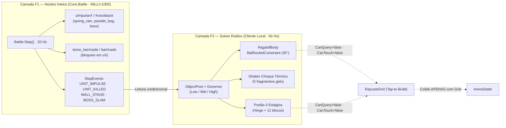
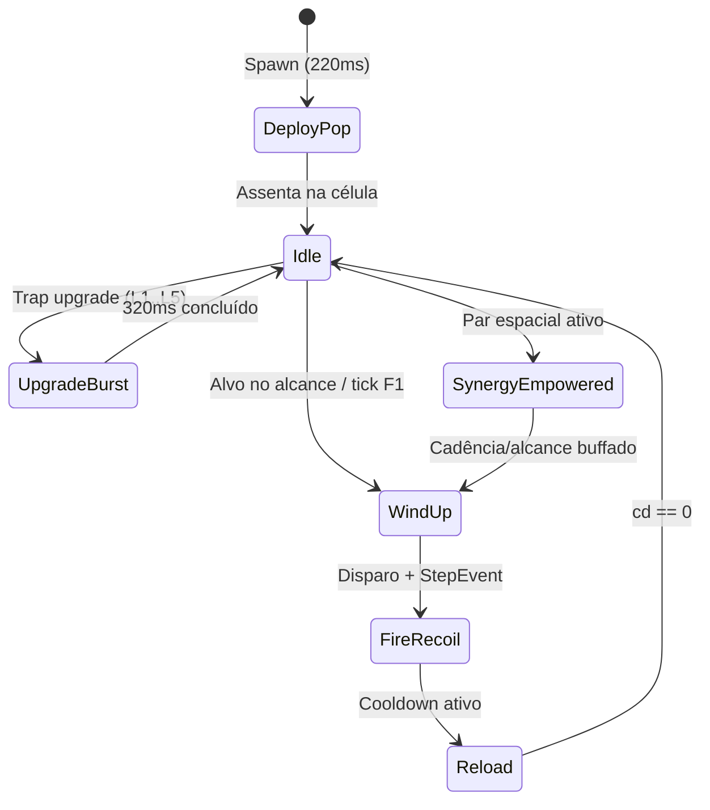
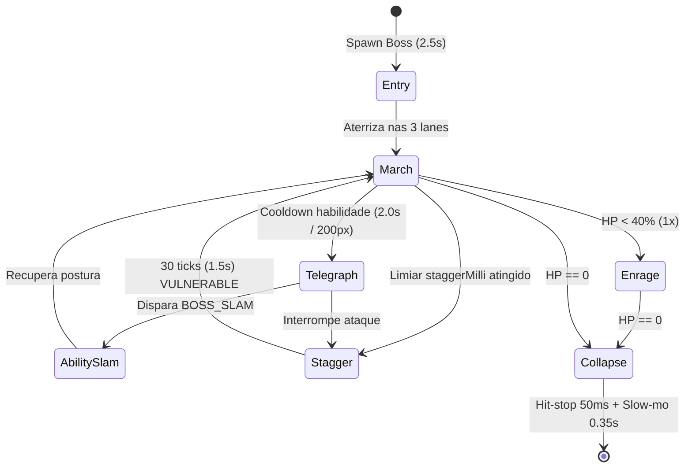

# Especificação Mestra: Animações, Física Real Híbrida e VFX

**Status:** Especificação de referência visual/tática (`P1` congelada em `sim=3, content=2, schema=2`; extensões `F1`/`P2+` dependem de autorização explícita e bump de versão).  
**Alinhamento Canônico:** [`VisualTheme.luau`](../src/shared/visual/VisualTheme.luau), [`core.luau`](../src/shared/sim/core.luau), [`Vfx.luau`](../src/client/visual/Vfx.luau), [`direcao-visual-e-silhuetas.md`](direcao-visual-e-silhuetas.md) e [`campanha-bosses-e-coop-sincrono.md`](campanha-bosses-e-coop-sincrono.md).

---

## 1. Arquitetura de Física Real Híbrida (2 Camadas: Núcleo Inteiro + Solver Roblox)

A MURALHA separa **autoridade determinística** de **simulação física real**: nenhum `BasePart` não-ancorado ou solver da engine pode alterar posição lógica, dano ou resultado de batalha.



### 1.1 Camada F1 (Núcleo Determinístico `MILLI = 1000`) vs. Camada F2 (Solver Roblox)

| Camada | Autoridade & Frequência | Escopo Determinístico / Físico | Regra de Isolamento |
|---|---|---|---|
| **F1 — Núcleo Inteiro** | Servidor + Replay (`20 Hz`, `MILLI=1000`) | Mantém `uX`, `uLane`, `uImpulseX` (knockback de `spring_ram`, `powder_keg` e `boss`), contenção de `stone_barricade` (`barricade`), HP do portão e emissão de `StepEvents`: `UNIT_IMPULSE`, `UNIT_KILLED`, `WALL_STAGE`, `BOSS_SLAM`. | Proibido usar `Workspace`, `RunService` ou floats em `Core.luau`. |
| **F2 — Solver Roblox** | Cliente local (`60 Hz`); se existir instância física no servidor, aplicar `SetNetworkOwner(nil)` | Clones visuais locais (`RagdollBody`, `FractureDebris`) instanciados via `ObjectPool` ao consumir `StepEvents`. Ragdolls, estilhaços e blocos pré-fraturados recebem `ApplyImpulse` derivado do `uImpulseX` da F1. | **Fluxo 100% unidirecional (F1 → F2).** Clones com `CanQuery=false` e `CanTouch=false`. |

### 1.2 Matriz de `PhysicsService.CollisionGroups` (Isolamento de Raycast & Sim)

| Grupo | Uso / Instâncias | Colide Com | `CanCollide` | `CanQuery` | `CanTouch` |
|---|---|---|---|---|---|
| `ArenaStatic` | Piso das `Lane_1..5`, paredes, rochas de borda | `RagdollBody`, `FractureDebris` | `true` | `false` | `false` |
| `LiveProxy` | Proxies animados das armadilhas e unidades vivas | *(nenhum)* | `false` | `false` | `false` |
| `RagdollBody` | Corpos abatidos pós-`UNIT_KILLED` | `ArenaStatic`, `FractureDebris` | `true` | `false` | `false` |
| `FractureDebris` | Ameias, fragmentos de gelo, blocos do portão | `ArenaStatic`, `RagdollBody`, `FractureDebris` | `true` | `false` | `false` |
| `RaycastGrid` | Plano invisível 5×5 (`r1c1..r5c5`) de tap-to-build | *(nenhum)* | `false` | `true` | `false` |

### 1.3 Ragdolls, Shatter de Gelo e Destruição do Portão em 4 Estágios

- **Ragdolls (`BallSocketConstraint`):** Ao receber `UNIT_KILLED`, o `LiveProxy` é trocado por um clone pooled articulado por `BallSocketConstraint` (`LimitsEnabled = true`, `UpperAngle = 35`, `TwistLimitsEnabled = true`, `TwistLowerAngle = -20`, `TwistUpperAngle = 20`, `MaxFrictionTorque = 8`) recebendo `ApplyImpulse` vetorial na direção de `uImpulseX` + torque local para queda em diorama.
- **Shatter de Choque Térmico (`frost` + `cannon`):** Abate sob status `uSlowUntil >= tick` por `cannon` substitui o ragdoll por **5 fragmentos de gelo** pré-modelados (`FractureDebris`, material `Ice`/`Glass`, cor `{180, 235, 255}`) com impulso radial ascendente (`Y = 14..22 studs/s`) e rotação angular livre.
- **Destruição da Muralha em 4 Estágios (`WALL_STAGE`):**

| Estágio (`hpPct`) | Geometria & Constraint F2 | Comportamento Visual / Câmera |
|---|---|---|
| **100% – 70%** | `ArenaStatic` intacto; `Merlon_-4..4` e `Gate` ancorados | Impacto seco + `Vfx.dust` leve no ponto de batida. |
| **< 70% (69%–31%)** | **Ameias (`Merlon`) soltas:** até 3 blocos desancorados (`FractureDebris`) rolam para fora das `Lane_1..5` | Cintas `WallBand_1..3` inclinam `2°–4°`; lascas locais no piso. |
| **< 30% (30%–1%)** | **`HingeConstraint` no Portão:** folha do `Gate` destrava (`LimitsEnabled=true`, `LowerAngle=-25`, `UpperAngle=15`) e oscila a cada impacto | Rachaduras `danger` (`#E4572E`) + pulso contínuo `wall_heartbeat`. |
| **0% (Finisher 8s)** | **12 blocos pré-fraturados** do `Gate` são arremessados para dentro (`-X`) via `ApplyImpulse` | Hit-stop `50ms` + slow-mo `0.35s` + corte `FOV=42` (`CaptureService`). |

### 1.4 Governor Adaptativo, Object Pool & Contrato Luau `--!strict`

| Perfil | Máx. Corpos F2 Ativos | TTL Máximo | Regra de Auto-Downgrade / Pool |
|---|---:|---:|---|
| **Low** | `<= 6` | `1.2 s` | Ativado automaticamente se FPS médio `< 48` por `2.0 s` contínuos; recicla o corpo mais antigo (FIFO). |
| **Mid** | `<= 18` | `2.0 s` | Padrão mobile (`375×812` / `720×1280`); degrada para `Low` sob queda térmica. |
| **High** | `<= 36` | `3.0 s` | Desktop/Console; `ObjectPool` pré-aquece `36` ragdolls, `15` shards de gelo e `12` blocos de portão no load da arena. |

```luau
--!strict
export type StepEventKind = "UNIT_IMPULSE" | "UNIT_KILLED" | "WALL_STAGE" | "BOSS_SLAM"
export type QualityTier = "Low" | "Mid" | "High"

export type StepEvent = {
	kind: StepEventKind,
	tick: number,
	entityId: number,
	impulseXMilli: number,
	thermalShatter: boolean,
	wallPct: number,
}

export type TierBudget = { maxBodies: number, ttlSec: number }

local PhysicsGovernor = {}
PhysicsGovernor.TIERS = table.freeze({
	Low = { maxBodies = 6, ttlSec = 1.2 },
	Mid = { maxBodies = 18, ttlSec = 2.0 },
	High = { maxBodies = 36, ttlSec = 3.0 },
} :: { [QualityTier]: TierBudget })

function PhysicsGovernor.configureGroups(ps: PhysicsService): ()
	local groups = { "ArenaStatic", "LiveProxy", "RagdollBody", "FractureDebris", "RaycastGrid" }
	for _, g in ipairs(groups) do
		pcall(function() ps:RegisterCollisionGroup(g) end)
	end
	for _, a in ipairs(groups) do
		for _, b in ipairs(groups) do
			ps:CollisionGroupSetCollidable(a, b, false)
		end
	end
	ps:CollisionGroupSetCollidable("RagdollBody", "ArenaStatic", true)
	ps:CollisionGroupSetCollidable("RagdollBody", "FractureDebris", true)
	ps:CollisionGroupSetCollidable("FractureDebris", "ArenaStatic", true)
	ps:CollisionGroupSetCollidable("FractureDebris", "FractureDebris", true)
end

function PhysicsGovernor.applyF2Flags(root: Instance, groupName: string): ()
	for _, desc in ipairs(root:GetDescendants()) do
		if desc:IsA("BasePart") then
			desc.CollisionGroup = groupName
			desc.CanQuery = false
			desc.CanTouch = false
			desc.CastShadow = false
		end
	end
end

function PhysicsGovernor.evaluateAutoDowngrade(tier: QualityTier, fps: number, lowFpsSec: number): QualityTier
	if fps < 48 and lowFpsSec >= 2.0 then
		if tier == "High" then
			return "Mid"
		elseif tier == "Mid" then
			return "Low"
		end
	end
	return tier
end

return PhysicsGovernor
```

---

## 2. Máquinas de Estado de Animação (`60 Hz` Procedural `Motor6D`/Spring + Rigs Blender 4.5.15 LTS)

### 2.1 Pipeline de Rigs (Blender 4.5.15 LTS → Studio)

- **Escala e Eixos:** `1 BU = 1 stud`, pivô no centro da base (`Z = 0`), frente `-Y` (Blender) → `-Z` (Studio), `Apply All Transforms` antes do export `.fbx` (rigs com `Armature`) ou `.glb` (estáticos).
- **Hierarquia Padrão de Bones:** `Root` (ancorado no `LiveProxy`) → `BasePivot` (rotação yaw em `Y`) → `TurretHead` / `WeaponArm` / `Torso` (movimento primário) → `RecoilTip` / `Muzzle` (attachment para VFX).
- **Atualização `60 Hz`:** Rigs articulados usam `Motor6D.Transform` via molas de 2ª ordem (`zeta`, `omega` em rad/s); proxies de enxame sem `Motor6D` usam `Workspace:BulkMoveTo` para zerar overhead de propriedade.



### 2.2 Máquina de Estado das Armadilhas (P1 Ativas + P2 Backlog)

| Armadilha (P1 / P2) | `Deploy Pop` | `Idle` ($\zeta/\omega$) | `Wind-up` | `Fire / Recoil` (Keyframes) | `Reload` | `Upgrade Burst` & `Synergy` |
|---|---|---|---|---|---|---|
| `archer` (P1) | `220ms` (`0→1.12→1.0`) | Respiro arco `0.6/8` | `90ms` puxa corda `-0.45s` | `70ms` solta + recuo `-6°` | `340ms` encaixa flecha | `320ms` + aura `Bateria Cruzada` |
| `tar` (P1) | `220ms` (`0→1.15→1.0`) | Bolhas caldeirão `0.8/6` | `120ms` inclina bico `+18°` | `110ms` jato + bounce | `670ms` reabastece | `320ms` + faísca âmbar c/ `cannon` |
| `frost` (P1) | `220ms` cristal sobe | Cristal levita `0.5/5` | `100ms` cristal gira `720°/s` | `90ms` pulso radial ciano | `510ms` recarrega brilho | `320ms` + arco azul (`Choque Térmico`) |
| `cannon` (P1) | `220ms` base pesada | Oscilação mínima `0.9/10` | `140ms` trava roda + fumaça | `130ms` recuo `-0.65 studs` | `1130ms` retorna eixo `0.7/12` | `320ms` + cano estendido (`Linha Artilharia`) |
| `catapult` (P1) | `220ms` braço armado | Tensão corda `0.7/7` | `200ms` tensiona `-28°` | `120ms` golpe até `+42°` | `1680ms` recolhe catraca | `320ms` + contrapeso dourado |
| `ballista` (P2) | `220ms` trilho abre | Mira fina `0.8/9` | `150ms` recua virote pesado | `80ms` disparo linear seco | `1470ms` catraca dupla | `320ms` + mira laser âmbar |
| `dynamo` (P2) | `220ms` bobina encaixa | Rotor gira `180°/s` | `70ms` arco interno | `60ms` descarga em cadeia | `470ms` estabiliza anéis | `320ms` + arcos entre bobinas |
| `cauldron` (P2) | `220ms` tampa abre | Líquido ferve `0.6/6` | `110ms` eleva borda | `140ms` derrama poça `10t` | `950ms` ferve nova carga | `320ms` + vapor verde/âmbar |
| `spring_ram` (P2) | `220ms` mola comprime | Vibração mola `0.4/14` | `80ms` trava placa | `90ms` avança `+1.6 studs` | `1630ms` recua pistão | `320ms` + impacto metálico duplo |
| `war_drum` (P2) | `220ms` pedestal firma | Baquetas espera `0.7/8` | `60ms` ergue baquetas | `100ms` batida rítmica | `400ms` ecoa membrana | `320ms` + anel `Zona de Ritmo` |
| `stone_barricade` / `barricade` (P2) | `220ms` estacas fincam | Estático (`0` osc.) | *(passiva)* | `80ms` tremor por hit (`0.5/22`) | *(HP local)* | `320ms` + cintas de ferro |
| `powder_keg` (P2) | `220ms` barril rola | Pavio crepita `0.7/10` | `150ms` incha `1.18×` | `60ms` explosão + remove | *(uso único)* | `320ms` + anel de pólvora |
| `decoy_bell` (P2) | `220ms` pórtico ergue | Sino pende `0.3/4` | `120ms` inclina sino `35°` | `180ms` badalada + onda | `3700ms` balanço amortecido | `320ms` + onda de atração |

### 2.3 Máquina de Estado da Horda (P1 + P2) & Overlays de Status

- **Dessincronia (`phaseOffset`):** Cada unidade aplica `phase = ((unitId * 0.6180339) % 1) * math.pi * 2` no ciclo de passo, eliminando marcha sincronizada em enxames.
- **Hit-Squash (`90ms`):** Em todo dano sofrido, a raiz recebe impulso de squash `Vector3.new(1.18, 0.82, 1.18)` ($\zeta = 0.55, \omega = 38$) + `VisualTheme.MOTION.hitFlash` (`0.08s`).

| Unidade (P1 / P2) | Rig / Partes (`<= 8`) | Ciclo Locomoção ($\zeta/\omega$) | Ataque ao Portão | Overlays Visuais (`Tar` / `Frost` / `Burn`) |
|---|---|---|---|---|
| `runner` (P1) | `6` partes (`0.85×`) | Passo ágil `14 rad/s`, torso `+12°` | Investida `180ms` | `Tar` (goteira preta), `Frost` (cristal azul), `Burn` (chama `danger`) |
| `brute` (P1) | `8` partes (`1.35×`) | Passo pesado `6 rad/s`, ombros `±9°` | Golpe duplo `340ms` | `Tar` + `Frost` + `Burn` em escala `1.35×` |
| `swarm` (P1) | `5` partes (`0.65×`) | Pulo rápido `20 rad/s`, `bob=0.12` | Mordida `110ms` | Tint direto no material por status (zero peças extras) |
| `shieldbearer` (P2) | `8` partes (`1.2×`) | Escudo frontal travado `8 rad/s` | Batida escudo `280ms` | Flare branco `120ms` quando escudo anula golpe `> 20000` |
| `sapper` (P2) | `7` partes (`0.9×`) | Corrida baixa `16 rad/s` | Sabotagem `240ms` | Faísca na trap desativada (`15t`) |
| `siege_ram` (P2) | `8` partes (`1.5×`) | Rodas acopladas a `uSpeed` | Choque lento `450ms` | Overlay `Frost` a `50%` de opacidade (imunidade parcial) |
| `rift_herald` (P2) | `7` partes (`1.1×`) | Levita `4 rad/s` com estandarte | Pulso aura `300ms` | Anel turquesa no solo (`raio = 2.0` unidades) |

### 2.4 Máquina de Estado dos 5 Bosses (`X-5` · Ato 1–5)

Todos os 5 Bosses ocupam `laneSpan = 3`, usam **Entrada (`2.5s`)**, **Telégrafo (`2.0s` = `40t` legível a `200px`)**, **Stagger (`VULNERABLE 30t` = `1.5s`)**, **Enrage (`<40% HP`)** e **Colapso com hit-stop local (`50ms`) + slow-mo (`0.35s`)**.



| Boss ID (Ato / Bioma) | Entrada (`2.5s`) | Telégrafo (`2.0s` · `200px`) | Habilidade / Impacto (`BOSS_SLAM`) | `Stagger` (`1.5s`) & `Enrage` (`<40%`) | Colapso (`50ms` + `0.35s`) |
|---|---|---|---|---|---|
| `iron_ram_colossus` *(Ato 1 · Cinzas)* | Queda pesada + onda poeira | Chifres recuam + faixa `danger` | Avança `+600` X e trava `c1` | Ajoelha `1.5s` / vapor vermelho | Tombamento + `50ms` hit-stop + `0.35s` slow-mo |
| `slag_juggernaut` *(Ato 2 · Escória)* | Emerge de poça de escória | Punhos incandescentes `2.0s` | Banho de escória + 2 `brute` | Placas abrem / brasa contínua | Fragmenta em 6 blocos + `0.35s` slow-mo |
| `rime_matriarch` *(Ato 3 · Geada)* | Nevasca + pouso glacial | Cetro erguido + cone ciano | Sopro Boreal congela 2 traps | Cristal trinca / aura geada | Shatter glacial + `50ms` hit-stop |
| `powder_baron` *(Ato 4 · Pólvora)* | Salto com salva de fumaça | Canhão ombro mira `c3–c4` | Salva de Barris atordoa traps | Recua desequilibrado / pavio aceso | Explosão controlada + `0.35s` slow-mo |
| `rift_titan` *(Ato 5 · Fenda)* | Rasga portal turquesa | Orbe central expande `2.0s` | Cisão Turquesa + sub-portal | Escudo cai / alterna `140t` | Implosão em espiral + `0.35s` slow-mo |

```luau
--!strict
export type SpringState = { pos: number, vel: number, target: number }

local SpringSolver = {}

-- Integração analítica estável a 60 Hz (clamped <= 1/30 s)
function SpringSolver.step(s: SpringState, dt: number, zeta: number, omega: number): number
	local cDt = math.min(dt, 1 / 30)
	local f = 1 + 2 * cDt * zeta * omega
	local oo = omega * omega
	local hoo = cDt * oo
	local hhoo = cDt * hoo
	local detInv = 1 / (f + hhoo)
	local detPos = f * s.pos + cDt * s.vel + hhoo * s.target
	local detVel = s.vel + hoo * (s.target - s.pos)
	s.pos = detPos * detInv
	s.vel = detVel * detInv
	return s.pos
end

return SpringSolver
```

---

## 3. Catálogo Completo de VFX & Orçamentos (`VisualTheme.BUDGET` / `VFX`)

Todos os efeitos respeitam estritamente [`VisualTheme.luau`](../src/shared/visual/VisualTheme.luau): `BUDGET` (`trapParts = 12`, `unitParts = 8`, `arenaParts = 160`, `maxUnits = 150`, `drawCalls = 500`) e `VFX` (`maxParticlesPerEmitter = 40`, `maxEmittersPerTrap = 2`, `maxConcurrentProjectiles = 12`, `maxImpactParts = 8`, `maxDustParts = 10`, `impactLifetime = 0.55`).

| Categoria | Evento / Origem | Asset / Tipo VFX | Orçamento Aplicado | Pool & TTL |
|---|---|---|---|---|
| **Combate Base** | Disparo `archer`/`cannon`/`catapult` | Muzzle flash + `Trail` (`projectileMin=0.18s..0.55s`) | `<= 12` projéteis simultâneos | Pool de 12 projéteis (`Vfx.luau`) |
| **Combate Base** | Impacto & Hit Flash | `Vfx.impact` (cubos `0.18³`) + `hitFlash = 0.08s` | `<= 8` `ImpactParts` por hit | `Debris` / Pool `0.55s` |
| **Combate Base** | Morte Horda (`UNIT_KILLED`) | Estouro turquesa (`death = 0.35s`) + `RagdollBody` | `<= 25` partículas / burst | Pool F2 (Low/Mid/High) |
| **Sinergia (Build)** | `Piche Incendiário`, `Choque Térmico`, `Bateria Cruzada`, `Linha Artilharia`, `Zona de Ritmo` | `Beam` no piso ligando pares válidos no Build | `1` `Beam` por par (`<= 8` total) | Destruído ao iniciar onda |
| **Sinergia (Combate)** | Acerto `Piche Incendiário` / `Choque Térmico` | Explosão híbrida âmbar+`danger` / shatter **5 shards gelo** | `<= 40` part./emitter (`<= 2` emitters) | Pool 15 shards + `0.55s` |
| **Telégrafo Boss** | Pré-`BOSS_SLAM` (`2.0s`) | `Decal` + anel `SurfaceGui` radial `0→100%` | `1` decal/boss (`drawCalls <= 500`) | Reuso por boss (`2.0s`) |
| **Atmosfera Ato 1** | *Cinzas da Fronteira* (`Bastilha`) | Fagulhas lentas das tochas `Merlon` | `1` emitter (`rate=6`, `<= 40` cap) | Contínuo (desliga em `Low`) |
| **Atmosfera Ato 2** | *Forjas de Escória* (`Deserto`) | Poeira ocre rasa cruzando borda externa | `1` emitter (`rate=8`, fora das lanes) | Contínuo (desliga em `Low`) |
| **Atmosfera Ato 3** | *Geada do Desfiladeiro* (`Cidadela`) | Flocos suaves dessaturados (`<15%` sat.) | `1` emitter (`rate=12`) | Contínuo (`Low` reduz `50%`) |
| **Atmosfera Ato 4** | *Pólvora e Trincheira* (`Vulcânico`) | Cinzas ascendentes + pulso fraco na Fenda | `2` emitters (`rate=10` total) | Contínuo (`Low` reduz `50%`) |
| **Atmosfera Ato 5** | *A Fenda Profunda* (`Bosque`) | Esporos âmbar/folhas secas periféricas | `1` emitter (`rate=7`) | Contínuo (desliga em `Low`) |
| **UI Juice** | Deploy, Upgrade, Muro Crítico (`<30%`), Vitória | Pop `220ms`, anel expansivo `UiKit`, borda `danger` | `0` `BaseParts` extras (`GuiObject` pool) | Tween `0.22s–0.45s` |

### 3.1 Contrato de Pool & Orçamento (`VfxPool` em Luau `--!strict`)

```luau
--!strict
local VfxPool = {}

export type VfxBudget = {
	maxParticlesPerEmitter: number, -- VisualTheme.VFX.maxParticlesPerEmitter (40)
	maxEmittersPerTrap: number,     -- VisualTheme.VFX.maxEmittersPerTrap (2)
	maxConcurrentProjectiles: number, -- VisualTheme.VFX.maxConcurrentProjectiles (12)
	maxImpactParts: number,         -- VisualTheme.VFX.maxImpactParts (8)
	maxDustParts: number,           -- VisualTheme.VFX.maxDustParts (10)
	maxDrawCalls: number,           -- VisualTheme.BUDGET.drawCalls (500)
}

function VfxPool.clampEmit(emitter: ParticleEmitter, requested: number, cap: number): ()
	local safeCount = math.min(math.max(0, math.floor(requested)), cap)
	if safeCount > 0 then
		emitter:Emit(safeCount)
	end
end

function VfxPool.canAttachEmitter(trapModel: Instance, maxPerTrap: number): boolean
	local count = 0
	for _, desc in ipairs(trapModel:GetDescendants()) do
		if desc:IsA("ParticleEmitter") then
			count += 1
		end
	end
	return count < maxPerTrap
end

return VfxPool
```

### 3.2 Checklist de Conformidade (`VisualTheme` & Mobile `375×812`)

- **Draw Calls & Peças:** soma máxima em campo (`arenaParts <= 160` + `7 traps × 12` + `150 units × 8`) mantida abaixo de `500` draw calls via **atlas único** (`VisualTheme.PALETTE`), instancing de `MeshPart` e `CastShadow = false` em todos os `Vfx` e proxies F2.
- **Emitters por Armadilha:** estritamente `<= 2` `ParticleEmitter`s por trap e `<= 40` partículas ativas por emitter; nenhum emitter é criado dentro de `Hit-Squash` para evitar picos de fill-rate no mobile.
- **Blindagem de Determinismo:** `PhysicsGovernor`, `SpringSolver`, `VfxPool` e `Vfx` consomem apenas snapshots e `StepEvents` imutáveis; desligar 100% da Camada F2 e dos VFX mantém idênticos `BattleLog`, hash de replay e `wallHp` final.
