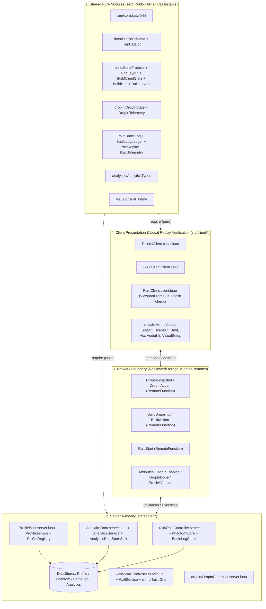
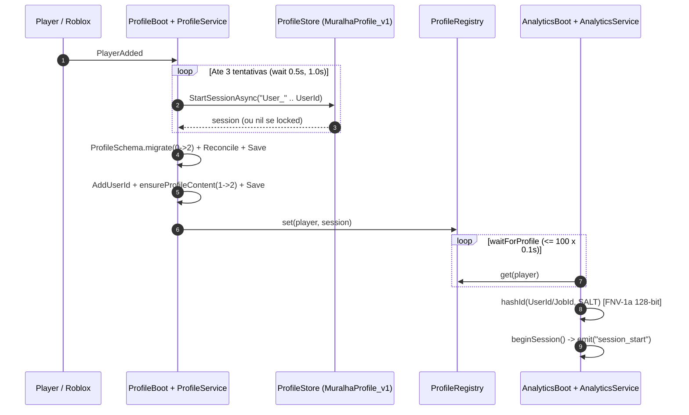
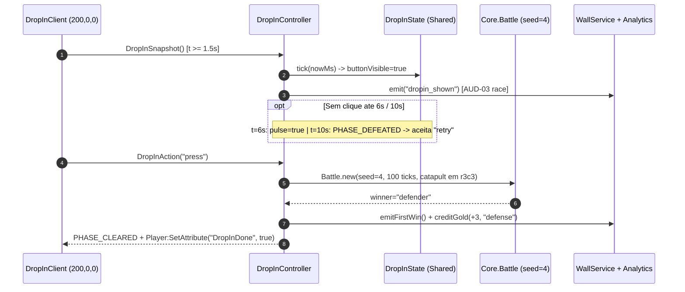
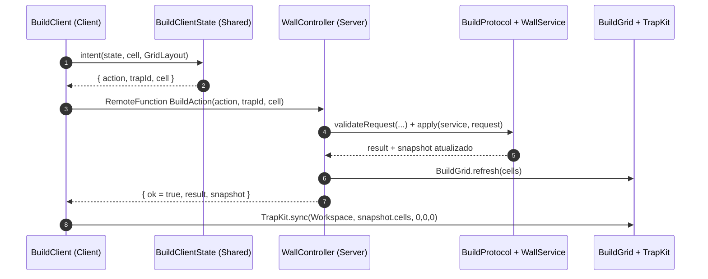
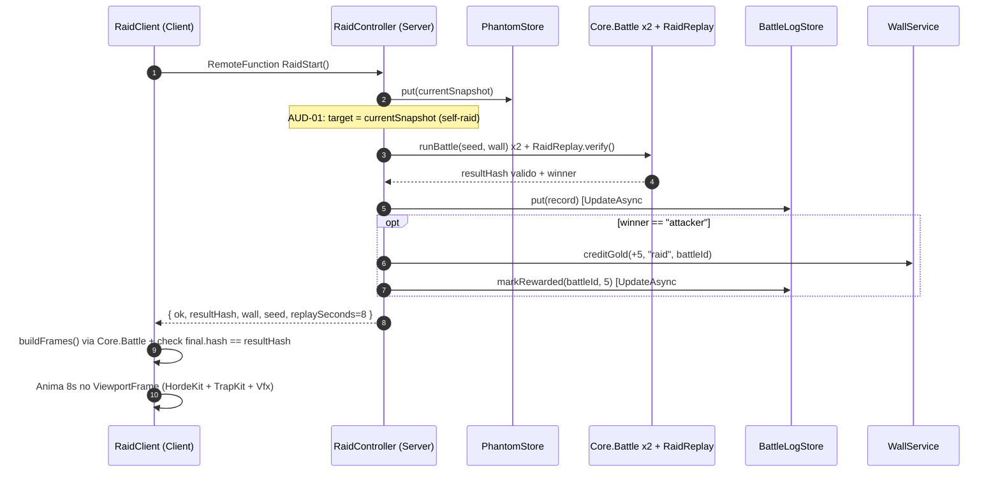
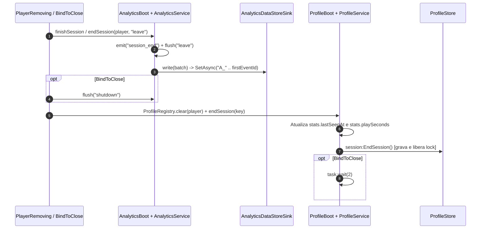
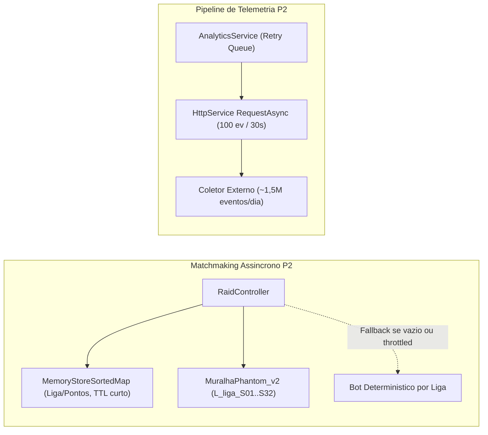

# Arquitetura Técnica, Fluxos End-to-End e Auditoria — MURALHA

> **Data de referência:** 13/11/2026 · **Fase:** P1 em pausa (S1–S8 fechadas; P2 bloqueada sem autorização)  
> **Versões congeladas:** `schemaVersion = 2` · `contentVersion = 2` · `simVersion = 3` · `hash = 2489780106`  
> **Fonte de verdade:** código em `src/`, contratos em `sim/` e estado em `.context/ESTADO.md`.

---

## 1. Topologia em 4 Camadas & Fronteiras de Autoridade

A arquitetura da **MURALHA** separa módulos puros em Luau (testáveis no CLI sem engine Roblox) dos controladores autoritativos de servidor, da fronteira de rede explícita e da camada de apresentação 3D no cliente. Nenhum estado crítico de economia, perfil ou resultado de combate confia no cliente.

### Fronteiras de responsabilidade por camada

| Camada | Diretórios / Arquivos principais | Responsabilidade e limite |
|---|---|---|
| **1. Shared Pure** | `src/shared/{sim,data,build,dropin,raid,analytics,visual}` | Regras puras, schemas, catálogo, estado/protocolo e tema visual. Proibido usar `game:GetService`; validado diretamente em `luau sim/*.luau`. |
| **2. Server Authority** | `src/server/{ProfileBoot,Main}.server.luau`, `data/`, `analytics/`, `walls/`, `dropin/`, `raid/`, `world/` | Única autoridade de `ProfileStore`, `gold`, muralha (`WallService`), combate (`Core.Battle`), `BattleLog`, `PhantomStore` e telemetria. `Main.server.luau` permanece como stub da S1. |
| **3. Network Boundary** | `ReplicatedStorage.MuralhaRemotes` (`DropInSnapshot`, `DropInAction`, `BuildSnapshot`, `BuildAction`, `RaidStart`) | Contrato RPC por `RemoteFunction`. Cliente envia apenas intenções (`place`, `remove`, `upgrade`, `press`, `retry`, `startRaid`); atributos coordenam boot (`DropInEnabled`, `DropInDone`, `ProfileSchemaVersion`, `ProfileContentVersion`). |
| **4. Client Presentation** | `src/client/{DropInClient,BuildClient,RaidClient}.client.luau` + `src/client/visual/*` | Câmera isométrica (`CharacterAutoLoads = false`), diorama 3D, UI mobile-first e verificação local do replay (`Core.Battle` + checagem de `resultHash` antes de animar 8 s). |

---

## 2. Os 5 Fluxos End-to-End

### Fluxo 1 — Join, Lock de Sessão, Migração & Boot de Analytics

1. `Players.PlayerAdded` aciona `ProfileBoot.server.luau:261-302` (`loadPlayer`).
2. `ProfileService.startSession("User_<UserId>")` (`ProfileService.luau:160-177`) executa `StartSessionAsync` com até **3 tentativas** (`attempts = 3`, `retryDelay = 0.5`), usando backoff exponencial `0.5 * 2^(attempt-1)` (**0,5 s** após a 1ª falha, **1,0 s** após a 2ª). Se todas retornarem `nil`, o jogador recebe `player:Kick(...)`.
3. `prepare()` (`ProfileService.luau:111-158`) roda `ProfileSchema.migrate(data, fromVersion)` (**0→2**), `session:Reconcile()`, e força `session:Save()` imediato quando `migratedNow == true`. Em seguida `noteSeen` registra `firstSeenAt`/`lastSeenAt`, incrementa `stats.sessions` e notifica `AnalyticsService.noteProfileStart(key, info)`.
4. `ProfileBoot.server.luau:273-295` chama `session:AddUserId(player.UserId)`, executa `TrapCatalog.ensureProfileContent(session.Data)` (migração de conteúdo **1→2** + `session:Save()` se `contentChanged`), publica em `ProfileRegistry.set(player, session)` e grava os atributos `ProfileSchemaVersion` e `ProfileContentVersion`.
5. Em paralelo, `AnalyticsBoot.server.luau:159-208` executa `waitForProfile(player)` (polling de até `100 × 0,1 s = 10 s`), consome `takeProfileStart(key)`, gera `player_id` e `server_id` via `AnalyticsService.hashId` (**FNV-1a 128-bit com salt**, 4 rodadas de 32 bits em hex de 32 caracteres — `AnalyticsService.luau:199-208`) e chama `service.beginSession`, emitindo `session_start`.

### Fluxo 2 — Drop-in 5s (S5)

1. `DropInClient.client.luau:42-50` aguarda `ReplicatedStorage:GetAttribute("DropInEnabled") == true`, posiciona a câmera e o diorama local em `ORIGIN = Vector3.new(200, 0, 0)` (isolado do grid principal em `(0, 0, 0)`) e consulta `DropInSnapshot`.
2. `DropInController.server.luau:187-240` inicializa `DropInState.new(nowMs)` e avança o relógio determinístico (`DropInState.luau:9-13`):
   - **1,5 s (`BUTTON_AT_MS = 1500`):** `buttonVisible = true` (exibe `DEFENDER`) e dispara `dropin_shown`.
   - **6,0 s (`PULSE_AT_MS = 6000`):** `pulse = true` (destaque visual do CTA).
   - **10,0 s (`PRESS_DEADLINE_MS = 10000`):** se não houver clique, transiciona para `PHASE_DEFEATED` (`outcome = "attacker"`), permitindo `DropInAction("retry")`.
3. Ao acionar `DropInAction("press")`, `DropInController.server.luau:92-117` roda uma batalha real em `Core.Battle.new` com `seed = 4`, `RUN_TICKS = 100`, onda `{ count = 12, spawnEveryTicks = 8 }` e muralha pré-montada com 5 armadilhas (`archer`, `tar`, `catapult` em `r3c3`, `frost`, `cannon`).
4. Ao entrar em `PHASE_CLEARED`, o servidor chama `AnalyticsService.emitFirstWin(player, session.battleId)`, dispara `grantReward(player)` (`DropInController.server.luau:152-185`) para creditar ouro com fonte `"defense"` via `WallService.creditGold` (estado atual P1: `+3` repetível; especificação de fechamento em [`plano-playtest-v1.md`](plano-playtest-v1.md): **bônus único `+40g`** travado por `if profile.stats.defenses == 0` atomicamente, preservando `schema v2`) e define `player:SetAttribute("DropInDone", true)`.

### Fluxo 3 — Build 5×5 (S4)

1. Após `DropInDone == true`, `BuildClient.client.luau:50-84` busca o snapshot inicial via `BuildSnapshot` e hidrata `BuildClientState` e `BuildHud`.
2. Ao clicar em uma célula 3D ou botão do grid, `BuildClient.client.luau:224,533` chama `BuildClientState.intent(state, cell, GridLayout)` para resolver a intenção (`place`, `upgrade` ou `remove`) e invoca `BuildAction:InvokeServer(intent.action, intent.trapId, intent.cell)`.
3. `WallController.server.luau:88-118` valida formato/célula em `BuildProtocol.validateRequest(GridLayout, ...)`, instancia `WallService.new({ profile, schema, catalog })` e aplica `BuildProtocol.apply(service, request)`.
4. O servidor atualiza os marcadores globais em `BuildGrid.refresh(session.Data.wall.cells)` (`WallController.server.luau:110`) e retorna `{ ok = true, result, snapshot }`.
5. O cliente atualiza `state.snapshot`, os cards de HUD e sincroniza os modelos 3D com `TrapKit.sync(Workspace, snapshot.cells, Vector3.new(0, 0, 0))` (`BuildClient.client.luau:477`).

### Fluxo 4 — Raid Assíncrono & Replay 3D (S6.1)

1. `RaidClient.client.luau:364-375` trava `busy = true`, abre o modal e invoca `RaidStart:InvokeServer()`.
2. `RaidController.server.luau:200-241` verifica `busy[player]`, gera `battleId` (UUID v4) e `seed`, converte o perfil atual com `WallService.toBattleWall(profile, ProfileSchema, TrapCatalog, 500)` (`snapshotFromProfile`) e publica em `PhantomStore.put(currentSnapshot)`. **Nota crítica (`AUD-01` / `GAP-014`):** na linha `230` atual, o servidor define `local target = currentSnapshot` (auto-raid). A remediação em [`plano-playtest-v1.md`](plano-playtest-v1.md) publica em `MuralhaPhantom_v1` com 8 slots/liga (`L<1..5>_S<1..8>`, sem `ownerName`), busca oponente distinto (`ownerHash ~= myHash`) e usa fallback determinístico `BotPhantoms.pick(league, seed)`.
3. `RaidController.server.luau:256-269` executa `Core.Battle` **duas vezes** (`result` e `replay`, onda de 70 unidades) e confirma o determinismo via `RaidReplay.verify(result, replay)`, emitindo `battle_started`, `raid_start`, `battle_finished` e `raid_end` (ou `battle_divergence` em caso de erro).
4. O servidor cria o registro com `BattleLog.fromBattle(...)`, valida `BattleLog.isReplayable`, persiste via `logStore.put(record)`, credita **`+5` ouro** (`RAID_REWARD_GOLD = 5`) via `creditRaid(player, battleId, 5)` se `result.winner == "attacker"`, e marca `logStore.markRewarded(battleId, creditedGold)` (`RaidController.server.luau:306-342`).
5. `RaidClient.client.luau:291-350` recebe `record` + `wall`, reexecuta `Core.Battle` localmente em `buildFrames` (capturando frames a cada 10 ticks), verifica `final.hash == result.resultHash` (`L307`), instancia `ArenaVisual` + `TrapKit` + 70 unidades em `HordeKit` dentro do `ViewportFrame` e reproduz o replay por `8 s` (`RaidReplay.SECONDS`).

### Fluxo 5 — Leave & BindToClose

1. **Saída normal (`Players.PlayerRemoving`):**
   - `AnalyticsBoot.server.luau:210-234` chama `service.endSession(player, "leave")` (`AnalyticsService.luau:581-594`), que emite `session_end`, limpa o mapa de sessão e dispara `flush("leave")` imediatamente para o sink (`MuralhaAnalytics_v1` em produção).
   - `ProfileBoot.server.luau:304-307` limpa `ProfileRegistry.clear(player)` e chama `service.endSession(profileKey(player))`, que consolida `lastSeenAt` e `playSeconds` e invoca `session:EndSession()` para gravar e liberar o lock do `ProfileStore`.
2. **Encerramento do servidor (`game:BindToClose`):**
   - `AnalyticsBoot.server.luau:236-241` itera `Players:GetPlayers()`, chama `service.endSession(player, "leave")` para cada jogador (disparando *N* flushes síncronos) e finaliza com `service.flush("shutdown")`.
   - `ProfileBoot.server.luau:310-315` itera `ProfileRegistry.all()`, chama `service.endSession(profileKey(player))` e aguarda `task.wait(2)` para garantir o flush dos locks no `ProfileStore`.

---

## 3. Persistência, Quotas de DataStore & Arquitetura Alvo P2 (25k DAU)

### Inventário dos 4 DataStores atuais (P1)

| DataStore | Padrão de Chave | Tamanho Máx. (Limite Roblox: 50 chars) | Escritas / Sessão | Gargalos e Riscos |
|---|---|---|---|---|
| `MuralhaProfile_v1` (`ProfileSchema.luau:10`) | `User_<UserId>` | ~15–18 chars (seguro) | Autosave ProfileStore + `Save()` na migração + `EndSession` | `DEFAULT_CONTENT_VERSION = 1` (`ProfileSchema:14`) força `Save()` extra no 1º join após migração de catálogo; lock depende de `EndSession` limpo. |
| `MuralhaPhantom_v1` (`PhantomStore.luau:8-9`) | `"latest"` (chave global única) | 6 chars (seguro) | 1 `UpdateAsync` por raid | **Gargalo severo:** 1 chave global sofre throttling >10 req/min (cooldown de 6 s por chave no Roblox), race last-writer-wins e PII (`ownerName` sem `AddUserId`). |
| `MuralhaBattleLog_v1` (`BattleLog.luau:8`) | `<battleId>` (UUID v4 ou `raid_<uid>_<ts>`) | Validado até **64 chars** (`BattleLog:93` > 50!) | **2 `UpdateAsync` por raid vitoriosa** (`put` + `markRewarded`) | Duas escritas imediatas na mesma chave atingem o cooldown de 6 s por chave (`AUD-04`); `isId` aceita até 64 chars e quebraria no DataStore se exceder 50 (`AUD-10`). |
| `MuralhaAnalytics_v1` (`AnalyticsDataStoreSink.luau:13`) | `A_<first_event_id>` | 38 chars (`MAX_KEY_LENGTH = 50`) | 1 `SetAsync` / lote (30 s ou 100 eventos) + `leave`/`shutdown` | Sem retry após evicção do buffer (`AUD-07`); inviável para analytics em escala (25k DAU ≈ **1,5 M eventos/dia** → explosão de chaves para ETL via `ListKeysAsync`). |

### Arquitetura Alvo P2 (Escala para 25k DAU)

Para sustentar **25.000 DAU** (~60 eventos/sessão ≈ **1,5 M eventos/dia**, ~15k–30k lotes/dia e picos de centenas de raids por minuto) sem estourar quotas por chave do DataStore nem violar conformidade GDPR:

1. **Pool de Fantasmas Shardado por Liga (`MuralhaPhantom_v2` + `MemoryStoreSortedMap`):**
   - Substituir `"latest"` por chaves shardadas **`L<league>_S<01..32>`** (ex.: `L3_S14`), com escrita determinística `slot = (hash32(userId) % 32) + 1` e leitura sorteando **2 shards distintos** da liga-alvo para eliminar o teto de ~10 req/min por chave.
   - Manter índice rápido de pareamento em `MemoryStoreSortedMap` usando chave composta string sem colisão **`string.format("%08d_%d", points, userId)`** (evita sobrescrita quando dois jogadores empatam em `points`, TTL curto) e valor `{ shardKey, wallSummary, ownerHash }` para parear atacantes contra defensores distintos (`ownerHash ~= attackerHash`), com **fallback determinístico de bot (`BotPhantoms.pick`)** quando o pool estiver frio ou sob throttling.
   - Anexar metadados GDPR com `AddUserId` (`DataStoreSetOptions:SetMetadata`) nas gravações e remover `ownerName` bruto do payload do fantasma (ver `RFC-005` em [`rfcs-p2-e-fechamento-gaps.md`](rfcs-p2-e-fechamento-gaps.md#6-rfc-005--sharding-muralhaphantom_v2-memorystoresortedmap-sem-colisão--gdpr-gap-015)).
2. **Sink de Telemetria via `HttpService`:**
   - Substituir `MuralhaAnalytics_v1` em produção por um sink HTTP assíncrono em lote (`HttpService:RequestAsync` para coletor externo), preservando fila com *backoff* exponencial e re-enfileiramento em caso de falha `429`/`5xx`. `AnalyticsDataStoreSink` permanece apenas como fallback local ou QA de Studio.
3. **BattleLog em Escrita Única:**
   - Calcular `rewardGold` e `rewarded` antes de gravar ou consolidar em **1 único `UpdateAsync`** no `BattleLogStore`, eliminando o cooldown de 6 s entre `put` e `markRewarded` e restringindo `BattleLog.keyFor` a `<= 50` caracteres.

---

## 4. Matriz Completa da Auditoria Técnica (`AUD-01` .. `AUD-12`)

| ID | Sev. | Arquivo : Linha | Causa Raiz & Impacto | Remediação (P1 Retomada vs P2) |
|---|---|---|---|---|
| **AUD-01** | **CRÍTICO** | `src/server/raid/RaidController.server.luau:224-231` | Publica `currentSnapshot` e imediatamente define `local target = currentSnapshot`. Causa **auto-raid exclusivo** e permite farm infinito de **+5 ouro** atacando a própria muralha fraca. | **P1:** Ler alvo distinto (`ownerId ~= player.UserId`) de pool em memória/bot fallback antes de publicar o fantasma do atacante. **P2:** Shards `L<league>_S<01..32>` + `MemoryStoreSortedMap`. |
| **AUD-02** | **CRÍTICO** | `src/server/walls/WallController.server.luau:75-81,103-118` | `WallService.new` não recebe callback `emit` e `handleAction` ignora `result.events` de `BuildProtocol.apply`. `trap_placed`, `upgrade_bought` e `gold_spent` nunca chegam ao `AnalyticsService`. | **P1:** Injetar `emit = function(name, props) AnalyticsService.emit(player, name, props) end` em `WallController.server.luau:76-80`. |
| **AUD-03** | **ALTO** | `src/server/dropin/DropInController.server.luau:119-139,207-225` | Corrida no join contra `AnalyticsBoot.waitForProfile`: `logShown` marca `session.shownLogged = true` (L137) antes de `logAnalytics`, e `AnalyticsService.emit` rejeita com `"not_started"`/`"no_session"`, descartando `dropin_shown` silenciosamente. | **P1:** Só marcar `shownLogged = true` quando `AnalyticsService.emit` retornar evento válido (não `nil`), ou aguardar sessão de analytics antes de logar `dropin_shown`. |
| **AUD-04** | **ALTO** | `src/server/raid/RaidController.server.luau:306,325,335-336` | `logStore.put(record)` e `logStore.markRewarded(battleId, creditedGold)` executam dois `UpdateAsync` consecutivos na mesma chave `<battleId>` em <100 ms, atingindo o cooldown de **6 s por chave** do DataStore em produção. | **P1:** Remover o `UpdateAsync` duplicado (gravar `BattleLog` já com `rewarded`/`rewardGold` final ou diferir `markRewarded` apenas para reconciliação). |
| **AUD-05** | **ALTO** | `AnalyticsService.luau:127-134` · `RaidClient.client.luau:307` · `DropInController.server.luau:152` · `RaidController.server.luau:201,380` · `WallController.server.luau:120` | 5 lacunas de fluxo/telemetria: (a) `build_complete`, `replay_started`, `replay_watched`, `clip_saved` não estão ligados; (b) cliente detecta divergência de hash em `L307` sem reportar `battle_divergence` ao servidor; (c) `grantReward` (+3 ouro) repete em toda entrada de veteranos; (d) `busy[player] = nil` (L380) libera nova raid antes do replay de 8 s terminar; (e) `BuildAction` (L120) sem rate limit por jogador. | **P1:** Ligar `build_complete` e eventos de replay via remote dedicado de telemetria validada; travar +3 ouro do drop-in por flag no perfil ou `sessions <= 1`; adicionar cooldown por jogador em `BuildAction` e `RaidStart`. |
| **AUD-06** | **MÉDIO** | `src/server/raid/PhantomStore.luau:9` · `RaidController.server.luau:126-127` | Chave única global `"latest"` sofre throttling acima de ~10 raids/min e expõe `ownerName` em claro no DataStore sem `AddUserId`/GDPR metadata. | **P2:** Migrar para `MuralhaPhantom_v2` shardado por liga, usar `SetMetadata`/`AddUserId` e remover `ownerName` bruto. |
| **AUD-07** | **MÉDIO** | `src/server/analytics/AnalyticsService.luau:476,593` · `AnalyticsBoot.server.luau:236-241` | `flush` remove o lote do `buffer` (`buffer = rest`, L476) antes de `sink.write` sem fila de retry; `BindToClose` dispara `endSession` (que chama `flush("leave")` no L593) para cada jogador seguido de `flush("shutdown")`. | **P2:** Manter lote pendente até confirmação do sink (com retry/backoff) e consolidar `BindToClose` em um único `flush("shutdown")` após fechar as sessões. |
| **AUD-08** | **MÉDIO** | `RaidClient.client.luau:69,156,193-281` · `HordeKit.luau:56-103` · `BuildGrid.luau:14` | (a) `buildFrames` compacta apenas unidades vivas (`L193-205`), fazendo unidades sobreviventes trocarem de silhueta ao assumir índices anteriores (`L259-281`); (b) botões `ATACAR` (`34 px`, L69) e `FECHAR` (`36 px`, L156) abaixo de `minTouch = 44`; (c) `runner` usa **9 partes** (> `unitParts = 8` em `VisualTheme:160`); (d) `BuildGrid` usa `MuralhaGrid` global único no `Workspace`, gerando churn multi-jogador. | **P1:** Indexar unidades no replay por `id` estável, ajustar botões para `>= 44 px`, reduzir `runner` para <=8 partes e isolar/tornar client-side o preview do grid. |
| **AUD-09** | **MÉDIO** | `src/shared/sim/core.luau:82-103,272-285,324,333,351` | (a) `slow` na linha 333 usa `55` hardcoded em vez de `TRAP.frost.slowPct`; (b) ramo `if def.splash` (L272-285) ignora aplicação de slow; (c) `trap.cd` (L324) reseta mesmo sem alvo no alcance; (d) `UNIT`/`TRAP`/`TUNING` não usam `table.freeze`; (e) `Battle:Finished()` (L351) não encerra antes de 1.200 ticks quando a onda inteira já morreu/vazou. | **P2 (requer bump `simVersion = 4`):** Parametrizar `slowPct`, congelar tabelas, só resetar `cd` quando houver disparo e parar quando `spawned == toSpawn` sem vivos; atualizar `docs/versoes.md` e `sim/acceptance.luau`. |
| **AUD-10** | **BAIXO** | `ProfileSchema.luau:14,40-48,175-192` · `BattleLog.luau:93` · `BuildProtocol.luau:88` | (a) `cellKeyOk` (`^r(%d+)c(%d+)$`) aceita `"r01c1"`; (b) `DEFAULT_CONTENT_VERSION = 1` força `Save()` extra no 1º load; (c) `BattleLog.isId` aceita até 64 chars (>50 do Roblox DataStore); (d) `stats.{raids,defenses,wins}` definidos no schema mas nunca incrementados nem expostos em `BuildProtocol.snapshot` (`L88`). | **P2:** Exigir dígito único sem zero à esquerda em `cellKeyOk`, alinhar `DEFAULT_CONTENT_VERSION`, limitar `BattleLog` key a `<= 50` chars e atualizar `stats` em `DropInController`/`RaidController`. |
| **AUD-11** | **MÉDIO-CI** | `scripts/check.sh:24,63` | `luau-lsp analyze` roda na linha 24 **antes** de `rojo sourcemap` (linha 63) e exclui `src/client/**` e os controllers de servidor (`ProfileBoot`, `AnalyticsBoot`, `WallController`, `DropInController`, `RaidController`, `PhantomStore`, `BattleLogStore`, `BuildGrid`). | **P1:** Gerar `sourcemap.json` antes da análise e incluir `src/client` e os controllers no `luau-lsp analyze`. |
| **AUD-12** | **BAIXO-DOCS** | Documentação histórica vs código | Deriva histórica de documentação identificada e saneada na revisão de **13/11/2026**. | **Resolvido:** Manter gate `check-versions.py` e `scan_repo.py --check` ativos no `check.sh`. |

### Plano curto de remediação por janela e gates de validação

- **Retomada imediata da P1 (antes do teste de 3 semanas / QA mobile):**
  - **Integridade de gameplay e economia (`AUD-01`, `AUD-04`, `AUD-05`):** remover auto-raid (`target ~= currentSnapshot`), consolidar `BattleLogStore` em escrita única, travar recompensa `+3` do drop-in para veteranos, manter `busy` durante o replay e aplicar rate limit em `BuildAction`. Validar com `luau sim/raid-contract.luau`, `luau sim/dropin-contract.luau` e `luau sim/build-contract.luau`.
  - **Confiabilidade do funil de telemetria (`AUD-02`, `AUD-03`, `AUD-05`):** injetar `emit` em `WallController`, só marcar `shownLogged` após aceite do `AnalyticsService`, ligar `build_complete` e eventos de replay/divergência. Validar com `luau sim/analytics-contract.luau` (34/34).
  - **UX mobile e CI (`AUD-08`, `AUD-11`):** corrigir alvos de toque `>= 44 px`, indexação estável no replay 3D, orçamento `runner <= 8` partes, isolamento do grid de preview e ordem `rojo sourcemap` antes de `luau-lsp analyze` em `scripts/check.sh`. Validar com `luau sim/visual-contract.luau` (8/8) e `bash scripts/check.sh`.
- **Liberação apenas na P2 (com autorização explícita do diretor):**
  - **Escala 25k DAU e GDPR (`AUD-06`, `AUD-07`, `AUD-10`):** shards `L<league>_S<01..32>` + `MemoryStoreSortedMap` sem `ownerName` bruto, sink HTTP com retry/backoff e flush único no shutdown, além de `BattleLog.keyFor <= 50` chars, `cellKeyOk` estrito e atualização de `stats.{raids,defenses,wins}`.
  - **Evolução determinística do motor (`AUD-09`):** corrigir `slowPct` parametrizado, splash slow, reset de `cd`, `table.freeze` e parada antecipada; exige subir `simVersion` (`3 -> 4`), atualizar `docs/spec-motor-deterministico.md` e `docs/versoes.md` e revalidar `sim/invariants.luau` (12/12) e `sim/acceptance.luau` (1.000 seeds × 3).
