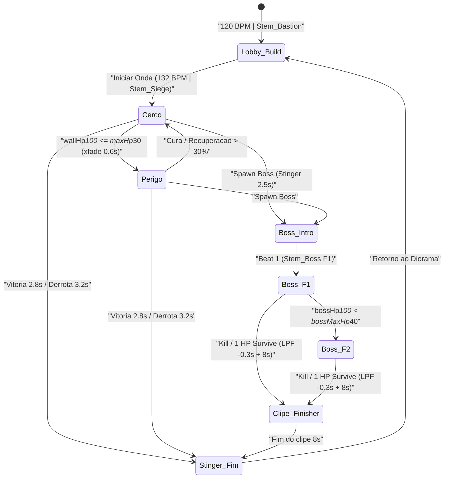

# Áudio, SFX & Música Adaptativa — MURALHA

> **Status:** Especificação de arquitetura de áudio (P1 preservada via `AudioKit`; expansão aditiva de mixer/stems/3D/Física para P2+).
> **Compatibilidade:** `VisualTheme.AUDIO.group == "MuralhaSFX"` e os 10 *cues* base permanecem intactos para manter `sim/visual-contract.luau` (`8/8`) 100% verde.

---

## 1. Arquitetura de Barramentos (`SoundService` & `SoundGroup` Hierarchy)

O `AudioMixer` cria uma árvore determinística sob `SoundService` encabeçada por `MuralhaMaster`, onde o grupo legado `MuralhaSFX` é preservado como barramento filho para roteamento direto de `AudioKit`.

```text
SoundService
└── MuralhaMaster (Volume = 1.00 | CompressorSoundEffect: Threshold=-6, Ratio=4, Attack=0.005, Release=0.08)
    ├── BGM_Bus        (Volume = 0.65 | EqualizerSoundEffect p/ low-pass pausa/derrota/finisher | Sidechain -4.5 dB / 0.35s)
    ├── MuralhaSFX     (Volume = 0.80 | Preservado p/ VisualTheme.AUDIO.group & sim/visual-contract.luau)
    ├── SFX_Physics    (Volume = 0.75 | Impactos físicos de peças/escombros; cooldown global 80 ms)
    ├── SFX_Boss       (Volume = 0.95 | Prioridade máxima: imune a voice-stealing comum)
    ├── SFX_UI_Coop    (Volume = 0.80 | UI, progresso e pings/ouro síncronos)
    ├── SFX_Stinger    (Volume = 0.90 | Stingers quantizados e finisher de 8s; dispara ducking no BGM_Bus)
    └── SFX_Ambient    (Volume = 0.45 | Ambiência por ato; atenuada durante Boss/Finisher)
```

| Barramento | `Volume` | DSP / Efeitos | Política de Ducking & Prioridade |
|---|---:|---|---|
| `MuralhaMaster` | `1.00` | `CompressorSoundEffect` (`Threshold=-6`, `Ratio=4`, `Attack=0.005`, `Release=0.08`) | Limiter final anti-clipping mobile em picos de horda. |
| `BGM_Bus` | `0.65` | `EqualizerSoundEffect` (`HighGain=-80` sweep em pausa/derrota/finisher) | Recebe *sidechain ducking* de `-4.5 dB` (`Volume` × `0.596`) por `0.35s` em `SFX_Boss`, `SFX_Stinger` e `gate_breach_hit`. |
| `MuralhaSFX` | `0.80` | — | Hospeda os 10 *cues* base de `AudioKit` e fallback S8 (`maxVoices` por categoria). |
| `SFX_Physics` | `0.75` | — | Cooldown global de `80 ms`; descarta colisões com velocidade `< 8`. |
| `SFX_Boss` | `0.95` | — | **Imune a voice-stealing comum**; dispara ducking de `-4.5 dB` no `BGM_Bus`. |
| `SFX_UI_Coop` | `0.80` | — | Sempre 2D para UI; pings 3D usam `SpatialPool` com prioridade alta. |
| `SFX_Stinger` | `0.90` | — | Quantizado ao compasso; reduz `BGM_Bus` em `-4.5 dB` por `0.35s` (ou sweep no Finisher). |
| `SFX_Ambient` | `0.45` | — | Loop estéreo/mono leve do ato; reduz `50%` durante `Stem_Boss`. |

### 1.1 Automação de Ducking, Low-Pass e Preservação da P1

- **Sidechain Ducking (`-4.5 dB / 0.35s`):** ao disparar qualquer *cue* em `SFX_Boss`, `SFX_Stinger` ou `gate_breach_hit`, o `AudioMixer` aplica `TweenService` linear de `10 ms` até `BGM_Bus.Volume = 0.65 * 0.596` (`0.387`) e restaura para `0.65` ao longo de `0.35s` (reiniciando a janela sem acumular quedas).
- **Low-Pass Contextual (`EqualizerSoundEffect`):** em pausa de interface, derrota ou entrada do **Clipe Finisher (`8s`)**, o EQ em `BGM_Bus` mantém `LowGain = 0`, `MidGain = -6` e varre `HighGain` de `0` para `-80` dB em `-0.3s` (`TweenInfo.new(0.3, Enum.EasingStyle.Quad)`).
- **Ponte `AudioKit` -> `MuralhaMaster`:** no boot do `AudioMixer`, se `SoundService:FindFirstChild("MuralhaSFX")` já foi criado por `AudioKit`, ele é reparentado para `MuralhaMaster` preservando `Name = "MuralhaSFX"` (`VisualTheme.AUDIO.group`) e `Volume = 0.80`.

---

## 2. Música Adaptativa Vertical e Horizontal (OST)

### 2.1 Camadas Verticais e Sincronismo de BPM

Todos os stems de um mesmo ato compartilham arquivo `.ogg` de mesma duração exata e são reproduzidos com **`TimePosition` travado** (sincronismo via `RunService.Heartbeat`: correção de *drift* se `|stem.TimePosition - masterPos| > 0.015s`).

| Modo / Estado | BPM | Compasso | Stems Ativos | Regra de Transição |
|---|---:|---|---|---|
| **Lobby / Build** | `120` | `4/4` | `Stem_Bastion` | Base calma de engenharia; `Volume = 1.0` no build, silenciada ao iniciar o cerco. |
| **Cerco Ativo** | `132` | `4/4` | `Stem_Siege` | Entra no início da onda; `0.4s` de crossfade na troca de cena. |
| **Perigo Crítico** | `132` | `4/4` | `Stem_Siege` + `Stem_Danger` + `wall_heartbeat` | Crossfade de `0.6s` quando `wallHp * 100 <= maxHp * 30` (inteiro `MILLI`). |
| **Boss — Fase 1** | `132` | `4/4` | `Stem_Boss` (F1) | Substitui `Stem_Siege` após `Boss Intro` (`2.5s`). |
| **Boss — Fase 2** | `132` | `4/4` | `Stem_Boss` (F2) + `Stem_Danger` | Ativada em `bossHp * 100 < bossMaxHp * 40` (`< 40% HP`). |

### 2.2 Temas Horizontais (Atos 1–5) & Stingers Quantizados

| Ato | Tema Horizontal | Paleta Sonora & Instrumentação |
|---|---|---|
| **Ato 1 — Cinzas** | *Bastião de Cinzas* | Cordas graves secas, caixas militares de madeira e metais contidos. |
| **Ato 2 — Forjas** | *Bigornas de Brasa* | Percussão metálica ritmada, foles graves e latão industrial. |
| **Ato 3 — Geada** | *Ruína Glacial* | Sineta cristalina, drones etéreos frios e pizzicato tenso. |
| **Ato 4 — Pólvora** | *Muralha de Pólvora* | Metais heroicos, tímpanos pesados e cadência acelerada de artilharia. |
| **Ato 5 — Fenda** | *Brecha Turquesa* | Sintetizadores granulares corrompidos sobre orquestra sombria em 132 BPM. |

- **Stingers Quantizados (alinhados ao próximo beat `4/4`):**
  - **Vitória (`2.8s`):** acorde resolutivo de metais + sino âmbar; faz fade-out suave do `Stem_Siege`.
  - **Derrota (`3.2s`):** acorde descendente + sub-grave; ativa `EqualizerSoundEffect` low-pass (`HighGain=-80`) no `BGM_Bus`.
  - **Boss Intro (`2.5s`):** impacto de corneta grave + riser orquestral antes da entrada de `Stem_Boss`.
  - **Clipe Finisher (`8.0s`):** sincronizado com `CaptureService` (`8s`); dispara **low-pass sweep `-0.3s`** no `BGM_Bus` seguido por `finisher_impact` no momento do golpe/clímax.
- **Regra de Quantização:** o próximo beat é calculado por `beatDur = 60 / bpm` (`0.500s` em `120 BPM`; `0.4545s` em `132 BPM`); stingers aguardam `delay = beatDur - (masterStem.TimePosition % beatDur)` (limitado a `<= 0.45s`), exceto `finisher_impact` que é imediato ao evento do clímax.



---

## 3. Catálogo Completo de 36 Cues SFX, Espacialização 3D e Polifonia

### 3.1 Regras de Espacialização 3D, Pool Fixo e Polifonia

- **Pool 3D Fixo:** `24` instâncias `Attachment` pré-alocadas como filhas de `Workspace.Terrain` (reutilizadas em *ring buffer*, zero `Instance.new` em combate por frame).
- **Atenuação 3D:** `RollOffMode = Enum.RollOffMode.InverseTapered`, `RollOffMinDistance = 12`, `RollOffMaxDistance = 95`.
- **Anti-metralhadora & Variação:** `cooldownMs = 45` por *cue* (`80 ms` global para `SFX_Physics`), `PlaybackSpeed` jitter aleatório `[0.92, 1.08]` (desligado em `BGM_Bus`, `SFX_Stinger` e `ui_action_feedback`).
- **Modulação de Física Real:** lê `part.AssemblyLinearVelocity.Magnitude` no impacto: `< 8` **mudo** (descartado), `8..25` **leve** (`Volume * 0.45`, pitch `+0.06`), `> 25` **pesado** (`Volume * 1.00`, pitch `-0.08`).

### 3.2 Tabela Mestra dos 36 Cues

| # | Cue ID | Grupo / Escopo | Barramento | 2D/3D | `maxVoices` | `cooldownMs` | Jitter | Disparo / Comportamento |
|---:|---|---|---|---|---:|---:|---|---|
| 01 | `trap_archer_fire` | Trap P1 (`archer`) | `MuralhaSFX` | 3D | 6 | 45 | `0.92..1.08` | Disparo ágil de corda + sibilo curto (mapeia `projectile`). |
| 02 | `trap_tar_splash` | Trap P1 (`tar`) | `MuralhaSFX` | 3D | 4 | 45 | `0.92..1.08` | Arremesso espesso + splat viscoso na lane. |
| 03 | `trap_frost_pulse` | Trap P1 (`frost`) | `MuralhaSFX` | 3D | 4 | 45 | `0.92..1.08` | Estalo cristalino + onda de congelamento `55%`. |
| 04 | `trap_cannon_blast` | Trap P1 (`cannon`) | `MuralhaSFX` | 3D | 3 | 45 | `0.92..1.08` | Wind-up curto de mecha + estampido grave + splash. |
| 05 | `trap_catapult_launch` | Trap P1 (`catapult`) | `MuralhaSFX` | 3D | 3 | 45 | `0.92..1.08` | Tensão de madeira/corda + impacto sísmico em área. |
| 06 | `trap_place_upgrade` | Build P1/P2 | `MuralhaSFX` | 3D | 4 | 45 | `0.95..1.05` | Encaixe de pedra/ferro (`trap_place` / `trap_upgrade`). |
| 07 | `trap_ballista_pierce` | Trap P2 (`ballista`) | `MuralhaSFX` | 3D | 3 | 45 | `0.92..1.08` | Wind-up metálico + seta pesada perfurando 2 alvos. |
| 08 | `trap_dynamo_arc` | Trap P2 (`dynamo`) | `MuralhaSFX` | 3D | 4 | 45 | `0.92..1.08` | Carga elétrica + estalo em cadeia (até 3 alvos). |
| 09 | `trap_cauldron_boil` | Trap P2 (`cauldron`) | `MuralhaSFX` | 3D | 3 | 45 | `0.92..1.08` | Derramamento + borbulha contínua por `10t`. |
| 10 | `trap_spring_ram_slam` | Trap P2 (`spring_ram`) | `MuralhaSFX` | 3D | 3 | 45 | `0.92..1.08` | Mola comprimida + pancada seca de knockback `+1500`. |
| 11 | `trap_war_drum_beat` | Trap P2 (`war_drum`) | `MuralhaSFX` | 3D | 2 | 45 | `0.92..1.08` | Tambor grave marcando buff `-15%` cd nas vizinhas. |
| 12 | `trap_barricade_hit` | Trap P2 (`barricade`) | `MuralhaSFX` | 3D | 4 | 45 | `0.92..1.08` | Golpe abafado em escudo/madeira com HP local. |
| 13 | `trap_decoy_bell_ring` | Trap P2 (`decoy_bell`) | `MuralhaSFX` | 3D | 2 | 45 | `0.96..1.04` | Badalo ressonante atraindo unidades de lanes adjacentes. |
| 14 | `syn_piche_incendiario` | Sinergia 1 | `MuralhaSFX` | 3D | 3 | 45 | `0.92..1.08` | Ignição explosiva ao acertar `tar` + `cannon`/`catapult`. |
| 15 | `syn_choque_termico` | Sinergia 2 | `MuralhaSFX` | 3D | 3 | 45 | `0.92..1.08` | Estilhaço térmico de `frost` + `cannon` (`+20%`). |
| 16 | `syn_bateria_cruzada` | Sinergia 3 | `MuralhaSFX` | 3D | 3 | 45 | `0.92..1.08` | Clique duplo cadenciado de `archer` adjacente. |
| 17 | `syn_linha_artilharia` | Sinergia 4 | `MuralhaSFX` | 3D | 2 | 45 | `0.92..1.08` | Eco de bateria sincronizada em `c1`/`c2`. |
| 18 | `phys_wood_impact` | Física Real | `SFX_Physics` | 3D | 4 | 80 | `0.92..1.08` | Colisão de madeira (`<8` mudo, `8..25` leve, `>25` pesado). |
| 19 | `phys_stone_impact` | Física Real | `SFX_Physics` | 3D | 4 | 80 | `0.92..1.08` | Fragmento de alvenaria modulada por velocidade. |
| 20 | `phys_iron_impact` | Física Real | `SFX_Physics` | 3D | 4 | 80 | `0.92..1.08` | Tilintar/pancada metálica modulada por velocidade. |
| 21 | `phys_ice_shatter` | Física Real | `SFX_Physics` | 3D | 4 | 80 | `0.92..1.08` | Quebra de gelo modulada por velocidade. |
| 22 | `horde_spawn_horn` | Horda | `MuralhaSFX` | 3D | 2 | 45 | `0.95..1.05` | Corneta da Fenda em `X = +25` (mapeia `horn`). |
| 23 | `horde_unit_hit` | Horda | `MuralhaSFX` | 3D | 8 | 45 | `0.92..1.08` | Acerto de projétil em construto (mapeia `impact`). |
| 24 | `horde_unit_dissolve` | Horda | `MuralhaSFX` | 3D | 6 | 45 | `0.92..1.08` | Sopro etéreo turquesa ao eliminar unidade. |
| 25 | `gate_breach_hit` | Portão / Perigo | `MuralhaSFX` | 2D/3D | 3 | 45 | `0.92..1.08` | Pancada grave no portão + pulso `wall_heartbeat` (`gate_hit`). |
| 26 | `boss_telegraph_2s` | Boss (5 Atos) | `SFX_Boss` | 3D | 2 | 45 | `1.00..1.00` | Telegrafagem ascendente de exatamente `2.0s` antes do golpe. |
| 27 | `boss_heavy_slam` | Boss (5 Atos) | `SFX_Boss` | 3D | 2 | 45 | `0.95..1.05` | Impacto sísmico principal; dispara ducking `-4.5 dB`. |
| 28 | `boss_stagger_break` | Boss (5 Atos) | `SFX_Boss` | 3D | 2 | 45 | `0.95..1.05` | Ruptura de armadura/postura com ressonância grave. |
| 29 | `boss_roar_phase2` | Boss (5 Atos) | `SFX_Boss` | 2D/3D | 1 | 45 | `1.00..1.00` | Rugido único de transição para Fase 2 (`< 40% HP`). |
| 30 | `boss_warden_summon` | Boss (5 Atos) | `SFX_Boss` | 3D | 2 | 45 | `0.95..1.05` | Invocação de reforços específica do Boss de cada Ato (1–5). |
| 31 | `coop_ping_tactical` | Co-op Síncrono | `SFX_UI_Coop` | 3D | 4 | 45 | `0.98..1.02` | Cobre os 4 pings 3D (`Alvo`, `Perigo`, `Ajuda`, `Ouro`) por timbre/pitch. |
| 32 | `coop_gold_send` | Co-op Síncrono | `SFX_UI_Coop` | 2D | 2 | 45 | `0.96..1.04` | Tinido de envio de ouro para aliado na muralha. |
| 33 | `coop_gold_receive` | Co-op Síncrono | `SFX_UI_Coop` | 2D | 2 | 45 | `0.96..1.04` | Sineta harmônica de ouro recebido. |
| 34 | `ui_action_feedback` | UI Geral | `SFX_UI_Coop` | 2D | 4 | 45 | `1.00..1.00` | Clique positivo e negação (`ui_click` / `ui_deny`). |
| 35 | `prog_star_chest_badge` | Progresso | `SFX_UI_Coop` | 2D | 3 | 45 | `1.00..1.00` | Fanfarra curta p/ 1–3 estrelas, abertura de baú e badge. |
| 36 | `stinger_match_finisher` | Stingers | `SFX_Stinger` | 2D | 2 | 45 | `1.00..1.00` | Vitória (`2.8s`), Derrota (`3.2s`) e `finisher_impact` (`victory`/`defeat`). |

### 3.3 Sub-variantes Paramétricas (Pings 3D, Bosses dos 5 Atos & Física Real)

| Subsistema | Parâmetro de Entrada | Variação Aplicada no `AudioMixer` | Regra Anti-Saturação / Prioridade |
|---|---|---|---|
| **4 Pings Co-op 3D** | `pingKind` (`target` / `danger` / `assist` / `gold`) | `PlaybackSpeed`: `1.00` (`target`), `0.85` (`danger` pulso duplo), `1.15` (`assist`), `1.25` (`gold`). | Máx. `4` vozes simultâneas em `SFX_UI_Coop`; cooldown `45 ms` por jogador. |
| **5 Bosses (Atos 1–5)** | `actId` (`1..5`) | Carimbo espectral do Ato (`Cinzas` sub-grave, `Forjas` bigorna, `Geada` cristal, `Pólvora` canhão, `Fenda` sintético) sobre os 5 cues `boss_*`. | `SFX_Boss` **ignora roubo de voz**; derruba vozes de `horde_unit_hit` se necessário. |
| **Física Real (4 materiais)** | `AssemblyLinearVelocity.Magnitude` (`v`) | `v < 8`: descartado; `8 <= v <= 25`: `vol * 0.45`, `pitch + 0.06`; `v > 25`: `vol * 1.00`, `pitch - 0.08`. | Cooldown global de `80 ms` em `SFX_Physics` + teto de `4` vozes/material. |

### 3.4 Envelopes Wind-up / Disparo / Impacto & Pool 3D (`24 Attachments`)

- **Camadas por Armadilha (5 P1 + 7 P2):**
  - *Disparo Instantâneo (`archer`, `dynamo`, `war_drum`):* ataque `<= 15 ms` + cauda curta (`120–280 ms`); sem wind-up audível para não atrasar leitura em `cooldown` baixo.
  - *Wind-up + Disparo (`cannon`, `catapult`, `ballista`, `spring_ram`, `decoy_bell`):* pré-carga de `90–180 ms` (corda/mecha/mola) sincronizada à animação de preparação + disparo + impacto em área/alvo.
  - *Zona / Contenção (`tar`, `frost`, `cauldron`, `barricade`):* transiente inicial no acionamento + cauda granulada filtrada abaixo de `3 kHz` para não mascarar sinais de Boss.
- **Alocação do Pool 3D (`Workspace.Terrain`):**
  1. `AudioMixer:init()` instancia `24` `Attachment`s fixos (`PoolSlot_01`..`PoolSlot_24`) em `Workspace.Terrain` com `Sound` filho pré-configurado (`InverseTapered`, `MinDistance = 12`, `MaxDistance = 95`).
  2. Ao receber `playCue` 3D, seleciona o primeiro slot ocioso; se os `24` estiverem ocupados, rouba o slot mais antigo **não pertencente a `SFX_Boss`**.
  3. Atualiza apenas `Attachment.WorldPosition = opts.position` antes de `sound:Play()`, evitando criação/destruição de instâncias em `Debris` durante hordas densas.

---

## 4. Pipeline de Produção, Normalização e Orçamento Mobile

### 4.1 Normalização `ffmpeg` (EBU R128 / LUFS)

Todos os assets passam pelo pipeline offline antes do upload para o Roblox Asset Manager, garantindo loudness consistente (`-14 LUFS`, `True Peak <= -1.0 dBTP`):

```bash
# SFX (mono, 44.1 kHz, OGG Vorbis q5, -14 LUFS)
ffmpeg -i input.wav -af "loudnorm=I=-14:TP=-1.0:LRA=11" -ac 1 -ar 44100 -c:a libvorbis -q:a 5 sfx_out.ogg

# BGM Stems & Stingers (estéreo, 44.1 kHz, 128-160 kbps OGG Vorbis, -14 LUFS)
ffmpeg -i stem_in.wav -af "loudnorm=I=-14:TP=-1.0:LRA=11" -ac 2 -ar 44100 -c:a libvorbis -b:a 160k bgm_stem.ogg
```

### 4.2 Orçamento de RAM Mobile (`< 18 MB`) & `PreloadAsync` por Ato

- **Teto Estrito de Memória de Áudio:** **`< 18 MB` descomprimidos/em cache no mobile** (alinhado ao limite de 150 unidades e 500 draw calls).
  - **BGM do Ato Ativo (4 stems 128–160 kbps, ~90s loop):** `~7.5 MB`.
  - **Stingers (4 arquivos curtos 2.5s–8.0s):** `~1.8 MB`.
  - **36 Cues SFX (mono 44.1 kHz, 0.2s–2.0s) + Ambiência do Ato:** `~5.2 MB`.
  - **Margem operacional (pool de 24 `Attachment`s + buffers DSP):** `~1.5 MB` (Total estimado: **`~16.0 MB`**, folga de `2.0 MB` abaixo do teto de `18 MB`).
- **Streaming por Ato:** `AudioMixer.preloadAct(actId)` invoca `ContentProvider:PreloadAsync(actAssets)` na transição de ato e limpa instâncias do ato anterior para impedir acúmulo de RAM entre Atos 1–5.

| Manifesto por Ato | Conteúdo Pré-carregado | RAM Estimada | Política de Descarte |
|---|---|---:|---|
| **Global Persistente** | 36 cues SFX (`MuralhaSFX`, `SFX_Physics`, `SFX_Boss`, `SFX_UI_Coop`) + 4 Stingers | `~7.0 MB` | Mantido residente durante toda a sessão. |
| **Ato Ativo (`1..5`)** | 4 stems BGM (`Bastion`, `Siege`, `Danger`, `Boss`) + loop `SFX_Ambient` | `~7.5 MB` | Trocado sob demanda em `preloadAct(actId)`; stems do ato anterior recebem `:Destroy()`. |
| **Buffer Operacional** | 24 slots `Attachment` + instâncias DSP (`Compressor`, `Equalizer`) | `~1.5 MB` | Alocação fixa no boot (`Total ~16.0 MB < 18.0 MB`). |

### 4.3 Contrato Luau `--!strict` (`AudioMixer.luau`) e Mapeamento para `AudioKit`

```luau
--!strict
export type BusName =
	"MuralhaMaster" | "BGM_Bus" | "MuralhaSFX" | "SFX_Physics"
	| "SFX_Boss" | "SFX_UI_Coop" | "SFX_Stinger" | "SFX_Ambient"

export type MusicState = "Lobby_Build" | "Cerco" | "Perigo" | "Boss_F1" | "Boss_F2" | "Finisher"

export type PlayOptions = {
	position: Vector3?,       -- nil => 2D; Vector3 => usa pool fixo de 24 Attachments no Terrain
	volumeScale: number?,
	pitchScale: number?,
	velocityMag: number?,     -- p/ SFX_Physics: <8 mudo, 8..25 leve, >25 pesado
	priorityOverride: boolean?,
}

export type SoundCueDef = {
	id: string,
	soundId: string,
	bus: BusName,
	baseVolume: number,
	is3D: boolean,
	maxVoices: number,
	cooldownMs: number,
	jitterRange: { number }?, -- { min, max }, ex.: { 0.92, 1.08 }
	immuneToSteal: boolean?,  -- true em SFX_Boss
}

export type AudioMixerApi = {
	init: (self: AudioMixerApi) -> (),
	preloadAct: (self: AudioMixerApi, actId: number) -> (),
	setMusicState: (self: AudioMixerApi, state: MusicState, actId: number?) -> (),
	triggerStinger: (self: AudioMixerApi, stingerId: "victory" | "defeat" | "boss_intro" | "finisher") -> (),
	playCue: (self: AudioMixerApi, cueId: string, opts: PlayOptions?) -> (),
	playPhysicsImpact: (self: AudioMixerApi, materialCue: string, pos: Vector3, velocityMag: number) -> (),
	triggerDucking: (self: AudioMixerApi, dbDrop: number, durationSec: number) -> (),
	setMuted: (self: AudioMixerApi, muted: boolean) -> (),
}
```

| Cue Base (`VisualTheme.AUDIO.cues`) | Cue Canônico no `AudioMixer` | Barramento Destino | Observação de Compatibilidade |
|---|---|---|---|
| `ui_click`, `ui_deny` | `ui_action_feedback` | `SFX_UI_Coop` | `AudioKit.play` continua válido em P1; `AudioMixer` redireciona quando ativo. |
| `trap_place`, `trap_upgrade` | `trap_place_upgrade` | `MuralhaSFX` | Mantém `VisualTheme.AUDIO.group == "MuralhaSFX"` sob `MuralhaMaster`. |
| `projectile`, `impact`, `gate_hit` | `trap_archer_fire`, `horde_unit_hit`, `gate_breach_hit` | `MuralhaSFX` | Ganha espacialização via pool 3D de 24 slots e jitter `[0.92, 1.08]`. |
| `victory`, `defeat`, `horn` | `stinger_match_finisher`, `horde_spawn_horn` | `SFX_Stinger` / `MuralhaSFX` | `victory`/`defeat` acionam ducking `-4.5 dB` e stingers quantizados. |

> **Verificação P1:** `AudioMixer` e `SoundCatalog` são camadas puramente client-side adicionadas na P2+. Nenhuma chave de `VisualTheme.AUDIO` é removida ou renomeada, garantindo `sim/visual-contract.luau` (`8/8`) sem alterações.

---

## 9. Backlog de Polimento de Áudio (Pós-Playtest / Registrado em 14/11/2026)

Melhorias planejadas para futuras iterações no `AudioKit` (a maioria em DSP/Luau local, sem consumir cota extra de upload na Open Cloud):

1. **Oclusão e Abafamento Dinâmico (Low-Pass Muffler — 0 uploads):** fechar dinamicamente as altas frequências via `EqualizerSoundEffect` quando a muralha cair abaixo de `15% HP` (efeito concussão/tensão crítica), quando modais pesados estiverem abertos, ou para unidades atrás de obstáculos altos.
2. **Espacialização de Projéteis Pesados em Movimento (Pass-by 3D — 0–1 upload):** acoplar um som posicional curto aos projéteis de catapulta e barris dos bosses para gerar cruzamento estéreo e Doppler sutil nas câmeras `corridor` e `wall` antes do impacto.
3. **Ducking Inteligente Estendido para Alertas Críticos (0 uploads):** ampliar o ducking atual (`triggerDucking` / `triggerVoiceDucking` já ativos em hits pesados e falas de boss) para atenuar a massa de `MuralhaSFX` também durante `wall_alarm` (`<30% HP`), `boss_telegraph` e stingers críticos de onda.
4. **Combo / Kill-Streak Pitch Ramp (0 uploads):** escalar progressivamente `+0.03` de pitch por abate rápido em janela curta (`~1.2 s`, teto `+0.18`) em `death_*` e `coin_gain` para amplificar a sensação de impacto e recompensa em hordas densas.
5. **Camada Ambiente do Vale na Preparação (1 upload):** loop sutil de vento do cânion e tochas em `build`, cortado em silêncio seco milissegundos antes do `horn` abrir a raid.
