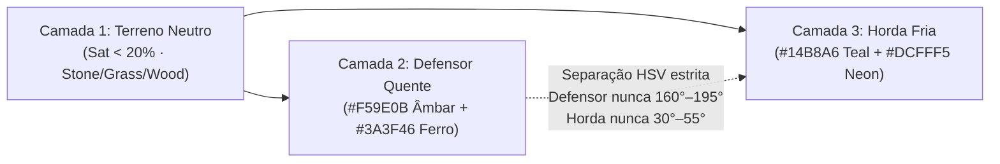
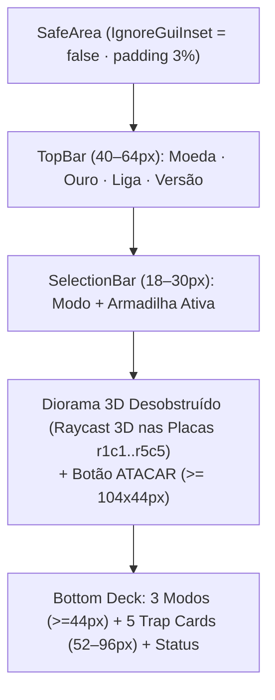
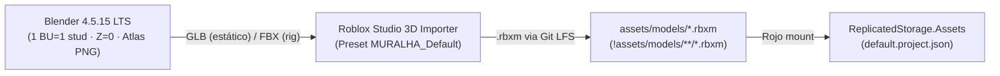

# Direção Visual, Silhuetas e Pipeline 3D/Áudio

> **Escopo:** especificação visual e técnica pós-S8 para evolução da apresentação **Diorama de Guerra de Brinquedo** (`VisualTheme.NAME = "diorama-guerra-brinquedo"`). Consolida constantes exatas de [`VisualTheme.luau`](../src/shared/visual/VisualTheme.luau), dos kits em [`src/client/visual/`](../src/client/visual/), de [`art/README.md`](../art/README.md), de [`s8-plano-visual.md`](s8-plano-visual.md) e de [`ferramentas.md`](ferramentas.md). **Não altera gameplay, `simVersion`, `schemaVersion` ou `contentVersion`.**

---

## 1. Hierarquia Visual de 3 Camadas & Lei Cromática de Facção

A leitura da batalha em menos de 3 segundos em telas móveis (`375×812` e `720×1280`) exige separação estrita de luminância, saturação e matiz (HSV) entre cenário, defensores e horda, sem depender de texto flutuante (`BillboardGui`) no mundo 3D.

### 1.1 Camadas, Paleta Canônica (`VisualTheme.PALETTE`) e Iluminação (`VisualSetup.luau`)

| Camada | Papel Visual | Regra de Saturação / Contraste | Valores Exatos no Código |
|---|---|---|---|
| **1. Terreno Neutro** | Plataforma, penhascos, base e lanes sem competir com peças ativas | Saturação **< 20%**; valor médio-baixo (`SmoothPlastic` / `Slate`) | `stone` `{92, 96, 102}`, `stoneDark` `{52, 56, 62}`, `grass` `{70, 94, 55}`, `ArenaVisual` `Base` `{126, 122, 114}`, `BaseTop` `{154, 147, 134}`, `Lane_1..5` `{92, 96, 104}` |
| **2. Defensor (Quente)** | Muralha, portão, torres, armadilhas e projéteis aliados | Alta legibilidade quente; madeira e ferro escuro com acento âmbar | `amber` `#F59E0B` (`{245, 158, 11}`), `amberBright` `{255, 199, 64}`, `iron` `#3A3F46` (`{58, 63, 70}`), `ironDark` `{32, 35, 40}`, `wood` `#8B5A2B` (`{139, 90, 43}`), `woodDark` `{92, 58, 28}`, `danger` `#E4572E` (`{228, 87, 46}`), `parchment` `#F5E6C8` (`{245, 230, 200}`) |
| **3. Horda (Fria)** | Portal de spawn e unidades avançando da direita para a esquerda | Frio saturado com ponto focal emissivo nos olhos | `teal` `#14B8A6` (`{20, 184, 166}`), `tealDark` `{10, 74, 70}`, `runner` `{20, 184, 166}`, `brute` `{13, 148, 136}`, `swarm` `{45, 212, 191}`, Olhos `Neon` `#DCFFF5` (`220, 255, 245` em [`HordeKit.luau:50`](../src/client/visual/HordeKit.luau#L50)) |

A configuração de luz em [`VisualSetup.luau`](../src/client/visual/VisualSetup.luau) ancora o contraste quente × frio sem estourar o chão:
- `Lighting`: `ClockTime = 16.4`, `Brightness = 3.3`, `Ambient = (120, 124, 132)`, `OutdoorAmbient = (165, 168, 175)`, `EnvironmentDiffuseScale = 0.65`, `EnvironmentSpecularScale = 0.25`, `ShadowSoftness = 0.35`, `GlobalShadows = true` (`ShadowMap`).
- `MuralhaAtmosphere`: `Density = 0.14`, `Offset = 0.08`, `Color = teal`, `Decay = iron`, `Glare = 0.15`, `Haze = 1.2`.
- `MuralhaColor` (`ColorCorrectionEffect`): `Brightness = 0.12`, `Contrast = 0.06`, `Saturation = 0.18`, `TintColor = (255, 244, 224)`.
- `MuralhaBloom` (`BloomEffect`): `Intensity = 0.42`, `Size = 22`, `Threshold = 1.15` — garante brilho exclusivo em `Neon` (olhos `#DCFFF5`, chamas de tocha, portal e `LaneInlay_1..5`).



### 1.2 Lei de Separação HSV e Regra dos 200 px

1. **Bloqueio de Matiz por Facção (Invariante de Arte):**
   - **Skins de Defensor (Armadilhas, Muralha, Comandante):** **PROIBIDO** usar matiz na faixa **HSV 160°–195°** (espectro ciano/verde-água reservado à Horda). Mesmo a armadilha `frost` (`{89, 166, 230}` / `~207°`) mantém azul glacial acima de `200°` com acento gelo `{180, 235, 255}` e base `stoneDark`, sem invadir a faixa do `teal`.
   - **Skins de Horda (Unidades, Portais, Efeitos Inimigos):** **PROIBIDO** usar matiz na faixa **HSV 30°–55°** (espectro âmbar/ouro reservado ao Defensor).
2. **Regra do Thumbnail de 200 px:** todo novo modelo ou skin só recebe aprovação visual após captura em **200×200 px** (versão colorida e versão em escala de cinza). Em ambas as versões deve ser imediato distinguir: (a) muralha âmbar à esquerda vs. horda verde-água à direita, e (b) cada uma das 5 armadilhas pela silhueta pura, sem `BillboardGui`.
3. **Modo Leitura Competitiva (Toggle Client-Side):** chave local nas configurações do cliente que força silhuetas padrão e a paleta canônica (`VisualTheme.PALETTE`) durante raids, replays e drop-in. Elimina qualquer vantagem ou ruído visual de skins elaboradas sem tocar no servidor ou na simulação determinística.

---

## 2. Matriz Ortogonal: Nível de Gameplay (L1–L5) vs. Tier Cosmético

> **Achado da S8 ([`TrapKit.luau:72-84, 334-343`](../src/client/visual/TrapKit.luau#L72-L84)):** na implementação atual, `TrapKit.setLevel` apenas alterna a transparência de `LevelPip1..3` com dimensões `0.26 × 0.16 × 0.26` stud (e aplica `math.clamp(level, 1, 3)`). Da câmera isométrica do `BuildClient` em `(48, 34, 52)` com `FOV = 40` em `375×812`, esses pinos são **invisíveis na leitura rápida**.

### 2.1 Eixo Estrutural — Nível de Gameplay (`L1–L5`)

O nível altera **silhueta estrutural e massa visual** dentro da base padrão `4.8 × 4.8` studs (`TrapKit.luau:307`) centrada na célula de `8` studs (`GridLayout.CELL_SIZE = 8`):

| Nível | Regra Estrutural (Silhueta) | Marcador Frontal Obrigatório | Estado no Runtime |
|---|---|---|---|
| **L1** | Madeira simples, cano/arco único, cristal central limpo | 1 chevron frontal **≥ 0,6 stud** em `amber` | Base S8 (substituir pip `0.26`) |
| **L2** | Cintas de ferro, carruagem reforçada, mecanismo duplo / anel lateral | 2 chevrons frontais **≥ 0,6 stud** em `amberBright` | Base S8 (substituir pip `0.26`) |
| **L3** | Brasão coroado no topo + ferragens contínuas e flâmula lateral | 3 chevrons grandes **≥ 0,6 stud** `Neon` | Máximo atual (`clamp 1..3`) |
| **L4–L5** | Engrenagens mestras, filigrana dourada e crista elevada (sem sair da classe de altura) | Chevron fusionado dourado + núcleo energizado sutil | Reservado pós-P1 (`maxLevel > 3`) |

> **Cotas e Ancoragem 3D (`ArenaVisual` / `TrapKit` / `HordeKit`):**
> - **Superfícies do piso:** topo de `Lane_1..5` = **`0.33` studs** (`origin.Y + 0.33`); topo de `DropInPath` = **`0.39` studs**.
> - **Armadilhas (`TrapKit`):** pivô na base em `Y = floorTopY + 0.15` (`0.48` na Lane, `0.54` no DropInPath); rodas da `catapult` em `local Y = 1.05` (`baseTop 0.30 + raio 0.75`); **mastro lateral de chevrons (`>= 0.65 × 0.22 × 0.18` stud)** ancorado na face voltada à câmera em `local offset = (+2.1, 1.4 + (n - 1) * 0.42, +2.1)`.
> - **Unidades (`HordeKit`):** criar `RootPart` invisível `(0.1, 0.1, 0.1)` em `Y = 0` (sola dos pés) como `PrimaryPart` **antes** de `ScaleTo(spec.scale * 1.8)`, permitindo spawn universal em `Y = floorTopY` sem afundamento no chão (ver [`plano-playtest-v1.md`](plano-playtest-v1.md#3-fatia-s82--visual-3d-raycast-tap-to-build-áudio-replay--mobile-gap-017)).

Aplicação estrutural por tipo dentro da pegada `4.8 × 4.8` studs:
- **`tar` (~1.2 studs):** L1 bacia simples -> L2 aro de ferro com rebites -> L3 borda caldeirão coroada + borbulhas maiores -> L4/L5 grade de engrenagem submersa.
- **`cannon` (~3.2 studs):** L1 cano único em madeira -> L2 carruagem com placas de ferro e cano reforçado -> L3 duplo anel de bronze + mira elevada -> L4/L5 culatra com engrenagens de recarga.
- **`frost` (~4.4 studs):** L1 obelisco único -> L2 trio de cristais com cinta metálica -> L3 coroa de prismas + anel basal brilhante -> L4/L5 giroscópio rúnico em torno do cristal.
- **`catapult` (~4.8 studs):** L1 braço simples de madeira -> L2 chassi ferrado + contrapeso duplo -> L3 arco frontal coroado + trava de ferro -> L4/L5 catraca mestra lateral com acabamento dourado.
- **`archer` (~5.2 studs):** L1 torre de madeira aberta -> L2 parapeito com chapas de ferro + 2º arco -> L3 telhado pontiagudo coroado + estandarte -> L4/L5 guarita dupla com vigia blindada.

### 2.2 Eixo Cosmético — Tiers de Skin (`Comum -> Mítico`) e Classes de Altura

Uma **Skin Cosmética** altera exclusivamente **material, tema e VFX**, sendo **proibido** imitar o volume estrutural de um nível superior ou romper a classe de altura definida em [`VisualTheme.TRAPS`](../src/shared/visual/VisualTheme.luau#L41-L82):
- `tar`: `~1.2` studs · `5` parts base (`VisualTheme.TRAPS.tar.height = 1.2`)
- `cannon`: `~3.2` studs · `8` parts base (`VisualTheme.TRAPS.cannon.height = 3.2`)
- `frost`: `~4.4` studs · `7` parts base (`VisualTheme.TRAPS.frost.height = 4.4`)
- `catapult`: `~4.8` studs · `11` parts base (`VisualTheme.TRAPS.catapult.height = 4.8`)
- `archer`: `~5.2` studs · `9` parts base (`VisualTheme.TRAPS.archer.height = 5.2`)

| Tier Cosmético | Triângulos (Máx.) | Textura / Atlas | Emitters & Partículas (S8) | Regra de Áudio (SFX) | Restrição de Silhueta |
|---|---|---|---|---|---|
| **Comum** | ≤ 800 tris | Palette Atlas `256²` | 0 emitters contínuos | SFX padrão do tipo | Recolor dentro da lei HSV |
| **Raro** | ≤ 1.000 tris | Palette Atlas `256²` | ≤ 1 emitter · ≤ 15 part. | SFX padrão + variação de pitch | Adornos pequenos na `Base` |
| **Épico** | ≤ 1.250 tris | Atlas + Trim `512²` | ≤ 2 emitters · ≤ 25 part. | Camada temática no disparo | Tema distinto na mesma altura |
| **Lendário** | ≤ 1.500 tris | Atlas `512²` + emissivo | ≤ 2 emitters · ≤ 40 part. | Cue exclusivo de disparo/impacto | Silhueta heráldica, sem imitar L4/L5 |
| **Mítico** | ≤ 1.500 tris | Atlas `512²` + flipbook | ≤ 2 emitters · ≤ 40 part. *(idle)* | Cue exclusivo + cauda de impacto | VFX de upgrade/finisher dentro da classe |

### 2.3 Silhuetas da Horda (`VisualTheme.ENEMIES`) e Constantes de Game Feel (`MOTION`)

Sem classes no motor determinístico, [`HordeKit.luau`](../src/client/visual/HordeKit.luau) diferencia a horda em 3 escalas e silhuetas com `ScaleTo(spec.scale * 1.8)` e `bobAmplitude = 0.12` / `bobSpeed = 7` (`VisualTheme.MOTION`):
- **`runner` (`CORREDOR`):** `scale = 0.85`, cor `{20, 184, 166}`, chifre central metálico (`Horn`).
- **`brute` (`BRUTO`):** `scale = 1.35`, cor `{13, 148, 136}`, ombreiras metálicas (`Shoulder`) + cutelo (`Cleaver`).
- **`swarm` (`ENXAME`):** `scale = 0.65`, cor `{45, 212, 191}`, tríade esférica (`Body` + `Swarmling-1/1`).
- **Tempos base (`VisualTheme.MOTION`):** `hitFlash = 0.08s`, `death = 0.35s`, `projectileMin/Max = 0.18s / 0.55s`, `shakeSmall/Large = 0.12s / 0.24s`, `pulseSeconds = 1.2s`.

---

## 3. Estados de Destruição da Muralha, Biomas e Finishers de 8s

### 3.1 Quatro Estados Determinísticos de HP (`WallBody` & `Gate`)

A degradação da muralha é uma projeção estritamente cosmética no cliente baseada em proporção inteira `hpPct = math.floor(battle.wallHp * 100 / battle.wallMax)` durante o drop-in e o replay de 8 s (`RaidClient.client.luau:203`):

| Faixa de HP | Estado Visual em `ArenaVisual` (`WallBody` / `Gate`) | Áudio & Feedback de Tela |
|---|---|---|
| **100% – 70%** | **Intacta:** `WallBody`, `WallBand_1..3`, `Gate`, `GateStud_1..4` e `Merlon_-4..4` íntegros; tochas constantes. | `gate_hit` seco por impacto |
| **69% – 31%** | **Avariada:** cintas `WallBand` inclinadas (`2°–4°`), lascas de madeira no chão e `Vfx.dust` a cada batida. | `gate_hit` pesado + estalo de madeira |
| **30% – 1%** | **Crítica:** rachaduras emissivas `danger` (`#E4572E`), fumaça contínua no `Gate` e barra vermelha (`UiKit.luau:174`). | Pulso contínuo `wall_heartbeat` |
| **0%** | **Rompida (Finisher):** `Gate` estilhaçado, `0.3s` slow-mo + `1.2s` Finisher com câmera em `CFrame.lookAt(origin + Vector3.new(-8, 9, 14), origin + Vector3.new(-22, 3.5, 0))` (`FOV = 42`) pronto para `CaptureService`. | `defeat` + `finisher_impact` + `Vfx.dust(..., 10)` |

**Cadência do Clipe de 8 s (`CaptureService` + 3 Cortes):**
1. **0,0 s – 4,5 s:** câmera isométrica acompanha a marcha nas `Lane_1..5` e disparos das armadilhas.
2. **4,5 s – 6,5 s:** corte aproximado no `Gate` (transição 69% -> <30% HP com `wall_heartbeat`).
3. **6,5 s – 8,0 s:** golpe final no `0%` aciona **`0.3s` slow-mo** + **`1.2s` Finisher** (estilhaço do portão, `shakeLarge` e poeira) pronto para compartilhamento social.

> **Estado de Login "Muralha Fumegante" (Idle):** quando o jogador retorna ao jogo após sofrer uma invasão bem-sucedida offline, a muralha permanece com marcas de chamuscado e fumaça leve sobre o portão até a abertura do `BattleLog`/replay de 8 s, criando gancho visual imediato sem pop-up intrusivo.

### 3.2 Cinco Temas de Bioma / Muralha em `ArenaVisual`

Os biomas substituem apenas os sockets periféricos de [`ArenaVisual.luau`](../src/client/visual/ArenaVisual.luau) (`Base`, `BaseTop`, `BaseTrim`, `WallBody`, `Tower_*`, `RockBack_*`, `RockSide_*`, `Cliff_*`), preservando **intactas** as superfícies de leitura `Lane_1..5` (`{92, 96, 104}`) e `LaneInlay_1..5` (`amberBright`):

1. **Bastilha Padrão (Madeira & Ferro):** `wood` + `iron` + `stoneDark` (kit base da S8).
2. **Alvenaria do Deserto:** `BaseTop` arenito dessaturado + `WallBody` calcário + `Cliff` ocre fosco.
3. **Cidadela Nevada:** `BaseTop` ardósia fria + neve fosca (`<15%` saturação) nos `Merlon` e `TowerRoof`, mantendo tochas âmbar.
4. **Forte Vulcânico (Basalto):** `Cliff` e `Rock` em basalto escuro + veios `danger` apagados na base (nunca nas lanes).
5. **Bosque Fortificado:** `grass` dessaturada nas bordas + paliçada de carvalho escuro e estandartes `amber`.

---

## 4. UX/UI Mobile-First (`375×812` & `720×1280`) & Correções Mapeadas S8

O módulo [`BuildLayout.luau`](../src/shared/build/BuildLayout.luau) computa retângulos absolutos testados em `sim/visual-contract.luau` para `375×812` e `720×1280`, respeitando `VisualTheme.UI.minTouch = 44` px.

| Métrica de Layout (`BuildLayout.compute`) | Retrato `375×812` | Retrato HD `720×1280` | Regra de Legibilidade Mobile |
|---|---:|---:|---|
| `padding` / `gap` / `innerPadding` | `11` / `5` / `8` px | `20` / `9` / `15` px | Margem mínima `3%` da menor dimensão (`SafeArea`) |
| `top` (`TopBar`) | `41` px alt. | `64` px alt. | Moeda `22` px, Ouro (`GothamBlack`), Liga e Versão |
| `hud` (`SelectionBar`) | `21` px alt. | `30` px alt. | Modo + Armadilha selecionada em linha única |
| `modeButton` (3 modos) | `h = 45` px | `h = 56` px | Sempre `>= VisualTheme.UI.minTouch` (`44` px) |
| `trapButton` (5 trap cards) | `w ≈ 63` · `h = 56` px | `w ≈ 123` · `h = 96` px | Ícone + nome truncado + custo em ouro |
| `status` | `19` px alt. | `30` px alt. | Feedback curto sem bloquear o deck inferior |

O layout alvo desobstruído segue esta hierarquia:

```text
+---------------------------------------+  <- SafeArea (IgnoreGuiInset = false, padding 3%)
| [Coin] 120    LIGA 1         v2 · c2  |  <- TopBar (40–64 px)
+---------------------------------------+
| COLOCAR · ARQUEIRO                    |  <- SelectionBar (18–30 px)
+---------------------------------------+
|                               [ATACAR]|  <- Botão flutuante (>= 44 px altura)
|                                       |
|        DIORAMA 3D DESOBSTRUÍDO        |  <- Picking 3D via Raycast nas placas r1c1..r5c5
|     (Sem 25 cellButtons opacos)       |     (Substitui BuildClient gridFrame 2D)
|                                       |
+---------------------------------------+
| [COLOCAR]   [REMOVER]     [UPGRADE]   |  <- Modes (44–56 px altura)
| [A 10] [P 15] [G 20] [C 25] [K 30]    |  <- Trap Cards (52–96 px altura)
| Muralha carregada                     |  <- Status (18–30 px)
+---------------------------------------+
```



### 4.1 Plano de Evolução: Raycast 3D no Lugar dos 25 `cellButtons` 2D

Atualmente, [`BuildClient.client.luau:168-258`](../src/client/BuildClient.client.luau#L168-L258) renderiza `gridFrame` com **25 `TextButton`s opacos** no centro da tela, encobrindo as armadilhas 3D recém-construídas. A evolução mantém o fluxo `BuildClientState.intent` -> `BuildAction:InvokeServer`, migrando a entrada para **picking 3D em world-space** ([`plano-playtest-v1.md`](plano-playtest-v1.md)):
1. Criar pasta `MuralhaCellTiles` em `ArenaVisual.build` com 25 placas `Cell_r{1..5}c{1..5}` (`Size = (7.6, 0.05, 7.6)`, `CFrame = origin + (x, 0.355, z)`, `Attribute("Cell", "rXcY")`, `CanQuery = true`, `Transparency = 0.85`).
2. Ao iniciar/encerrar toque (`UserInputService`), exigir **`TOUCH_SLOP_PX = 12`** (`(endPos - startPos).Magnitude <= 12` e `not gameProcessedEvent`) para não disparar colocação durante pan/pinch, lançando `camera:ViewportPointToRay` + `Workspace:Raycast` (`Include` em `{ cellTilesFolder, trapModelsFolder }`, alcance `500` studs).
3. Toque fora do grid nos modos `UPGRADE`/`REMOVE` limpa a célula selecionada; placa/célula ativa exibe moldura `SelectionBox` âmbar (`#F59E0B`), mantendo `gridFrame.Visible = false` sem quebrar `BuildLayout` ou `sim/build-contract.luau`.

### 4.2 Correções Mapeadas da S8 (Propostas via `GAP-017`)

Desvios levantados na auditoria do código S8 a serem endereçados sob **GAP-017** na próxima janela de polimento visual:

| Item Auditado | Evidência Exata no Código | Desvio vs. Contrato / Regra | Correção Mapeada |
|---|---|---|---|
| `ATACAR` (`RaidClient`) | [`RaidClient.client.luau:69`](../src/client/RaidClient.client.luau#L69): `UDim2.fromOffset(96, 34)` | Altura `34 px` < `VisualTheme.UI.minTouch = 44` | Ajustar para mínimo `104 × 44` px |
| `FECHAR` (`RaidClient`) | [`RaidClient.client.luau:156`](../src/client/RaidClient.client.luau#L156): `UDim2.new(0.5, 0, 0, 36)` | Altura `36 px` < `VisualTheme.UI.minTouch = 44` | Ajustar para `UDim2.new(0.5, 0, 0, 44)` |
| `DebugHud` no mobile | [`BuildClient.client.luau:631`](../src/client/BuildClient.client.luau#L631): apenas `Enum.KeyCode.F3` | Inacessível em dispositivos touch (`375×812` / `720×1280`) | Adicionar gesto touch (ex.: toque longo `1.5s` no `versionLabel`) |
| Peças em `HordeKit` | [`HordeKit.luau:56-153`](../src/client/visual/HordeKit.luau#L56-L153): `runner` e `brute` criam **9** `BasePart`s (`swarm` cria **8**) | Excede `VisualTheme.BUDGET.unitParts = 8` (e `ENEMIES.runner.parts = 6`) | Consolidar olhos/partes para ≤ `8` partes (ou 1 `MeshPart` Blender) |
| Cap de projéteis `Vfx` | [`Vfx.luau:146-192`](../src/client/visual/Vfx.luau#L146-L192) vs. [`VisualTheme.luau:125`](../src/shared/visual/VisualTheme.luau#L125) | `maxConcurrentProjectiles = 12` não é aplicado em `Vfx.projectile` | Manter contador ativo e limitar a `12` simultâneos |

---

## 5. Pipeline de Produção 3D & Áudio (Blender 4.5.15 LTS -> Studio -> Rojo/LFS)

### 5.1 Calibração Blender -> Studio & Atlas de Paleta Compartilhado

Conforme [`art/README.md`](../art/README.md) e [`ferramentas.md`](ferramentas.md):
- **Calibração (`art/calibration.blend`):** `Scene > Units > Unit System = None`, `Rotation = Degrees`, **1 BU = 1 stud**, Blender **Z-up** -> Studio **Y-up**, frente **`-Y` (Blender)** -> **`-Z` (Studio)**, pivô na base (`Z = 0`), *Apply All Transforms* sem escala negativa.
- **Formatos e Preset:** `.glb` para modelos estáticos; `.fbx` apenas para rigs/animações. No 3D Importer do Studio salvar/aplicar o preset **`MURALHA_Default`** (`Scale Unit = Studs`, `World Forward = Front`, `World Up = Top`, `Anchored = true`, `Insert In Workspace = true`).
- **Solução do bug `baseColorFactor` cinza (`art/README.md:51-56`):** o importador glTF do Studio ignora `baseColorFactor` sem textura e deixa materiais cinza. Todo asset final deve mapear UVs para um **PNG Palette Atlas compartilhado (`256×256` ou `512×512`)** otimizado com `oxipng`/`pngquant`. Isso elimina o bug na importação e reduz **5–11 `Part`s** por armadilha a **1 `MeshPart` = 1 draw call**.



### 5.2 Montagem Rojo, Convenção de Nomes & Orçamentos Unificados

1. **Nomenclatura obrigatória (`art/README.md` & `ferramentas.md`):** `PREFIXO_nome_variante` em minúsculas no corpo (`TRAP_`, `WALL_`, `CMD_`, `PROP_`, `VFX_`), com fonte em `art/src/*.blend` (Git LFS), export em `art/export/*.glb` / `.fbx` (Git LFS) e preview descartável em `art/renders/` (ignorado pelo git).
2. **Montagem Rojo:** para disponibilizar os `.rbxm` no cliente, adicionar `"Assets": { "$path": "assets/models" }` dentro de `ReplicatedStorage` em [`default.project.json`](../default.project.json) e abrir exceção `!assets/models/**/*.rbxm` no `.gitignore` (rastreando os binários no Git LFS).
3. **Verificação pré-commit de arte:**
   - Regenerar/validar cena de calibração: `blender4.5 -b --factory-startup --python art/scripts/make_calibration.py`.
   - Otimizar PNG do Palette Atlas sem alpha desnecessário via `oxipng`/`pngquant`.
   - Validar orçamento em `sim/visual-contract.luau` e no MicroProfiler do Studio antes do merge.

| Métrica | Orçamento Runtime S8 (`VisualTheme`) | Teto Especial / Finisher (`ferramentas.md` §6) |
|---|---|---|
| Frame / Draw Calls | **60 FPS** · **≤ 500 draw calls** | Medido via MicroProfiler em Android fraco |
| Arena / Unidades | **≤ 160 `arenaParts`** · **≤ 150 `maxUnits`** | `HordeKit` ≤ **8 `unitParts`** · **≤ 800 tris** |
| Armadilha | **≤ 12 `trapParts`** (alvo: **1 `MeshPart`**) · **≤ 1.500 tris** · **≤ 512²** tex | Textura via Palette Atlas compartilhado |
| Partículas (VFX) | **≤ 2 emitters/trap** · **≤ 40 partículas/emitter** · `12` projéteis | **≤ 3 emitters · ≤ 150 partículas** reservado a *finishers* |
| Burst Local (`VisualTheme.VFX`) | `maxImpactParts = 8` · `maxDustParts = 10` · `impactLifetime = 0.55s` | Limpeza determinística via `Debris:AddItem` |
| UI Tokens (`VisualTheme.UI`) | Fontes `GothamBlack` / `Gotham` / `Code` · Raios `10` / `8` / `6` px | Alvo de toque mínimo `minTouch = 44` px |

**Checklist de Validação de Asset (DoD Visual):**
- [ ] Escala `1 BU = 1 stud`, pivô na base (`Z = 0`), frente `-Y` (Blender) -> `-Z` (Studio).
- [ ] UVs mapeadas no Palette Atlas compartilhado (zero material cinza do `baseColorFactor`).
- [ ] Aprovado no thumbnail `200×200` px colorido e em escala de cinza, respeitando a lei HSV.
- [ ] Triângulos, textura, partículas e draw calls dentro da tabela acima em build Mobile.

### 5.3 Matriz de Áudio Original (16 Cues · `-14 LUFS` OGG)

Substitui os **5 arquivos `rbxasset://` reutilizados como placeholder** nos 10 cues de [`AudioKit.luau:19-30`](../src/client/visual/AudioKit.luau#L19-L30) por **16 cues originais** em OGG Vorbis, masterizados a **-14 LUFS** (true peak ≤ -1 dBTP) via Audacity/FFmpeg (`loudnorm=I=-14:TP=-1:LRA=7`), com fontes e licenças registradas em `CREDITS.md`:

| Grupo | Cues (16 no total) | Placeholder S8 Atual (`AudioKit.SOUNDS`) | Direção Sonora & Mix (`MuralhaSFX`, Vol `0.8`) |
|---|---|---|---|
| **UI & Fluxo (4)** | `ui_click`, `ui_deny`, `trap_place`, `trap_upgrade` | `electronicpingshort`, `uuhhh`, `snap` | Madeira/latão tátil (<120 ms); erro grave curto; encaixe + catraca |
| **Disparos (5)** | `projectile` *(fallback)*, `trap_archer`, `trap_cannon`, `trap_frost`, `trap_catapult` | Apenas `projectile` (`snap.mp3`) | Corda seca, canhão grave, estalo cristalino, braço de madeira (variação ±8% pitch) |
| **Combate (4)** | `impact`, `gate_hit`, `wall_heartbeat`, `finisher_impact` | `impact_water`, `bass` | Impacto sólido; batida no portão; pulso em `<30%` HP; estouro slow-mo |
| **Estado (3)** | `horn`, `victory`, `defeat` | `bass`, `electronicpingshort`, `uuhhh` | Trombeta curta na abertura; acorde de vitória; acorde grave de queda |

> **Regra de regressão:** qualquer alteração em [`VisualTheme.luau`](../src/shared/visual/VisualTheme.luau) ou nas proporções de [`BuildLayout.luau`](../src/shared/build/BuildLayout.luau) exige rodar `luau sim/visual-contract.luau` (`8/8`) e `bash scripts/check.sh` (`RC=0`).
