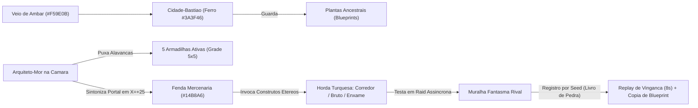

# Literatura, Universo e UX Writing — A MURALHA / WALLBREAKER

> **Versão:** 1.0 · **Escopo:** Bíblia narrativa e guia de micro-texto (P1 congelada; ganchos narrativos para P2+).  
> **Alinhamento:** [`gdd-muralha.md`](gdd-muralha.md) · [`s8-plano-visual.md`](s8-plano-visual.md) · [`VisualTheme.luau`](../src/shared/visual/VisualTheme.luau)

---

## 1. Premissa Central & Justificativa Diegética Zero-Avatar

### A Fantasia do Arquiteto-Mor

> **"Você não controla um herói. Você é a própria Muralha."**

No mundo de **A MURALHA** (`WALLBREAKER`), os senhores da guerra nunca pisam no pátio de lama. O jogador encarna um **Arquiteto-Mor da Ordem do Âmbar** — um mestre de cerco invisível que governa sua fortaleza de dentro da **Câmara de Alavancas** no topo do torreão central. Tudo o que existe entre o trono de pedra e as fendas do horizonte são cinco corredores de terra batida (`r1`–`r5`), vinte e cinco encaixes de fundação (`5×5`, de `c1` junto ao portão até `c5` perto do portal), sinos de alarme, roldanas de ferro e estandartes que mudam de cor conforme o cerco aperta.

Quando o botão **DEFENDER** surge na tela aos `1,5s` do *drop-in*, o jogador não controla um guerreiro dando espadadas: ele puxa a **Alavanca Mestra da Catapulta** na vigia superior. Quando uma armadilha dispara, são suas engrenagens, cordas e contrapesos respondendo à sua planta de engenharia.

### Mapeamento Diegético da Interface

| Elemento da Câmara / Arena | Função na Ficção do Arquiteto | Equivalente no Produto / HUD |
|---|---|---|
| **Câmara de Alavancas** | Sala blindada onde o Arquiteto opera polias, trancas e contrapesos. | HUD inferior de cartas e botão `DEFENDER` (zero avatar no pátio). |
| **Sino de Vigia (`HP < 30%`)** | Badalada grave que ecoa pelas vigas quando o portão começa a ceder. | Batimento sonoro da muralha + alerta visual vermelho (`#E4572E`). |
| **Estandarte do Torreão** | Bandeira hasteada sobre o portão anunciando o Comandante de plantão. | Placa/brasão do Comandante equipado + timbre das falas curtas. |
| **Livro de Pedra** | Registro mecânico de cada impacto por `seed` e `simVersion`. | Replay determinístico de 8s no login + botão **GRAVAR CLIPE**. |

### Por que a Ausência de Avatar Sustenta Produto e Negócio

A decisão técnica congelada de **zero avatar visível** (`CharacterAutoLoads = false` e câmera isométrica fixa em diorama) não é economia escondida — é a própria coluna vertebral da imersão e da viabilidade econômica do projeto:

1. **Custo de arte 70% menor:** Sem boneco controlável, não há orçamento drenado em *rigs* humanos, chapéus, roupas ou animações de corrida. Todo esforço visual vai para a leitura das 5 armadilhas, das 3 silhuetas inimigas e da destruição física do diorama.
2. **Legibilidade imediata no mobile (`375×812`):** Um avatar correndo pelo campo obstruiria as células `rXcY` e disputaria atenção com os projéteis. Sem ele, o jogador entende o estado das 5 lanes em menos de 3 segundos.
3. **Alinhamento DevEx 18+ (`US$ 0,54 / 100 R$`):** Estratégia tática com humor mecânico conversa diretamente com o público **18–34 anos** (sem perder segurança **13+**), sustentando monetização ética via placas de muralha, efeitos de destruição para clipe, vozes de Comandante e slots de *Blueprint*.
4. **Identidade pelo que você constrói:** Seu "avatar social" no jogo é a sua **planta 5×5**, seu **brasão de Comandante** e a forma espetacular como sua muralha explode ou segura o cerco no replay de 8 segundos.

---

## 2. Tom Estético-Narrativo: *Tactical Toy-War / Comic-Macabre*

O tom de **A MURALHA** une a leitura instantânea de miniaturas táticas (*Clash*), o prazer engenhoso de montar corredores mortais (*Orcs Must Die!*) e a comédia física exagerada de **"Tom & Jerry com catapultas"**:

- **Violência de Marcenaria, Nunca Carnificina:** Inimigos derrotados não sangram. Eles estilhaçam em lascas de madeira, parafusos saltando, molas retorcidas, nuvens de cal e faíscas turquesa. O resultado é **13+ seguro** e **18–34 atraente**.
- **Peso de Brinquedo Gigante:** Armadilhas parecem maquetes robustas de madeira de lei (`#8B5A2B`), ferro batido (`#3A3F46`) e placas de pergaminho (`#F5E6C8`). No *slow motion* de `0,3s` da salva inicial, a câmera treme, os alvos voam em parábola cômica e a poeira sobe em tufos grandes.
- **Dramaturgia da Ruína:** Perder não gera punição frustrante (nível de armadilha nunca é destruído; derrota só afeta pontos de liga). Ao logar, a muralha está fumegando e o relatório aponta com malícia em qual lane o rival entrou.
- **Clipe de 8 Segundos como Palco:** Todo impacto visual foi pensado para gerar micro-histórias compartilháveis — a catapulta limpando uma lane inteira no último segundo ou um bruto derrubando o portão por 1% de HP.

### Guia Editorial Rápido (Sim vs. Não)

| Fazer (Identidade da Muralha) | Evitar (Quebra de Tom ou Regra) |
|---|---|
| Lascas de madeira, engrenagens voando, fumaça densa, capacetes girando. | Sangue, ossos realistas, gritos de agonia ou *gore*. |
| Humor seco de engenheiro, provocação de taberna, jargão de cerco. | Fantasia épica prolixa, monólogos de lore, termos de RPG genéricos. |
| Silhuetas exageradas e contraste quente × frio legível a `200 px`. | Detalhes microscópicos, poluição de texto flutuante (`BillboardGui`). |
| Frases que apontam **causa e ação** ("Lane 4 cedeu. Vingar?"). | Textos de tutorial passivos explicando controles óbvios. |

---

## 3. Cosmologia e Assimetria das Duas Cores

### Cidades-Bastião do Âmbar vs. As Fendas Mercenárias

O mundo é formado por vales murados onde **Cidades-Bastião** rivais disputam **Plantas Ancestrais** (*Blueprints*) sem jamais marchar em carne e osso até a porta do vizinho:

- **Cidades-Bastião do Âmbar (`#F59E0B` / Ferro `#3A3F46`):** Erguidas sobre **Veios de Âmbar**, essas fortalezas canalizam energia mineral quente para tensionar arcos, aquecer caldeirões de breu e girar engrenagens de ferro. Tudo o que defende o portão veste **tons quentes de forja, madeira e latão**.
- **As Fendas Mercenárias (`#14B8A6` Turquesa):** Nenhuma guilda arrisca seus próprios engenheiros em terreno inimigo. Em vez disso, os Arquitetos sintonizam **Portais de Cerco** (`X = +25`) para invocar construtos etéreos de névoa turquesa — mercenários descartáveis moldados para testar plantas rivais e extrair cópias de *Blueprints* durante os **3 Grandes Saques** diários.
- **As Muralhas Fantasmas (Combate Assíncrono):** Quando você lança uma *raid*, a fenda projeta a **Muralha Fantasma** de outro jogador a partir do registro dela no servidor. Você enfrenta a engenharia real de um rival enquanto ele dorme, e o **Livro de Pedra** envia o replay determinístico de volta para o dono da muralha assistir quando acordar.

### Os Três Construtos da Fenda (Leitura Visual em `VisualTheme.luau`)

| Construto | Código | Silhueta e Papel Diegético | Reação Cômica na Derrota |
|---|---|---|---|
| **Corredor** | `runner` | Batedor esguio de turquesa vivo (`0.85×`); corre para testar o tempo de recarga das primeiras células. | Derrapa no piche e se desfaz em estilhaços leves de quartzo turquesa. |
| **Bruto** | `brute` | Ariete ambulante escuro (`1.35×`); feito de pedra etérea compacta para absorver fogo de canhão. | Desaba como estátua oca, soltando fumaça pelas rachaduras antes de sumir. |
| **Enxame** | `swarm` | Pacote ágil de mini-construtos claros (`0.65×`); tenta passar pelos intervalos entre disparos lentos. | Espalha dezenas de faíscas turquesa como peças de dominó caindo juntas. |

### Glossário Canônico (Localização PT-BR / EN / ES)

| Termo Oficial (PT-BR) | Equivalente (EN) | Equivalente (ES) | Significado no Universo | Evitar Usar |
|---|---|---|---|---|
| **Arquiteto-Mor** | *Master Siege-Architect* | *Arquitecto Mayor* | O jogador operando da Câmara de Alavancas. | "Herói", "Avatar", "Comandante" (para o jogador) |
| **Cidade-Bastião** | *Amber Bastion* | *Ciudad Bastión* | Fortaleza do jogador erguida sobre veio de âmbar. | "Vila", "Base espacial", "Ilha" |
| **Fenda Mercenária** | *Mercenary Rift* | *Grieta Mercenaria* | Portal turquesa em `X = +25` que conjura hordas. | "Portal demoníaco", "Inferno" |
| **Muralha Fantasma** | *Phantom Wall* | *Muralla Fantasma* | Projeção assíncrona da planta de um rival no servidor. | "Bot", "Clone morto" |
| **Livro de Pedra** | *Stone Ledger* | *Libro de Piedra* | Registro determinístico (`seed` + `simVersion`) do replay. | "Vídeo gravado", "Câmera" |
| **Grande Saque** | *Grand Plunder* | *Gran Saqueo* | Um dos 3 saques diários que rendem fragmento de *Blueprint*. | "Baú pago", "Loot box" |

---

## 4. Elenco de Comandantes (Personas de Voz e Estandarte)

Os Comandantes representam as grandes escolas de engenharia do vale. Eles falam diretamente pela **corneta acústica da Câmara de Alavancas**, estampam seu brasão no topo do portão e assinam os relatórios matinais de batalha.

> [!IMPORTANT]
> **Política Estética de Monetização (P1 congelada / P2+):** Comandantes pagos (**199–299 R\$**) são **estritamente cosméticos** (visual de placa/estandarte, timbre e linhas de voz). Qualquer passiva tática ou doutrina de gameplay pertence exclusivamente às **Doutrinas Sazonais gratuitas desbloqueáveis por jogo na P2+**, preservando a regra de ouro: **nenhuma vantagem vendida por Robux**.

| ID | Nome / Título | Facção / Afinidade | Fantasia Tática | Brasão | `raid_start` (≤8 palavras) | `wall_hp<30%` (≤8 palavras) | `gate_breach` (≤8 palavras) | `clean_defense` (≤8 palavras) |
|---|---|---|---|---|---|---|---|---|
| `cmd_vorn` | **Mestre Artilheiro Vorn** | Liga da Bigorna (Âmbar Clássico) | Veterano de pólvora e contrapeso; ama impacto pesado e risada rouca. | Canhão cruzado sobre escudo de ferro | `"Pólvora seca! Ajustem o ângulo das cinco trilhas!"` | `"Ferro range, mas não dobra! Segurem a linha!"` | `"Argh! Quem deixou o ferrolho solto na tranca?!"` | `"Limpo! Nem poeira turquesa sobrou no tapete!"` |
| `cmd_brasa` | **Engenheira Brasa-Piche** | Oficina da Caldeira (Fogo & Atrito) | Inventora caótica que mede vitória pelo cheiro de breu torrado. | Caldeirão derramando gota âmbar em brasa | `"Breu fervendo! Vamos assar esses fantasmas na entrada!"` | `"Fumaça no salão! Mais lenha nas engrenagens!"` | `"Vazaram! Minha oficina vai virar sucata de brinquedo!"` | `"Fritura perfeita! Anotem a receita dessa planta!"` |
| `cmd_astrid` | **Vigia Boreal Astrid** | Torre do Granizo (Controle & Gelo) | Escrivã gelada de cronômetro na mão; trata cerco como cálculo exato. | Cristal azul-gelo partido por seta reta | `"Cronômetro ligado. Congelem o passo antes da curva."` | `"Integridade crítica. Reduzam o avanço na trilha."` | `"Falha estrutural confirmada. Registrem o ponto exato."` | `"Zero avarias. Eficiência máxima documentada no livro."` |
| `cmd_cerbero` | **Marechal Cérbero** | Guarda do Portão (Disciplina & Vingança) | General de bigode de ferro que transforma cada derrota em dívida pessoal. | Três elos de corrente mordendo uma torre | `"Sem piedade! Cada centímetro custa caro hoje!"` | `"Portão gemendo! Ninguém recua um único prego!"` | `"Anotem esse nome! Vingança sai antes do sol!"` | `"Muralha intacta! Que aprendam a bater na porta!"` |
| `cmd_kael` | **Arauto da Fenda Kael** | Pacto Turquesa (Mercenário de Portal) | Negociante cínico que traduz a energia da fenda e ironiza ambos os lados. | Portal partido em dois semicírculos turquesa | `"Fenda aberta! Vamos ver quanto vale sua pedra!"` | `"A maquete está rachando... adoro o som!"` | `"Belo buraco! Copiamos a planta e saímos rindo!"` | `"Nada mal! A fenda saiu de bolso vazio."` |

### Direção de Entrega das Falas

- **Regra dos 8 vocábulos:** Toda linha de voz deve caber em um balão compacto no canto superior sem cobrir as células `c1`–`c2` da grade `5×5`.
- **Frequência controlada:** Máximo de 1 fala no início da onda, 1 em `wall_hp < 30%` (junto ao batimento sonoro do portão) e 1 no desfecho (`gate_breach` ou `clean_defense`), evitando poluição sonora em *4x fast-forward*.

---

## 5. Guia de Micro-Literatura & UX Writing (Regra `<60s`)

No celular (`375×812`), parede de texto é abandono garantido entre 61s e 180s. Todo texto de UI segue três leis: **verbo mecânico primeiro**, **zero adjetivo vazio** e **máximo de 60 caracteres no texto de sabor**.

### 5.1 Cartões de Armadilha (P1 Ativas + Teasers P2)

#### Catálogo Congelado da P1 (`TrapCatalog.luau` · `contentVersion 2`)

| `trap_id` | Nome na UI | Liga | Verbo Mecânico Direto | Flavor Text (estrito `≤ 60` caracteres) |
|---|---|---|---|---|
| `archer` | **ARQUEIRO** | 1 | **Dispara** flechas rápidas na lane. | `"Madeira tensionada, flecha barata e zero piedade."` *(49)* |
| `tar` | **PICHE** | 2 | **Retarda** a horda no piso. | `"Breu quente que transforma corrida em passo de lesma."` *(53)* |
| `frost` | **GELO** | 3 | **Congela** avanço e cadência inimiga. | `"Vento engarrafado para esfriar horda apressada."` *(48)* |
| `cannon` | **CANHÃO** | 4 | **Explode** o alvo com recuo alto. | `"Quando sutileza falha, ferro redondo resolve."` *(45)* |
| `catapult` | **CATAPULTA** | 5 | **Esmaga** grupo em área na pista. | `"Lança pedregulhos do tamanho da sua teimosia."` *(46)* |

#### Teasers de Expansão Futura (P2+ · Não existem no `TrapCatalog` nem em `core.luau`)

> [!NOTE]
> Os itens abaixo são **conceitos narrativos para P2+** e exigem RFC de conteúdo (`CONTENT_VERSION++` / `SIM_VERSION++`) e teste de kit em `tools/expansion-test/` antes de entrar no código de produção.

| Codinome P2+ | Nome Sugerido | Verbo Mecânico Direto | Flavor Text (estrito `≤ 60` caracteres) |
|---|---|---|---|
| `spring_pad` *(teaser)* | **MOLA DE BÁSCULA** | **Arremessa** invasor para trás. | `"Devolve visita indesejada para a fila do portal."` *(48)* |
| `amber_coil` *(teaser)* | **BOBINA DE ÂMBAR** | **Eletrocuta** alvos em cadeia. | `"Choque compartilhado: ninguém fura fila sozinho."` *(48)* |
| `ram_gate` *(teaser)* | **ARÍETE DE CONTRA-GOLPE** | **Empurra** brutos na última célula. | `"Porta que bate de volta em quem esqueceu a chave."` *(50)* |

### 5.2 Relatórios de Login ("Muralha Fumegando")

Exibidos na entrada da sessão junto ao replay de 8s para converter curiosidade passiva em clique imediato de **VINGAR** ou **MELHORAR**:

1. **Derrota noturna rápida:** `"Portão trincado às 03h: Horda de [Rival] vazou na Lane [Lane]. Vingar?"`
2. **Ruptura por enxame:** `"Enxame de [Rival] furou seu bloqueio em [Tempo]s. Sua muralha pede reforço!"`
3. **Quase-vitória amarga:** `"Faltou 1 disparo: [Rival] levou seu estandarte com [HP]% de portão restante."`
4. **Defesa limpa (orgulho):** `"Muralha intacta! [Rival] bateu na Lane [Lane] e voltou sem um prego."`
5. **Defesa tripla na madrugada:** `"[Qtd] cercos barrados enquanto você dormia. Colete seu ouro de vigília!"`
6. **Choque de vingança:** `"[Rival] devolveu o troco na sua planta antiga. Ajustar a grade 5×5?"`

> **Variáveis dinâmicas e origem no perfil:**
> - `[Rival]` (apelido público sanitizado em runtime via exibição segura, nunca persistido em claro no DataStore), `[Lane]` (`1`–`5`), `[Tempo]` (segundos inteiros da ruptura: `math.floor(ticks / 20)`), `[HP]` (`math.floor(wallHp * 100 / wallMax)`).
> - `[Qtd]` e `[Tempo]` agregado no login: na **P1 (`schema v2`)**, usa apenas o último `BattleLog` consultado localmente (ou suprime o template #5 quando não houver inbox); na **P2 (`schema v3`)**, lê `profile.inbox.unreadDefenses` e `profile.inbox.lastBreachSec` (zerados ao abrir a tela de relatório, conforme [`rfcs-p2-e-fechamento-gaps.md`](rfcs-p2-e-fechamento-gaps.md#3-rfc-002--profileschema-v3-battlelog-estendido--core-v4-gap-004--gap-016)).

### 5.3 Arcos de Crônicas Sazonais

Cada temporada batiza molduras de liga, estandartes e desafios diários sem complicar o loop central:

| Temporada | Arco / Tema | Premissa Narrativa | Foco de Produto & Recompensas |
|---|---|---|---|
| **Temporada 1** | **A Fundação de Ferro** | As primeiras Cidades-Bastião erguem suas muralhas sobre os Veios de Âmbar e selam o Pacto do Livro de Pedra. | Validação solo (`5×5`), domínio das 5 armadilhas-base e cultura do replay de vingança. |
| **Temporada 2** | **Inverno da Fenda** | Uma frente fria congela as fronteiras do vale; fendas turquesa cospem ondas mais densas que punem corredores mal protegidos. | Estreia da liga semanal, loja cosmética completa, efeitos de destruição de gelo e doutrinas gratuitas (P2). |
| **Temporada 3** | **Engrenagens Gêmeas** | Dois Arquitetos-Mores acoplam plantas em uma **Muralha Compartilhada** — metade esquerda, metade direita, ouro conjunto e culpa dividida no relatório. | Estreia da **Dupla Assíncrona (P3)**: edição alternada e replay apontando qual lado cedeu primeiro. |

### 5.4 Quick-Chat Curado (Zero Texto Livre)

Para proteger jogadores 13+ e eliminar moderação pesada sem abrir mão da zoeira entre rivais e parceiros, toda interação usa exclusivamente **8 frases pré-aprovadas**:

| Código | Frase Curada | Contexto de Uso | Tom |
|---|---|---|---|
| `qc_nice_wall` | `"Bela muralha! Quebra-cabeça duro."` | Pós-raid / Replay | Respeito tático |
| `qc_revenge_coming` | `"Anota aí: a vingança já está no forno!"` | Botão Vingar / Relatório | Provocação leve |
| `qc_lane_oops` | `"Lane errada... deixei o portão aberto!"` | Replay / P3 Dupla | Autodepreciação |
| `qc_close_call` | `"Por um fio de cabelo de arqueiro!"` | Vitória/derrota apertada | Tensão cômica |
| `qc_your_side` | `"O lado direito aguentou — olha o esquerdo!"` | P3 Dupla Assíncrona | Zoeira cooperativa |
| `qc_upgrade_now` | `"Hora de reforçar essa trilha juntos!"` | P3 Dupla Assíncrona | Coordenação rápida |
| `qc_great_clip` | `"Esse voo de catapulta mereceu clipe!"` | Pós-clipe 8s | Orgulho / Viral |
| `qc_gg_architect` | `"Bom cerco, Arquiteto!"` | Encerramento neutro | Esportividade |

> **Contrato de Rede & Anti-Abuso (P2/P3):**
> - **Remote:** `ReplicatedStorage.MuralhaRemotes.QuickChatEvent` (`RemoteEvent` cliente→servidor).
> - **Payload:** `{ code: string, battleId: string? }` — servidor valida `code` contra a whitelist estrita das 8 chaves `qc_*` (qualquer outra string é descartada) e verifica `TextChatService:CanUsersChatAsync` quando direcionado a um rival/parceiro.
> - **Rate Limit:** *token bucket* server-side de no máximo **3 mensagens a cada 10 s** com *cooldown* mínimo de **2 s** entre envios.
> - **Telemetria (`RFC-003`):** emite `quickchat_sent` com `{ code, context }` (sem texto livre e sem `UserId`).

### 5.5 Orçamento de Caracteres na UI Mobile (`375×812`)

| Superfície | Limite Estrito | Regra de Redação | Exemplo Aprovado |
|---|---|---|---|
| Botão de Ação (`CTA`) | `≤ 12` caracteres | Verbo no infinitivo ou imperativo seco. | `"DEFENDER"`, `"VINGAR"`, `"MELHORAR"` |
| Toast de Drop-in (`5s`) | `≤ 36` caracteres | Número + ganho direto, sem frase completa. | `"+3 ouro · Armadilha pronta"` |
| Verbo de Cartão | `≤ 38` caracteres | Ação mecânica imediata + alvo. | `"Retarda a horda no piso."` |
| Flavor de Cartão | `≤ 60` caracteres | Imagem física curta; nunca explica matemática. | `"Quando sutileza falha, ferro redondo resolve."` |
| Fala de Comandante | `≤ 8` palavras | Tom vocal imediato; zero bloco multi-linha. | `"Pólvora seca! Ajustem o ângulo das cinco trilhas!"` |

### 5.6 Checklist Rápido de Aprovação Editorial

Antes de adicionar qualquer nova linha de texto à UI ou a pacotes sazonais, validar 4 critérios:

1. **Regra dos 3 Segundos:** A mensagem comunica ação ou consequência sem exigir leitura de parágrafo?
2. **Alinhamento Cromático e Zero-Avatar:** O texto trata o jogador como **Arquiteto** (não herói de espada) e respeita **Âmbar/Ferro** vs. **Fenda Turquesa**?
3. **Sem Gatilho Tóxico ou Falso P2W:** Nenhuma promessa de poder pago, zero texto livre não moderado e zero culpa punitiva permanente.
4. **Paridade PT-BR / EN / ES:** A frase cabe na caixa mobile tanto em `A MURALHA` quanto em `WALLBREAKER` e `LA MURALLA` sem quebrar em três linhas?
