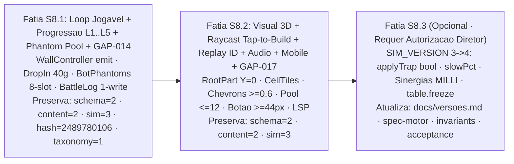

# Plano de Implementação — Playtest V1 (S8.1 · S8.2 · S8.3)

> **Escopo:** Runbook técnico sem brechas para entregar **"Playtest Bonito, Profundo e Jogável"** em **MURALHA**, fechando `GAP-014` (`AUD-01..06`) e `GAP-017` (`AUD-08, AUD-11`) sem violar nenhum contrato congelado da P1.
> **Regra de congelamento:** **S8.1** e **S8.2** mantêm `schema=2`, `content=2`, `sim=3`, `hash=2489780106`, `taxonomy=1`. **S8.3** (`SIM_VERSION=4`) exige **autorização explícita do diretor**.

---

## 1. Arquitetura, Fatiamento e Armadilhas Fatais



> [!CAUTION]
> **Armadilhas Fatais Verificadas no Código**
> 1. **`ProfileSchema.luau` (`checkForeignKeys`, L194, L269–321):** `profile.league` aceita **apenas** `{ points, season }` (NÃO existe campo `tier`; compute sempre `TrapCatalog.leagueOf(points) = 1 + math.floor(points / 100)` via `TrapCatalog.luau:48-53`). `profile.stats` aceita **apenas** `{ raids, defenses, wins, sessions, playSeconds, firstSeenAt, lastSeenAt }` (NÃO grave `losses` nem `tutorialCompleted` — a whitelist rejeita o perfil no boot).
> 2. **`AnalyticsTypes.luau` v1 congelada (L136–228, L284–295):** NÃO existem `trap_removed`, `raid_started` ou `raid_finished`. Os nomes reais são `raid_start` e `raid_end`; `WallService.remove` (`WallService.luau:356-376`) retorna `events = {}`. Enums exatos: `gold_earned.source = "raid" | "defense" | "daily"` (L201) e `gold_spent.sink = "trap" | "upgrade" | "repair"` (L207).
> 3. **`scripts/check.sh` `luau-lsp` (L24, L63):** Hoje `luau-lsp analyze` roda `--platform=standard` só em Luau puro e **antes** de `rojo sourcemap`. Para validar `src/client/**` e `*Controller.server.luau`, execute `rojo sourcemap` **antes** do `luau-lsp` e adicione um segundo passe com `--platform=roblox --sourcemap=sourcemap.json --definitions=vendor/globalTypes.d.luau src` (fornecendo `vendor/globalTypes.d.luau`).

---

## 2. Fatia S8.1 — Loop Jogável, Progressão L1..L5 & GAP-014

### S8.1.1 Telemetria de Construção em `WallController` (`src/server/walls/WallController.server.luau:75-81`)
Em `WallController.server.luau:75-81`, `WallService.new` não recebe o callback `emit`, fazendo `trap_placed`, `upgrade_bought` e `gold_spent` nunca chegarem ao `AnalyticsService` em produção (`AUD-02`):

```lua
-- src/server/walls/WallController.server.luau (L75-81)
local ok, service = pcall(function()
	return WallService.new({
		profile = session.Data,
		schema = ProfileSchema,
		catalog = TrapCatalog,
		emit = function(name: string, props: { [string]: any })
			AnalyticsService.emit(player, name, props)
		end,
	})
end)
```

### S8.1.2 Corrida do Drop-In & Grant Único de 40g (`DropInController.server.luau:119-139, 152-185, 207-209`)
- **Correção de corrida (`AUD-03`, `logShown` L131–139):** Chamar `AnalyticsService.emit(player, "dropin_shown", props)` **antes** de atribuir `session.shownLogged = true`. Se retornar `err == "no_session"`, manter `session.shownLogged = false` para tentar novamente no próximo `snapshotFor` (L207–209):
  ```lua
  local function logShown(session: any, player: Player, msSinceJoin: number): ()
  	local props, err = DropInTelemetry.shownProps(msSinceJoin)
  	if props == nil then
  		warn("[dropin] shown props invalidas: " .. tostring(err))
  		return
  	end
  	local event, emitErr = AnalyticsService.emit(player, "dropin_shown", props)
  	if event ~= nil then
  		session.shownLogged = true
  	elseif emitErr == "not_started" then
  		session.shownLogged = true
  		print(DropInTelemetry.format("dropin_shown", props))
  	elseif emitErr ~= "no_session" then
  		warn("[dropin] analytics dropin_shown recusado: " .. tostring(emitErr))
  	end
  end
  ```
- **Grant único de 40g no clear (`AUD-05`, `winner == "defender"` L152–185, L215):** Substituir `REWARD_GOLD = 3` (que repetia em todo join de veterano e não comprava a 1ª armadilha `archer = 40g`) por:
  ```lua
  if profileSession.Data.stats.defenses == 0 then
  	profileSession.Data.stats.defenses = 1
  	local result, err = service.creditGold(40, "defense", nil)
  	if result == nil then
  		warn("[dropin] starter grant recusado: " .. tostring(err))
  		return false
  	end
  end
  ```
- **Justificativa anti-exploit:** (1) Luau no servidor executa em *single-thread* cooperativo sem nenhum `task.wait` entre o teste `stats.defenses == 0` e a escrita `stats.defenses = 1`; (2) `ProfileStore` garante lock exclusivo da sessão em `MuralhaProfile_v1` entre servidores; (3) `stats.defenses` está ocioso no código atual (`0` em todo perfil novo); (4) compatível com `schema=2` (`defenses` já consta em `STATS_FIELDS`). Atualizar `sim/dropin-contract.luau`.

### S8.1.3 `PhantomStore` 8 Slots/Liga sem PII + `BotPhantoms.luau` (`AUD-01`, `AUD-06`)
1. **`src/server/raid/PhantomStore.luau`:** Remover `KEY = "latest"` (L9) e o campo `ownerName` (L27–32). Implementar sharding por liga em 8 slots:
   ```lua
   PhantomStore.SLOTS_PER_LEAGUE = 8
   function PhantomStore.slotKey(league: number, slot: number): string
   	return string.format("L%d_S%d", math.clamp(league, 1, 5), ((slot - 1) % 8) + 1)
   end
   -- put(snapshot): grava em slot = (userId % 8) + 1 usando PhantomStore.slotKey(snapshot.league, slot)
   -- getForLeague(league, excludeHash): tenta ate 2 slots aleatorios 1..8; ignora se value.ownerHash == excludeHash
   ```
   - **Payload livre de PII:** `{ ownerHash: string, league: number, hp: number, traps: { BattleTrap }, contentVersion: number, updatedAt: number }`, com `ownerHash = string.format("%08x", bit32.bxor(player.UserId, 0xA5A55A5A))` — elimina `ownerName` e `ownerId` em claro do DataStore.
2. **Novo módulo puro `src/shared/raid/BotPhantoms.luau`:** 10 muralhas curadas (2 por Liga `1..5`, `hp = 500`) + `BotPhantoms.pick(league: number, seed: number)`:
   ```lua
   local POOLS = {
   	[1] = { -- L1: calibrada para first_win_seconds < 60s
   		{ hp = 500, traps = { { cell = "r3c3", type = "archer", level = 1 } } },
   		{ hp = 500, traps = { { cell = "r2c3", type = "archer", level = 1 }, { cell = "r4c3", type = "archer", level = 1 } } },
   	},
   	[2] = { -- L2: archer + tar
   		{ hp = 500, traps = { { cell = "r2c3", type = "archer", level = 1 }, { cell = "r3c2", type = "tar", level = 1 } } },
   		{ hp = 500, traps = { { cell = "r1c3", type = "archer", level = 1 }, { cell = "r3c3", type = "tar", level = 1 }, { cell = "r5c3", type = "archer", level = 1 } } },
   	},
   	[3] = { -- L3: archer + tar + frost
   		{ hp = 500, traps = { { cell = "r2c3", type = "archer", level = 2 }, { cell = "r3c2", type = "tar", level = 1 }, { cell = "r4c3", type = "frost", level = 1 } } },
   		{ hp = 500, traps = { { cell = "r1c2", type = "frost", level = 1 }, { cell = "r3c3", type = "archer", level = 2 }, { cell = "r4c2", type = "tar", level = 1 } } },
   	},
   	[4] = { -- L4: cannon L1-L2
   		{ hp = 500, traps = { { cell = "r2c2", type = "cannon", level = 1 }, { cell = "r3c3", type = "frost", level = 1 }, { cell = "r4c2", type = "tar", level = 1 } } },
   		{ hp = 500, traps = { { cell = "r1c3", type = "archer", level = 2 }, { cell = "r3c2", type = "cannon", level = 2 }, { cell = "r5c3", type = "frost", level = 1 } } },
   	},
   	[5] = { -- L5: Core.defaultWall() + catapult L2 / cannon L2 / tar L2
   		-- Slot 1: Core.defaultWall() substituindo r3c1 por catapult L2 (ou adicionando conforme limite N=5)
   		{ hp = 500, traps = { { cell = "r1c2", type = "archer", level = 2 }, { cell = "r2c2", type = "frost", level = 2 }, { cell = "r3c1", type = "catapult", level = 2 }, { cell = "r4c2", type = "tar", level = 2 }, { cell = "r5c2", type = "cannon", level = 2 } } },
   		{ hp = 500, traps = { { cell = "r1c2", type = "cannon", level = 2 }, { cell = "r2c2", type = "tar", level = 2 }, { cell = "r3c1", type = "catapult", level = 2 }, { cell = "r4c2", type = "frost", level = 2 }, { cell = "r5c3", type = "archer", level = 2 } } },
   	},
   }
   function BotPhantoms.pick(league: number, seed: number)
   	local pool = POOLS[math.clamp(league, 1, 5)]
   	return pool[(math.abs(seed) % #pool) + 1]
   end
   ```
   *(Na L5 Slot 1, manter paridade com `Core.defaultWall()` + `catapult L2` / `cannon L2` / `tar L2` dentro do teto `ACTIVE_TRAP_LIMIT = 5`.)*
3. **`src/server/raid/RaidController.server.luau:216-232`:** Calcular `myLeague = TrapCatalog.leagueOf(profile.league.points)`, publicar `currentSnapshot` no slot do jogador e buscar oponente via `phantomStore.getForLeague(myLeague, myHash)`. Se retornar `nil`, usar `BotPhantoms.pick(myLeague, seed)`. **Proibido** `target = currentSnapshot` (auto-raid eliminado).

### S8.1.4 `BattleLogStore` em Escrita Única + Economia & Elo Calibrados (`RaidController.server.luau:289-360`)
- **Cálculo de recompensa, fadiga e consolação (ANTES de gravar o BattleLog):**
  ```lua
  local baseGold = 15 + 3 * targetLeague -- L1=18, L2=21, L3=24, L4=27, L5=30
  local raidsNow = profile.stats.raids
  local fatiguePct = if raidsNow < 10 then 100 elseif raidsNow < 25 then 50 else 25
  local winGold = math.max(5, math.floor(baseGold * fatiguePct / 100))
  local rewardGold = if result.winner == "attacker" then winGold elseif raidsNow < 3 then 5 else 0
  ```
- **Atualização de `stats` e Elo por liga:**
  ```lua
  local oldPoints = profile.league.points
  local oldLeague = TrapCatalog.leagueOf(oldPoints)
  profile.stats.raids += 1
  local newPoints = oldPoints
  if result.winner == "attacker" then
  	profile.stats.wins += 1
  	newPoints = oldPoints + 25 -- 4 vitorias = 100 pts -> Liga 2 (desbloqueia tar)
  elseif oldLeague >= 3 then
  	newPoints = math.max((oldLeague - 1) * 100, oldPoints - 10) -- piso protege traps desbloqueadas
  end
  profile.league.points = newPoints
  local newLeague = TrapCatalog.leagueOf(newPoints)
  if newLeague ~= oldLeague then
  	logEvent(player, "league_changed", { from = oldLeague, to = newLeague, delta = newPoints - oldPoints })
  end
  ```
- **Escrita única no `BattleLogStore`:** Creditar `rewardGold` via `creditRaid(player, battleId, rewardGold)` **antes** de `logStore.put(record)`, construindo o registro já com `rewarded = true` e `rewardGold = creditedGold`. Remove `logStore.markRewarded` (L336) e elimina o segundo `UpdateAsync` em `< 100ms` (violava o cooldown de 6s por chave).
- **Testes de contrato (`sim/raid-contract.luau`):** Cobrir curva de fadiga (`<=10 / 11..25 / 26+` e piso `5g`), consolação (`raids < 3`), Elo (`+25` / `-10` com piso de liga em `L >= 3`), `BotPhantoms.pick` nas 5 ligas e ausência de `ownerName`/auto-raid.

### S8.1.5 Normalização de Locale LATAM (`AnalyticsBoot.server.luau:66-74`)
Em `src/server/analytics/AnalyticsBoot.server.luau`, `normalizeLocale` atualmente exige `^(%a%a)[-_](%a%a)$` (`5` chars exatos para `AnalyticsTypes.isLocale`), fazendo com que clientes `es-419` (Espanhol LATAM da Roblox) caiam no fallback `"pt-BR"`:
```lua
local function normalizeLocale(raw: any): string
	if type(raw) == "string" then
		local lower = string.lower(raw)
		local language, region = string.match(lower, "^(%a%a)[-_](%a%a)$")
		if language ~= nil and region ~= nil then
			return language .. "-" .. string.upper(region)
		end
		if lower == "es-419" or string.sub(lower, 1, 2) == "es" then
			return "es-MX"
		elseif string.sub(lower, 1, 2) == "en" then
			return "en-US"
		elseif string.sub(lower, 1, 2) == "pt" then
			return "pt-BR"
		end
	end
	return "pt-BR"
end
```
Preserva `AnalyticsTypes` v1 congelada (`str(5, "locale")`) enquanto garante segmentação real de jogadores em `es-*` e `en-*`.

---

## 3. Fatia S8.2 — Visual 3D, Raycast Tap-to-Build, Áudio, Replay & Mobile (`GAP-017`)

### S8.2.1 Correção do Afundamento 3D (`HordeKit`, `TrapKit`, `DropInClient`, `RaidClient`)
- **Topos reais de piso (`ArenaVisual.luau`):**
  - `Lane_1..5` (L205–206): centro `Y = 0.25`, espessura `0.16` → **`floorTopY = 0.33`**.
  - `DropInPath` (L396–397): centro `Y = 0.33`, espessura `0.12` → **`floorTopY = 0.39`**.
- **Causa raiz:** `HordeKit` definia `model.PrimaryPart = body` (`Y = 1.15` no `runner` L61; `Y = 1.75` no `brute` L110), e os clientes spawnam em `Y = 0.90` (`DropInClient:90,382`, `RaidClient:242,270`) antes de `model:ScaleTo(spec.scale * 1.8)` (`HordeKit:212`):
  - `runner` (`0.85 * 1.8 = 1.53`): pés descem `1.125 * 1.53 = 1.72` studs abaixo do `body` → afunda **`1.21` studs** em `DropInPath` (`0.39 - (0.90 - 1.721)`).
  - `brute` (`1.35 * 1.8 = 2.43`): pés descem `1.75 * 2.43 = 4.25` studs abaixo do `body` → afunda **`3.74` studs** em `DropInPath` (`0.39 - (0.90 - 4.252)`).
- **Correção exata em `HordeKit.luau`:**
  1. Criar `RootPart` invisível (`Size = Vector3.new(0.1, 0.1, 0.1)`, `CFrame = CFrame.new(0, 0, 0)`, `Transparency = 1`, `CanQuery = false`, `CanCollide = false`) no plano dos pés e atribuir `model.PrimaryPart = rootPart` **antes** de `model:ScaleTo(spec.scale * 1.8)` (mantendo `if descendant.Name ~= "RootPart"` no loop `Transparency = 0` em L215–218).
  2. Atualizar spawns/`setBase` para `floorTopY`: **`Y = 0.33`** em `RaidClient` (`Lane`) e **`Y = 0.39`** em `DropInClient` (`DropInPath`).
  3. Fundir `EyeL + EyeR` (L101–102, L151–152) em um único `Visor` Neon (`Vector3.new(0.54, 0.14, 0.16)` no `runner`; `0.72, 0.18, 0.18` no `brute`): reduz ambos de **9 → 8 partes**, cumprindo `VisualTheme.BUDGET.unitParts = 8`.
  ```lua
  -- HordeKit.luau: RootPart no plano dos pes (Y = 0) antes de ScaleTo
  local rootPart = makePart(model, "RootPart", Vector3.new(0.1, 0.1, 0.1), Vector3.new(0, 0, 0), Color3.new())
  rootPart.Transparency = 1
  rootPart.CastShadow = false
  model.PrimaryPart = rootPart
  -- ... montar partes ... -> model:PivotTo(cframe) -> model:ScaleTo(spec.scale * 1.8)
  -- No loop L215-218: if descendant:IsA("BasePart") and descendant.Name ~= "RootPart" then descendant.Transparency = 0 end
  ```
- **Correção exata em `TrapKit.luau`:**
  1. `catapult` (L259): subir `Wheel` de local `Y = 0.80` para **`Y = 1.05`** (`baseTop 0.30 + wheelRadius 0.75`).
  2. `TrapKit.sync` (L392): aceitar `floorTopY` opcional (default `0.33`; `0.39` no DropIn) e posicionar `Base` (`Size.Y = 0.3`, centro local `0.15`) em **`Y = floorTopY + 0.15`** (`0.48` em `Lane` / `0.54` em `DropInPath`):
  ```lua
  -- TrapKit.sync(parent, cells, origin, options)
  local floorTopY = if type(options) == "table" and type(options.floorTopY) == "number" then options.floorTopY else 0.33
  local target = CFrame.new(origin + Vector3.new(x, floorTopY + 0.15, z)) -- 0.48 Lane / 0.54 DropInPath
  ```

### S8.2.2 Raycast 3D Tap-to-Build (`ArenaVisual.luau` + `BuildClient.client.luau`)
- **`ArenaVisual.build` (`src/client/visual/ArenaVisual.luau`):** Criar pasta `MuralhaCellTiles` em `MuralhaArena` contendo as 25 peças `Cell_r{1..5}c{1..5}`:
  - `Size = Vector3.new(7.6, 0.05, 7.6)`, `CFrame = CFrame.new(origin + Vector3.new(x, 0.355, z))`, `Anchored = true`, `CanCollide = false`, `CanQuery = true`, `Transparency = 0.85`, `tile:SetAttribute("Cell", cell)`.
  - Criar `SelectionIndicator` (anel/borda em `#F59E0B`, `CanQuery = false`, `Transparency = 1` quando oculto) para destacar a célula em hover/seleção.
- **`BuildClient.client.luau`:** Ocultar `gridFrame` (`gridFrame.Visible = false`, mantendo `BuildLayout` e `BuildClientState` ativos para que `sim/build-contract.luau` 14/14 permaneça verde) e ligar raycast 3D com `TOUCH_SLOP_PX = 12`:

```lua
-- src/client/BuildClient.client.luau
local TOUCH_SLOP_PX = 12
local touchOrigin: Vector2? = nil
local rayParams = RaycastParams.new()
rayParams.FilterType = Enum.RaycastFilterType.Include
rayParams.FilterDescendantsInstances = { cellTilesFolder, trapModelsFolder }

local function cellFromHit(inst: Instance?): string?
	local cur = inst
	while cur ~= nil do
		local attr = cur:GetAttribute("Cell")
		if type(attr) == "string" then return attr end
		if cur:IsA("Model") and string.sub(cur.Name, 1, 5) == "Trap_" then
			return string.sub(cur.Name, 6)
		end
		cur = cur.Parent
	end
	return nil
end

local function onTap3D(screenPos: Vector2): ()
	local ray = camera:ViewportPointToRay(screenPos.X, screenPos.Y)
	local result = Workspace:Raycast(ray.Origin, ray.Direction * 500, rayParams)
	local cell = if result ~= nil then cellFromHit(result.Instance) else nil
	if cell == nil then
		if state.mode == "upgrade" or state.mode == "remove" then
			BuildClientState.setMode(state, "place")
			updateModeButtons(); refreshSelection()
		end
		return
	end
	onCell(cell)
end

UserInputService.InputBegan:Connect(function(input: InputObject, processed: boolean)
	if processed then return end
	if input.UserInputType == Enum.UserInputType.Touch or input.UserInputType == Enum.UserInputType.MouseButton1 then
		touchOrigin = Vector2.new(input.Position.X, input.Position.Y)
	end
end)
UserInputService.InputEnded:Connect(function(input: InputObject, processed: boolean)
	if processed or touchOrigin == nil then return end
	if input.UserInputType == Enum.UserInputType.Touch or input.UserInputType == Enum.UserInputType.MouseButton1 then
		local endPos = Vector2.new(input.Position.X, input.Position.Y)
		local delta = (endPos - touchOrigin).Magnitude
		touchOrigin = nil
		if delta <= TOUCH_SLOP_PX then onTap3D(endPos) end
	end
end)
```

### S8.2.3 Chevrons >= 0.6 stud, Pool de Projéteis <= 12 & Cenário
- **`TrapKit.luau` (`addPips` L72–84):** Substituir `LevelPip` (`0.26`) por mastro lateral + chevrons verticais Neon **`Size = Vector3.new(0.65, 0.22, 0.18)`** e crista estrutural por nível: L1 madeira (`wood`), L2 ferro (`#334155`), L3 âmbar (`#F59E0B`):
  ```lua
  -- TrapKit.luau: mastro + 3 chevrons legiveis em viewport mobile
  makePart(model, "RankMast", Vector3.new(0.18, 1.35, 0.18), Vector3.new(-2.05, 0.82, 1.95), rgb(VisualTheme.PALETTE.ironDark), Enum.Material.Metal)
  for index = 1, 3 do
  	local chevron = makePart(model, "LevelChevron" .. tostring(index), Vector3.new(0.65, 0.22, 0.18),
  		Vector3.new(-2.05, 0.35 + index * 0.34, 2.05), rgb(VisualTheme.PALETTE.amberBright), Enum.Material.Neon)
  	chevron.Transparency = 1
  end
  -- Em TrapKit.setLevel(model, level): atualizar LevelChevron1..3 e cor do RankCrest (L1=wood, L2=#334155, L3=#F59E0B)
  ```
- **`Vfx.luau` (`Vfx.projectile` L146–192):** Manter contador de módulo `local activeProjectiles = 0`; rejeitar spawn se `activeProjectiles >= 12` (`VisualTheme.VFX.maxConcurrentProjectiles`) e decrementar no fim do voo:
  ```lua
  local activeProjectiles = 0
  -- No inicio de Vfx.projectile:
  if activeProjectiles >= VisualTheme.VFX.maxConcurrentProjectiles then return end
  activeProjectiles += 1
  -- Ao encerrar task.spawn (mesmo se piece.Parent == nil): activeProjectiles = math.max(0, activeProjectiles - 1)
  ```
- **`ArenaVisual.luau`:** Adicionar meio-fio perimetral baixo de pedra, **2 braseiros quentes** junto ao portão (`X = -22`, `Z = ±21`) e **2 pilones frios verde-água** no spawn (`X = +24`, `Z = ±21`), respeitando `BUDGET.arenaParts <= 160`.

### S8.2.4 Identidade no Replay, Alvos Mobile >= 44px & Áudio Offline (`AUD-08`)
- **`RaidClient.client.luau` (`buildFrames` L184–215 & `updateFrame` L251–282):** Sem modificar `core.luau` (`SIM_VERSION` fica `3`), mapear tipo por velocidade base e indexar modelos pelo `id` real da unidade:
  ```lua
  local function kindFromSpeed(speed: number): string
  	if speed <= 75 then return "brute" elseif speed >= 210 then return "swarm" else return "runner" end
  end
  -- Em buildFrames:
  unitsFrame[#unitsFrame + 1] = {
  	id = index, kind = kindFromSpeed(battle.uBaseSpeed[index]),
  	lane = battle.uLane[index], x = battle.uX[index],
  }
  -- Em updateFrame: buscar/atualizar `units[unitData.id]` garantindo silhueta estavel ate morrer
  ```
- **Toque Mobile (`VisualTheme.UI.minTouch = 44`):**
  - `RaidClient.client.luau:69`: `attackButton.Size = UDim2.fromOffset(108, 44)` (era `96x34`).
  - `RaidClient.client.luau:156`: `closeButton.Size = UDim2.new(0.5, 0, 0, 44)` (era altura `36`).
  - `BuildClient.client.luau:149`: ligar *long-press* de `1.5s` em `versionLabel` para alternar `debugHud.Visible` no mobile (junto ao `F3`).
- **`AudioKit.luau` + `AudioMixer` base (`GAP-019` client, sem bump de versão):** Substituir qualquer `rbxassetid://203785492` legado que falhe ao carregar pelos 5 built-ins offline `rbxasset://sounds/` (`electronicpingshort.wav`, `snap.mp3`, `impact_water.mp3`, `bass.wav`, `uuhhh.mp3`), manter `VisualTheme.AUDIO.group = "MuralhaSFX"` intacto (garantindo `visual-contract` verde) e acoplar o barramento aditivo `MuralhaMaster` → `BGM_Bus` com tema de loop Build/Raid, `wall_heartbeat` abaixo de `30%` de HP do portão e `cooldownMs = 45` + jitter `[0.92, 1.08]`, seguindo [`audio-musica-e-soundscape.md`](audio-musica-e-soundscape.md).
- **Animações 60 Hz & Física Real Híbrida Cliente (`GAP-019` client, zero mudança no `Core`):**
  - `TrapKit.luau` / `HordeKit.luau`: aplicar máquina procedural `Deploy Pop (220ms) → Wind-up → Recoil` nas 5 armadilhas e *Hit-Squash* (`90ms`) + `phaseOffset` por `unitId` na horda.
  - `Vfx.luau` / `ArenaVisual.luau`: ativar camada cliente `F2` de **Física Real Híbrida** em `CollisionGroup` isolado (`RagdollBody`/`FractureDebris` com **`CanQuery = false`** e **`CanTouch = false`** para nunca bloquear raycast tap-to-build): ragdoll com `BallSocketConstraint` na morte de unidades por catapulta/canhão e fratura do portão aos `0%` sincronizada com o replay/finisher de 8s, sob governor adaptativo (`<=6` corpos no tier `Low` mobile), seguindo [`animacoes-fisica-real-e-vfx.md`](animacoes-fisica-real-e-vfx.md).
- **`sim/visual-contract.luau`:** Subir de **8/8 → 12/12 checagens** (incluindo `unitParts <= 8`, `25` cell tiles, `maxConcurrentProjectiles == 12`, alvos de toque `>= 44` e `CanQuery == false` em debris/ragdolls).

### S8.2.5 Pipeline `luau-lsp` Completo (`scripts/check.sh` + `.tools/globalTypes.d.luau`, `AUD-11`)
Reordenar `scripts/check.sh` para gerar `sourcemap.json` **antes** do `luau-lsp` e usar `bash scripts/check-roblox-full.sh` (`.tools/globalTypes.d.luau` via `scripts/fetch-roblox-types.sh`) cobrindo `src/client/**` e `*Controller.server.luau`:
```bash
bash scripts/fetch-roblox-types.sh
echo "== sourcemap =="
rojo sourcemap default.project.json -o sourcemap.json
echo "== luau-lsp analyze =="
luau-lsp analyze --platform=standard --definitions=.tools/globalTypes.d.luau sim src/shared/sim src/shared/data src/shared/analytics src/shared/visual src/shared/build src/shared/dropin src/shared/raid src/server/analytics/AnalyticsService.luau src/server/analytics/AnalyticsDataStoreSink.luau src/server/data src/server/walls/WallService.luau src/server/Main.server.luau tools/coop-net-sim.luau
luau-lsp analyze --platform=roblox --sourcemap=sourcemap.json --definitions=.tools/globalTypes.d.luau src
```

### S8.2.6 Localização Trilíngue Nativa (`PT-BR` · `EN` · `ES`)
Sem alterar `ProfileSchema v2`, criar o módulo puro `--!strict` **`src/shared/i18n/I18n.luau`** sincronizado com [`../assets/i18n/LocalizationTable.csv`](../assets/i18n/LocalizationTable.csv) (validado no `check.sh` via `tools/check-i18n.py`):
- **Detecção automática + troca instantânea de sessão:** `I18n.resolveLocale(rawLocale)` mapeia `"pt*"` → `"pt"`, `"en*"` → `"en"`, `"es*"` (`es-419`, `es-ES`, `es-MX`) → `"es"` (fallback `"pt"`). No cliente, ler `LocalizationService.RobloxLocaleId` / `LocalPlayer.LocaleId` e permitir troca imediata pela pílula compacta **`[PT | EN | ES]`** (`>= 44 px` de altura de toque, salva em atributo local durante o Playtest V1 até o `ProfileSettings` da P2).
- **Cobertura completa da UI P1:** traduzir cabeçalhos, botões (`cta_defend`, `cta_attack`, `cta_close`), modos (`mode_place/upgrade/remove`), nomes/verbos das 5 armadilhas (`trap_name_*`, `verb_*`), unidades (`unit_*`), HUD (`hud_gold/league/traps`), toasts (`toast_*`) e banner de replay (`replay_banner`) em `DropInClient`, `BuildClient`, `RaidClient` e `UiKit`.
- **Compatibilidade congelada (`build-contract` 14/14):** `BuildHud.formatSelection(mode, trapLabel, locale?)` deve aceitar o 3º argumento opcional e assumir `"pt"` quando `locale == nil` (preservando `sim/build-contract.luau` L300–303). Adicionar `sim/i18n-contract.luau` provando paridade das 51 chaves entre `pt`, `en`, `es` e placeholders `%d`/`%s`.

---

## 4. Fatia S8.3 — Evolução Opcional do Motor (`SIM_VERSION: 3 → 4`)

> [!IMPORTANT]
> **Gate de Autorização:** Executada **apenas** com autorização explícita do diretor. Requer incrementar `Core.SIM_VERSION` (`3 -> 4`), atualizar `docs/versoes.md` + `docs/spec-motor-deterministico.md`, e re-ancorar `sim/invariants.luau` e `sim/acceptance.luau`.

1. **Disparo real de armadilha (`core.luau:267-307, 323-325`):** `Battle:applyTrap(trap) -> boolean` retorna `true` somente se atingiu `>= 1` alvo; em `Battle:Step()` só resetar `trap.cd = TRAP[trap.type].cd` quando `applyTrap(trap)` retornar `true`.
2. **Slow parametrizado e compatível com splash (`core.luau:272-285, 333`):** Guardar `self.uSlowPct[i]` por unidade e ler `TRAP[trap.type].slowPct` na linha 333 em vez do literal `55`; permitir aplicação de `slow` também no ramo `if def.splash`.
3. **Sinergias espaciais em inteiro (`MILLI = 1000`):**
   - **Piche Incendiário:** `tar` aplica `self.uTarUntil[i] = self.tick + 30`; `cannon` e `catapult` causam `math.floor(dmg * 1250 / 1000)` enquanto `self.tick <= self.uTarUntil[i]`.
   - **Choque Térmico:** `frost` aplica `self.uFrostUntil[i] = self.tick + slowTicks`; `cannon` causa `math.floor(dmg * 1200 / 1000)` sem consumir o `slow`.
   - **Bateria Cruzada:** Cada `archer` ortogonalmente adjacente reduz o `cd` base em `-1t` (cap `-2t`, piso mínimo `8t`).
4. **Imutabilidade estrutural:** Aplicar `table.freeze` recursivo em `Core.TRAP`, `Core.UNIT` e `Core.TUNING`.

---

## 5. Matriz de Verificação & Critérios de Aceite Mobile

| Alvo | Comando / Ambiente | Critério de Aprovação |
|---|---|---|
| Gate único CLI | `source scripts/env.sh && bash scripts/check.sh` | `.rbxl`, `stylua`, `luau-lsp` (standard + roblox), `check-versions.py`, `scan_repo.py --check` verdes |
| Contratos S8.1 | `luau sim/dropin-contract.luau && luau sim/raid-contract.luau && luau sim/analytics-contract.luau` | `dropin`: 40g único + retry `no_session`; `raid`: 8 slots, `BotPhantoms`, fadiga e Elo; `analytics`: 34/34 |
| Contratos S8.2 | `luau sim/visual-contract.luau && luau sim/build-contract.luau && luau sim/i18n-contract.luau` | `visual-contract`: **12/12**; `build-contract`: **14/14**; `i18n-contract`: **PT/EN/ES** + `tools/check-i18n.py` |
| Motor (S8.3) | `luau sim/invariants.luau && luau sim/acceptance.luau` | `invariants`: 12/12; `acceptance`: 1.000 seeds × 3 determinísticas com novo `hash` em `docs/versoes.md` |
| Studio Mobile QA | Device Emulator `375x812` & `720x1280` | Tempo até 1ª armadilha `< 30s`; `first_win_seconds < 60s`; 4 vitórias = Liga 2 (`tar`); `FPS >= 60`; **0 erros** no Output; **0 modelos afundados** |

### Roteiro de Validação Terminal + Studio Mobile QA

```bash
source scripts/env.sh
bash scripts/check.sh
luau sim/profile-contract.luau && luau sim/walls-contract.luau && luau sim/content-contract.luau
luau sim/dropin-contract.luau && luau sim/raid-contract.luau && luau sim/analytics-contract.luau
luau sim/visual-contract.luau && luau sim/build-contract.luau && luau sim/i18n-contract.luau
```

- **Checklist Mobile Emulator (`375x812` & `720x1280`):**
  1. **Drop-In (`< 10s`):** Horda visível sobre `DropInPath` (`Y = 0.39`, 0 afundamento), botão `DEFENDER` clicável, claro credita **`+40g` uma única vez** (`stats.defenses == 1`) e emite `dropin_shown` sem perda de corrida.
  2. **Tap-to-Build (`< 30s` até 1ª armadilha):** `gridFrame` 2D oculto; toque no tile 3D `r3c3` posiciona `archer` (`-40g`), chevrons `>= 0.6` stud visíveis, long-press `1.5s` em `versionLabel` abre/fecha `DebugHud`.
  3. **Raid & Progressão L1..L5:** `ATACAR` (`108x44`) dispara contra `BotPhantoms` L1 (`first_win_seconds < 60s`), replay preserva `id`/`kind` sem troca de silhueta; 4 vitórias somam `100` pontos e desbloqueiam `tar` (Liga 2) com evento `league_changed`.
  4. **Idioma (`PT-BR` · `EN` · `ES`) & Orçamento:** Alternar pílula `[PT | EN | ES]` (`>= 44px`) atualiza `A MURALHA` / `WALLBREAKER` / `LA MURALLA`, CTAs e toasts sem truncamento; `FPS >= 60`, `activeProjectiles <= 12`, `0` erros de áudio (`rbxasset://sounds/`) ou DataStore no Output.
