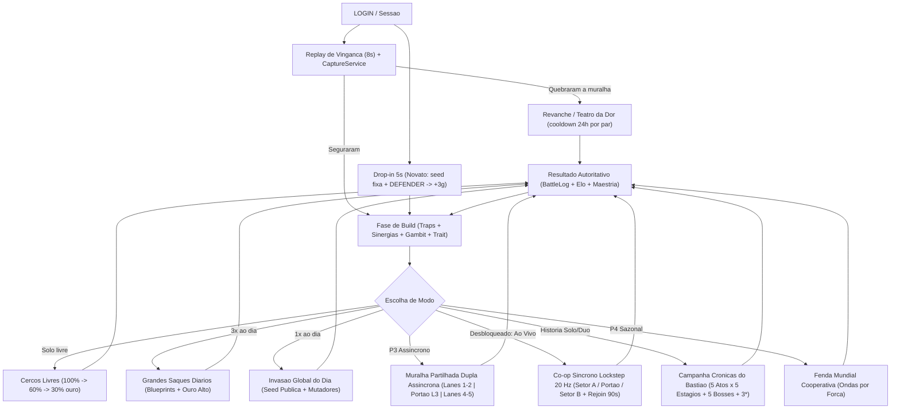

# Skills Determinísticas, Tiers, Calibração e Matriz de Modos — MURALHA 2.0

> **Status:** Especificação de design e arquitetura de sistemas (pós-P1 / roadmap P2–P4).
> **Governança:** A P1 está em pausa (S1–S8 fechadas; ver [`.context/ESTADO.md`](../.context/ESTADO.md)) e **P2+ não começa sem autorização explícita do diretor**. Este documento consolida a evolução sobre o núcleo atual (`Core.SIM_VERSION = 3`, `TrapCatalog.CONTENT_VERSION = 2`, `ProfileSchema.SCHEMA_VERSION = 2`) sem alterar código de produção.

---

## 1. Arquitetura de Skills e Sinergias Determinísticas (3 Camadas Puras)

### 1.1 Por que skills clicáveis em tempo real quebram o núcleo da MURALHA

No motor atual ([`src/shared/sim/core.luau`](../src/shared/sim/core.luau)), uma batalha é integralmente reproduzida a partir de um payload compacto contendo `seed`, `simVersion`, `contentVersion`, `wall` (`hp` e lista de armadilhas por célula) e `wave` (`count`, `spawnEveryTicks`). Toda a simulação roda em aritmética inteira (`MILLI = 1000`, `TICK_HZ = 20`, `MAX_TICKS = 1200`), produzindo o `hash` determinístico de referência (`2489780106` na seed `42`).

Introduzir habilidades ativas sem carimbo determinístico ou em **raids contra fantasmas offline** quebraria três pilares estruturais do projeto:

1. **Defesa offline assíncrona:** o defensor não está conectado quando seu fantasma (`MuralhaPhantom_v1`) é atacado; por isso, modos assíncronos usam exclusivamente **3 camadas determinísticas puras em inteiros** configuradas na Fase de Build.
2. **Replay por seed de 40 bytes e Clipe de Vingança:** nas raids solo/fantasma, o replay de 8s re-simula apenas a seed e o estado inicial. Já no **Co-op Síncrono em Tempo Real** (desbloqueado pelo diretor em 13/11/2026), o servidor grava uma trilha compacta `commands[]` carimbada por tick (`20 Hz`, ~120–300 B no `BattleLog v2`), permitindo inputs síncronos ao vivo **sem quebrar** o replay determinístico de 8s (`resultHash` idêntico).
3. **Paridade e anti-cheat:** toda decisão matemática roda dentro de `Battle:Step()` sem floats, `os.clock()` ou física acoplada à lógica de hit, mantendo ~1,4 ms por batalha (~710 batalhas/s na PoC).

**Solução combinada:** **3 camadas determinísticas puras em inteiros** na Build para todos os modos + **Lockstep `20 Hz` (`commands[]`) + 4 Pings** para Co-op Síncrono e Bosses ([`campanha-bosses-e-coop-sincrono.md`](campanha-bosses-e-coop-sincrono.md)).

---

### 1.2 Camada A — Sinergias Espaciais de Grade (`Core.normalizeTraps`)

Como a colocação livre nas 25 células (`r1c1`..`r5c5`, `C(25,5) = 53.130` layouts na P1) já foi fechada na Q2 ([`gdd-muralha.md`](gdd-muralha.md)), o posicionamento geométrico passa a ser o centro da profundidade tática. As sinergias são pré-calculadas **uma única vez** na inicialização da batalha dentro de `Core.normalizeTraps` em complexidade $O(N^2)$ (para $N \le 7$, no máximo 49 comparações de pares — impacto nulo de performance).

| Sinergia | Condição Espacial (Build) | Regra em Aritmética Inteira | Impacto no Meta |
|---|---|---|---|
| **Piche Incendiário** | `tar` + (`cannon` ou `catapult`) na **mesma lane** (`row`) | Ao acertar o disparo (`cd = 18t`), `tar` aplica `uTarUntil[i] = tick + 30`; acertos de `cannon`/`catapult` (todos os alvos do `splash`) ganham `+25%` (`math.floor(dmg * 1250 / 1000)`) | Premia combo de controle + artilharia pesada |
| **Choque Térmico** | `frost` + `cannon` na **mesma lane** (`row`) | `cannon` causa `+20%` (`math.floor(dmg * 1200 / 1000)`) em alvos com `tick <= uSlowUntil[i]`, **sem consumir** o status de slow | Cria alternativa anti-`brute` sem exigir `catapult` |
| **Bateria Cruzada** | `archer` **ortogonalmente adjacente** (`\|dr\| + \|dc\| == 1`) | Cada vizinho `archer` reduz `cd` base em `-1` tick (teto **`-2` ticks**, piso **`8` ticks**) | Incentiva formação compacta contra hordas `swarm` |
| **Linha de Artilharia** | `cannon` + `catapult` em `c1` ou `c2` (`x <= 3500`, retaguarda) | Soma `+300` milli ao `range` de ambos (`2200 → 2500` / `3000 → 3300`) | Compensa alcance curto na defesa de último recurso |
| **Zona de Ritmo** *(expansão)* | Nova armadilha `war_drum` ortogonalmente adjacente a qualquer trap | Reduz `cd_ticks` da vizinha em `-15%` (`math.floor(cd * 85 / 100)`, piso `>= 1`) | Amplificador posicional puro; exige `CONTENT_VERSION++` e `SIM_VERSION++` |

**Ordem determinística de resolução no `normalizeTraps`:**
1. Ordenar/normalizar células canônicas (`rXcY`), preservando ordem determinística (`WallService.toBattleWall`).
2. Inicializar multiplicadores neutros por trap (`cdDelta = 0`, `cdScalePct = 100`, `rangeBonus = 0`, flags de sinergia por lane).
3. Avaliar pares `(i, j)` para detectar adjacência ortogonal (`math.abs(a.row - b.row) + math.abs(a.col - b.col) == 1`) e presença na mesma lane (`a.row == b.row`).
4. Aplicar descontos percentuais antes de subtrações fixas (`math.max(1, math.floor(baseCd * cdScalePct / 100) + cdDelta)`), mantendo valores inteiros auditáveis por `Battle:CheckIntegers()`.

---

### 1.3 Camada B — Gatilhos Táticos Programáveis ("Gambits de Muralha")

Cada muralha equipa **1 slot ativo de Gambit**, que dispara **no máximo 1 vez por batalha** dentro de `Battle:Step()`. Por ser puramente condicional sobre o estado inteiro da simulação, o Gambit opera de forma idêntica em raids ao vivo e defesas offline, além de emitir um marcador de evento para destacar o momento exato no replay de 8 segundos.

| ID do Gambit | Condição de Disparo (`Battle:Step`) | Efeito Determinístico | Papel no Replay de 8s |
|---|---|---|---|
| `gambit_emergency_salvo` | `self.wallHp <= 150000` (30% de 500 HP, ou `<= math.floor(self.wallMax * 30 / 100)`) | Reseta `trap.cd = 0` para todas as armadilhas ativas no tick atual | Virada dramática sincronizada com o "batimento" da muralha (< 30% HP) |
| `gambit_tar_flood` | `>= 4` unidades vivas com `uX[i] <= 3500` na **mesma lane** (desempate: mais unidades; empate → menor `row` `1..5`) | Aplica slow de `50%` (`math.floor(speed * 500 / 1000)`) por `30` ticks na lane vencedora | Resposta automática contra picos de `swarm` ou colapso de linha |
| `gambit_overclock` | `self.tick == 800` (marca de 40s a 20 Hz) | Aumenta velocidade de recarga em `+25%` (`cd` reduzido a `80%`, `math.floor(cd * 80 / 100)`) até `tick 1200` | Sprint final para segurar o cap de 60s (1.200 ticks) |
| `gambit_iron_brace` | Primeiro vazamento letal (`self.wallHp - leakDamage <= 0`) | Fixa `self.wallHp = 1000` (**1 HP**) e ativa `ironBraceTick = self.tick` (absorve demais vazamentos **apenas até o fim deste tick**) | Cria momentos virais de *"Sobrevivência a 1 HP!"* para o clipe (`CaptureService`) |

**Regras de segurança do Gambit no motor:**
- O estado consome uma única flag booleana inteira/binária (`gambitTriggered = true`) e, quando aplicável, um inteiro de expiração (`overclockUntilTick = 1200`).
- Nenhum Gambit cria novas entidades ou altera o RNG (`self.rng:nextU32()`); portanto, não desalinha a geração da onda.

---

### 1.4 Camada C — Classes, Traits Horizontais (Trade-offs) e Doutrinas de Comandante

Conforme provado no trial de expansão S3.2 ([`expansion-test-2026-11-10.md`](expansion-test-2026-11-10.md)), adicionar variantes a `Cell` exige fechar `GAP-004` (schema de `Cell`) e `GAP-008` (taxonomia v2 de analytics). A arquitetura adotada rejeita escalonamento vertical pago e **proíbe terminantemente rerolls pagos ou odds aleatórios** ([`.context/REJEITADOS.md`](../.context/REJEITADOS.md) e GDD §6).

- **Desbloqueio gratuito:** todos os traits e doutrinas são desbloqueados via Blueprints (Grandes Saques) e marcos de Maestria; o jogador alterna livremente na fase de build sem custo em Robux.
- **Preservação de hashes legados (`GAP-010`):** toda célula migrada sem variantes recebe obrigatoriamente o default neutro `class = "artillery"`, `trait = "none"` (`100%` em todos os multiplicadores), garantindo que o hash `2489780106` na seed `42` permaneça intacto para setups neutros.

| Trait Horizontal | Modificador de Dano (`MILLI`) | Modificador Secundário | Caso de Uso Tático |
|---|---|---|---|
| `none` *(default neutro)* | `100%` | Sem alteração | Paridade exata com motor v3 e migrações antigas |
| `heavy` (*Pesado*) | `+25%` (`* 125 // 100`) | `+20% cd` (`* 120 // 100`) | Abate de `brute` (45 HP) em sinergia com slow |
| `rapid` (*Cadenciado*) | `-20%` (`* 80 // 100`) | `-25% cd` (`* 75 // 100`) | Limpeza eficiente de `swarm` (7 HP) evitando desperdício de overkill |
| `long_range` (*Longo Alcance*) | `-15%` (`* 85 // 100`) | `+600` milli de `range` | Cobertura antecipada a partir da retaguarda (`c1`/`c2`) |
| `cryo` (*Criogênico*) | `-15%` (`* 85 // 100`) | `+8 slowTicks` (em `frost`, soma `+8t`; em outras traps sem slow nativo, aplica slow `70%` por `8` ticks) | Controle contínuo de lane sem sacrificar slot extra para `frost` |

- **Doutrinas de Comandante (1 slot global):** passivas leves e determinísticas (ex.: *Engenheiro de Cerco* para economia de upgrade na run, ou *Mestre de Balística* para estender janela de status elemental em `+5` ticks). O `commanderId` é gravado no `BattleLog` ao lado de `contentVersion` e `simVersion` para auditoria do replay.

### 1.5 Contrato de Aritmética Inteira e Impacto no Replay

Todas as três camadas respeitam as invariantes verificadas por [`sim/invariants.luau`](../sim/invariants.luau) (`CheckIntegers()` e ausência de divisão não truncada):

| Camada | Momento de Execução | Campos Adicionais no Estado/Spec | Risco de Divergência de Hash |
|---|---|---|---|
| **A — Sinergia Espacial** | 1× em `Core.normalizeTraps` | `cd`, `range`, `synergyFlags` por trap + `uTarredUntil[]` por unidade | Zero em layouts sem par sinérgico; determinístico via ordenação canônica `rXcY` |
| **B — Gambit de Muralha** | Por tick em `Battle:Step()` | `gambitId`, `gambitTriggered`, `overclockUntilTick` no `Battle` | Só dispara uma vez por partida; marcador no `BattleLog` garante reprodução exata |
| **C — Traits & Doutrina** | `normalizeTraps` + `trapDamage` | `trait`, `class`, `commanderId` (com default neutro `none` / `100%`) | Preserva `2489780106` (seed 42) quando neutro (`GAP-010`) |

---

## 2. Calibração do Dia 1, Tiers, Ligas e Maestria

### 2.1 Diagnóstico e Correção do Deadlock Econômico do Dia 1

Auditando os números atuais da P1 no código de produção, há um gargalo crítico no fluxo de entrada do jogador:

- [`ProfileSchema.luau`](../src/shared/data/ProfileSchema.luau) inicializa toda conta nova com `gold = 0`.
- `DropInController.server.luau` credita `REWARD_GOLD = 3` (`source = "defense"`) após o botão `DEFENDER`.
- `RaidController.server.luau` credita `RAID_REWARD_GOLD = 5` (`source = "raid"`) por vitória de raid.
- [`TrapCatalog.luau`](../src/shared/data/TrapCatalog.luau) define o custo da armadilha inicial (`archer`, Liga 1) em **`40` ouro**.

**Diagnóstico matemático:** ao sair do drop-in com `3` ouro, o jogador precisa acumular mais `37` ouro. Recebendo `5` ouro por raid vencida, são necessárias **8 vitórias consecutivas de raid** (`3 + 8 × 5 = 43` ouro) apenas para comprar o **1º arqueiro** — rompendo diretamente a curva-alvo do GDD §5 (*"Dia 1: primeira sessão rende 3 raids e desbloqueia a 2ª armadilha"*).

| Parâmetro | Estado Atual (P1) | Opção A — Recomendada | Opção B — Alternativa |
|---|---|---|---|
| **Mecanismo** | `gold = 0`, drop-in `+3g`, raid `+5g` | **Subsídio único de fundação (`+40g`)** na 1ª vitória de conta (flag persistida em `ProfileSchema`) **+** raid escalonada **`15–25g`** | **`archer` L1 pré-posicionado em `r3c3`** automaticamente ao concluir o drop-in (via `WallService` / template pós-tutorial) |
| **Ouro após Drop-in + 1ª Raid** | `8g` (insuficiente para 1º `archer`) | `3g + 40g + 15g = 58g` (compra 1º `archer` = `40g` e sobra `18g`) | `3g + 5g = 8g`, porém já possui `1 archer` ativo em `r3c3` |
| **Raids até 2ª Armadilha** | `16` vitórias (`archer` + `archer`) | **2 a 3 raids** (`tar` = `60g` ou 2º `archer` = `40g`) — alinha com GDD §5 | Depende ainda de elevar `RAID_REWARD_GOLD` acima de `5g` |
| **Impacto em Schema / Analytics** | Nenhum | **Zero no `schema v2`:** usa `if profile.stats.defenses == 0` atomicamente (`stats.defenses = 1`, já no schema); raid escalonada via `gold = 15 + 3 * targetLeague` (`plano-playtest-v1.md §2`) | Requer gravar célula inicial pós-drop-in ou aceitar estado inicial não vazio |

> **Recomendação (executável já na P1 / Fatia S8.1):** adotar a **Opção A** usando o gate `profile.stats.defenses == 0` no `DropInController` (`+40g` único no clear inicial com fonte `"defense"`, sem migrar `SCHEMA_VERSION = 2`) e recompensa de raid `baseGold = 15 + 3 * targetLeague` (`18g–30g`), conforme especificado passo a passo em [`docs/plano-playtest-v1.md`](plano-playtest-v1.md#2-fatia-s81--loop-jogável-progressão-l1l5--gap-014).

**Curva resultante da 1ª Sessão (Opção A, ~8 min):**

| Passo da Sessão | Ação | Ouro Creditado | Saldo Acumulado | Marco Desbloqueado |
|---|---|---:|---:|---|
| 1. Drop-in (0–25s) | Botão `DEFENDER` + clear inicial | `+3g` | `3g` | Tutorial de combate concluído |
| 2. 1ª Vitória (Raid #1) | Primeira vitória de conta (grant único + raid base) | `+40g + 15g` | `58g` | Compra **1º `archer`** (`40g`) → saldo `18g` |
| 3. Raid #2 | Vitória em cerco livre (faixa 100%) | `+18g` | `36g` | Acumula para 2ª peça ou 1º upgrade (`30g`) |
| 4. Raid #3 | Vitória em cerco livre (faixa 100%) | `+20g` | `56g` | Compra **2º `archer`** (`40g`) ou junta para `tar` (`60g`) |

---

### 2.2 Sistema de 7 Ligas Competitivas e Fórmula de Elo

Hoje `TrapCatalog.leagueOf(points)` aplica `1 + math.floor(points / 100)`. Para a P2, o ranqueamento evolui para **7 Ligas Competitivas** com proteção de piso e normalização no topo:

| Liga | Nome | Faixa de Pontos | Desbloqueios Associados (`TrapCatalog` / Estrutura) |
|---|---|---|---|
| **L1** | Madeira | `0 – 99` | `archer` (`40g`) |
| **L2** | Pedra | `100 – 199` | `tar` (`60g`) |
| **L3** | Ferro | `200 – 299` | `frost` (`90g`) |
| **L4** | Engrenagem | `300 – 399` | `cannon` (`140g`) |
| **L5** | Âmbar | `400 – 599` | `catapult` (`180g`) + habilita grade `7×5` (com Muralha Nv5) |
| **L6** | Obsidiana | `600 – 899` | Molduras, banners de perfil e recompensas sazonais cosméticas |
| **L7** | Bastião Eterno | `900+` | **Normalização competitiva:** teto fixado no nível L3 (econômico) / L5 (motor) para todas as armadilhas, isolando habilidade de layout |

**Fórmula de Pontos Elo e Proteções:**
- **Vitória no Ataque (Raid):** ganha entre **`+12` e `+24` pontos**, calculado por `18 + clamp(math.floor((eloDefensor - eloAtacante) / 25), -6, +6)`. Derrotas no ataque não penalizam ouro nem destroem armadilhas (GDD Decisão 3).
- **Vitória na Defesa Offline:** **`+8` pontos**, limitada por **teto diário** (ex.: `+40` pontos/dia via defesa offline) para evitar escalada artificial em contas-isca.
- **Derrota na Defesa Offline:** **`-6` pontos**, com duas salvaguardas obrigatórias:
  1. **Proteção de piso de liga:** a penalidade passiva nunca reduz os pontos abaixo do limite inferior da liga semanal atual do defensor.
  2. **Escudo de 30 minutos após 2 rupturas:** após 2 derrotas consecutivas em defesa offline, o fantasma sai temporariamente da fila de pareamento por 30 minutos, evitando perda em cascata enquanto o jogador está ausente.

---

### 2.3 Tiers Estruturais da Muralha (Nv1..Nv5) e Regra *Cross-Width*

O campo `gridWidth` já existe no save ([`ProfileSchema.luau`](../src/shared/data/ProfileSchema.luau)), mas permanece fixo em `5` e `ACTIVE_TRAP_LIMIT = 5` na P1. A tabela abaixo define os **5 Tiers Estruturais** da muralha:

| Tier da Muralha | HP Base (`wall.hp` / milli) | Limite Ativo `N` | Grade (`gridWidth × 5`) | Requisito de Acesso |
|---|---:|---:|---|---|
| **Nv 1** | `500` (`500.000`) | `5` | `5 × 5` (25 células) | Padrão inicial (P1) |
| **Nv 2** | `650` (`650.000`) | `5` | `5 × 5` (25 células) | XP de raid / marco inicial |
| **Nv 3** | `800` (`800.000`) | `6` | `5 × 5` (25 células) | Liga L3+ / progressão de conta |
| **Nv 4** | `1.000` (`1.000.000`) | `6` | `5 × 5` (25 células) | Liga L4+ / progressão de conta |
| **Nv 5** | `1.250` (`1.250.000`) | `7` | `7 × 5` (35 células) | Liga L5 (Âmbar) + validação de legibilidade mobile |

**Regra de Matchmaking *Cross-Width* (GDD Decisão 1):**
- O pareamento prioriza estritamente confrontos **`7×5` vs `7×5`** e **`5×5` vs `5×5`**.
- Se um perfil `7×5` entrar em contexto/modo restrito a `5×5`, as colunas `c6` e `c7` tornam-se **dormentes**: `WallService.toBattleWall` omite essas células da batalha sem apagá-las de `profile.wall.cells`, preservando o layout do jogador intacto ao retornar ao modo `7×5`.

**Exemplo prático de dormência (`wall.cells` → `toBattleWall`):**

| Célula salva no Perfil (`gridWidth = 7`) | Avaliação em Arena `7×5` | Avaliação em Arena `5×5` (Fallback) |
|---|---|---|
| `r1c2` (`archer`, Lv 2) | **Ativa** (`x = 3500`) | **Ativa** (`x = 3500`) |
| `r3c5` (`frost`, Lv 1) | **Ativa** (`x = 8000`) | **Ativa** (`x = 8000`) |
| `r2c6` (`cannon`, Lv 1) | **Ativa** (`c6`) | **Dormente** (ignorada em combate, mantida no save) |
| `r4c7` (`catapult`, Lv 1) | **Ativa** (`c7`) | **Dormente** (ignorada em combate, mantida no save) |

---

### 2.4 Maestria de Armadilha (Grau I..IV) — 100% Cosmética

Em respeito estrito às regras de monetização e progressão justa (GDD §6 e §10), a Maestria recompensa domínio e dedicação **sem conceder qualquer bônus numérico de combate**:

| Grau de Maestria | Marco Acumulado (por `trap_id`) | Recompensa Exclusiva | Bônus de Status |
|---|---|---|---|
| **Grau I — Bronze** | Primeiros abates e ativações com o tipo | Acabamento metálico bronze na base 3D | **Zero** |
| **Grau II — Ferro** | Defesas vitoriosas com o tipo em campo | Variação visual de projétil / partícula | **Zero** |
| **Grau III — Âmbar** | Combinações bem-sucedidas de sinergia (Camada A) | Título exclusivo no cartão de ataque + brilho âmbar | **Zero** |
| **Grau IV — Mestre** | Marco sazonal completo da armadilha | Efeito especial de destruição / troféu no diorama | **Zero** |

---

## 3. Matriz Completa de Modos de Jogo (P1 a P4)

### 3.1 Diagrama de Loop Integrado

### 3.2 Tabela Comparativa dos 9 Modos

| # | Modo | Fase | Cadência / Limite | Economia / Recompensa | Regra Anti-Abuso e Contrato Técnico |
|---|---|---|---|---|---|
| 1 | **Drop-in 5s** | **P1 (S5)** | 1ª sessão da conta | `+3g` (`defense`) no clear real | Seed fixa, botão único `DEFENDER`, derrota roteirizada em 10s se inativo |
| 2 | **Cercos Livres** | **P1 / P2** | **Sem timer duro de energia** | Ouro com **curva decrescente suave**: `100%` (raids 1–10/dia), `60%` (11–20), `30%` (21+) | Honra a proibição de energia ([`.context/REJEITADOS.md`](../.context/REJEITADOS.md)) e contém inflação `<= 30%` |
| 3 | **3 Grandes Saques Diários** | **P2** | 3 grátis/dia (+1 extra opcional R$) | Blueprints (traits/doutrinas) + maior pacote diário de ouro/XP | Controla a economia pelo teto de loot nobre sem expulsar quem quer continuar jogando |
| 4 | **Replay de Vingança & Teatro da Dor** | **P1 (S6) / P2** | Sob demanda no login | Elo de revanche + clipe de vídeo via `CaptureService` | **Trava anti-win-trading de 24h por par `(UserId_A, UserId_B)`**; pré-roll 0,5s + 8s na ruptura |
| 5 | **Invasão Global do Dia** | **P2 / P4** | 1 tentativa oficial/dia | Fragmento cosmético + ranking global | Muralha da IA com seed pública + mutadores determinísticos; desempate por `wallHp` restante e `ticks` |
| 6 | **Muralha Partilhada Dupla Assíncrona** | **P3** | Edição assíncrona versionada | Baú de dupla + liga semanal de dupla/clã | **Lanes 1–2 (Jogador A)**, **Lane 3 (Portão Partilhado)**, **Lanes 4–5 (Jogador B)**; relatório aponta **qual lado caiu primeiro** |
| 7 | **Bastião Co-op Síncrono (Lockstep 20 Hz)** | **Desbloqueado (V1.5/P2+)** | Servidor reservado ao vivo (`N=8`) | Baú de dupla + bônus de combo + clipe 8s | Comandos carimbados `currentTick+2` no `BattleLog v2`, cursor `10 Hz`, envio `+25g` (`5s` cd) e **Anti-Leaver 90s** ([`campanha-bosses-e-coop-sincrono.md`](campanha-bosses-e-coop-sincrono.md)) |
| 8 | **Campanha *Crônicas do Bastião* + Bosses** | **Desbloqueado (V1.5/P2+)** | 5 Atos × 5 fases + Pesadelo (Solo ou Duo) | Ouro de marcos + selos 3★ + fragmentos de Boss | Escalonamento inteiro `MILLI=1000`, 8 mutadores e **5 Bosses multi-lane** (`laneSpan=3`, stagger, fases) |
| 9 | **Fenda Mundial Cooperativa** | **P4** | Evento comunitário sazonal | Marcos globais cosméticos + títulos | Ondas escaladas por **força** (HP/velocidade), mantendo `MAX_TICKS = 1200` (60s) da PoC |

### 3.3 Regras Detalhadas por Modo

- **Drop-in 5s (P1/S5 — implementado):** o jogador entra diretamente no portão sob ataque real no motor. O botão `DEFENDER` aciona a salva pré-autorizada da catapulta, entrega `+3g` e abre a UI de build em menos de 60s.
- **Cercos Livres (Curva Suave sem Energia):** energia ou bloqueio por timer foi rejeitado em [`.context/REJEITADOS.md`](../.context/REJEITADOS.md) por punir sessões longas (público 18+) e aumentar o bounce no algoritmo da Roblox, com gatilho de reabertura caso a economia inflacione `> 30%`. A curva em degraus (`100%` nas raids 1–10, `60%` nas raids 11–20, `30%` da 21ª em diante) resolve esse risco sem criar barreira de entrada.
- **3 Grandes Saques Diários (P2):** concentram a entrega de fragmentos de blueprint e o grosso da progressão diária nas 3 primeiras vitórias elegíveis. Um 4º Grande Saque opcional por Robux (GDD §6) oferece conveniência de ritmo sem vender dano ou HP.
- **Replay de Vingança & Teatro da Dor (P1/P2):** sobre o `BattleLog` (`sim/raid-contract.luau`, com `contentVersion` e `isReplayable`), o botão **GRAVAR CLIPE** chama `StartVideoCaptureAsync()`, aguarda ~0,5s de pré-roll, reproduz os 8 segundos centrados no disparo do Gambit/ruptura e finaliza com `StopVideoCapture()` + `PromptSaveCapturesToGallery()`. O botão **VINGAR** abre ataque direto contra o fantasma do agressor, bloqueando novas pontuações de revanche entre o mesmo par de `UserId` por **24 horas** (anti-*win-trading*).
- **Invasão Global do Dia / Mutadores por Seed (P2/P4):** todo jogador enfrenta exatamente a mesma muralha da IA e a mesma seed diária, combinadas a 1–2 mutadores determinísticos (ex.: *"Nevoeiro Denso: `range -200`"* ou *"Marcha Acelerada: `speed +15%`"*). Por usar apenas parâmetros inteiros na criação da batalha, o servidor valida o ranking com custo de ~1,4 ms por submissão.
- **Muralha Partilhada Dupla Assíncrona & Co-op Síncrono em Tempo Real (desbloqueado em 13/11/2026):** na versão assíncrona, a grade `5×5` é dividida por responsabilidade (**Jogador A** `r1–r2`, **Lane 3** Portão Partilhado com lock otimista `rev++`, **Jogador B** `r4–r5`). Na versão **Co-op Síncrona em Tempo Real** ([`campanha-bosses-e-coop-sincrono.md`](campanha-bosses-e-coop-sincrono.md) §5), a dupla entra em servidor reservado (`TeleportService:ReserveServer`), opera `N = 8` (`4 + 4`) sob lockstep `20 Hz` gravado no `BattleLog v2` (`commands[]`), compartilha presença via cursor `10 Hz` (`6 bytes`) e 4 Pings 3D, e é protegida contra saída prematura por reconexão de `90s` + absorção do setor/ouro em `10s`.
- **Campanha *Crônicas do Bastião* (Solo / Duo Assíncrono / Duo Síncrono) & 5 Bosses:** 25 estágios com selos de 3★ (`starsMask`), 8 mutadores e Chefes multi-lane determinísticos; especificação completa em [`campanha-bosses-e-coop-sincrono.md`](campanha-bosses-e-coop-sincrono.md) §2–§4.
- **Fenda Mundial Cooperativa (P4):** evento sazonal onde todas as vitórias individuais de jogadores contribuem dano/progresso para uma meta global de servidor. As ondas da Fenda escalam estritamente por **força** (HP e velocidade dos tipos `runner`, `brute`, `swarm`) e nunca por contagem excessiva de unidades, respeitando a descoberta da PoC de que o cap de 60s (`1.200` ticks) trunca ondas acima de ~85 unidades.

---

## 4. Checklist de Governança para Entrada em Produção

Antes de implementar qualquer camada ou modo deste documento em `src/`, o pipeline de [`docs/pipeline-expansao.md`](pipeline-expansao.md) exige:

1. **Autorização explícita do diretor** para iniciar a P2+ (atualmente bloqueada).
2. **Fechamento de `GAP-004` e `GAP-008`:** estender `Cell` e `ProfileSchema` com migração neutra verificada (`GAP-010`) e atualizar a taxonomia de eventos (`AnalyticsTypes` v2).
3. **Trial em branch temporária (`tools/expansion-test/`):** validar zero alteração de hash para setups neutros antes do merge.
4. **Bump sincronizado de versões:** toda mudança matemática em `Core` exige `SIM_VERSION++`, re-ancoragem de hash em `sim/acceptance.luau` e atualização conjunta de [`docs/versoes.md`](versoes.md) e [`docs/spec-motor-deterministico.md`](spec-motor-deterministico.md) para passar no `scripts/check.sh`.
